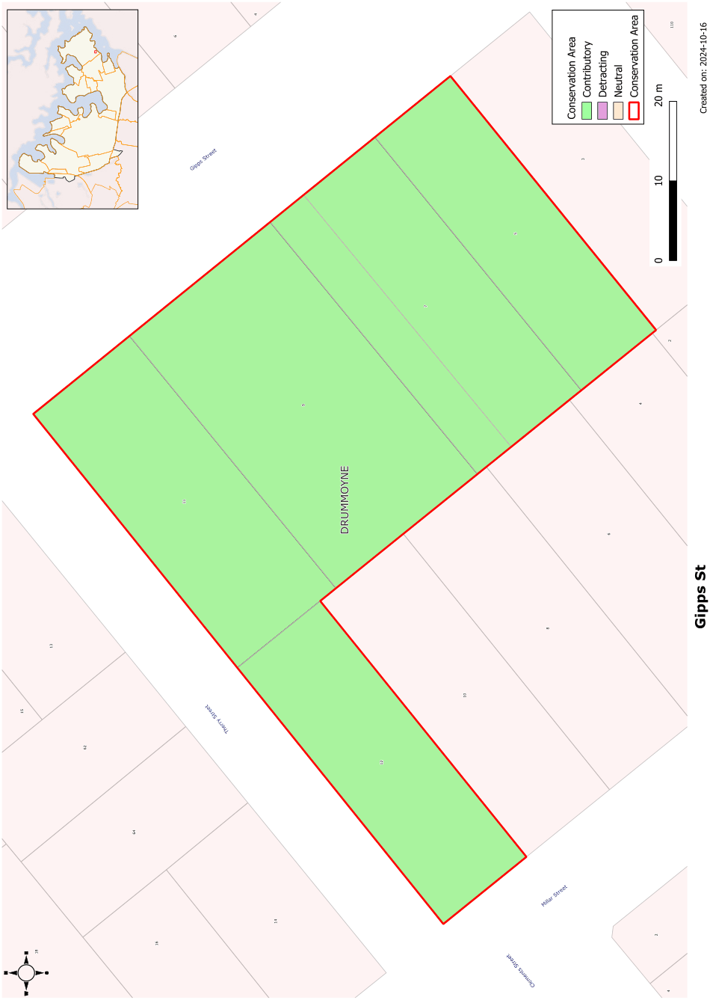

### CA.10  Gipps Street Conservation Area

#### History

Of this small group of buildings, Euroka, at 9 Gipps Street, Drummoyne is the earliest, existing, with its tennis court, on the site in 1912 when the block bounded by Gipps, Therry, Miller and Market Streets was subdivided. The remaining houses in the group appear to have been built soon after the subdivision.

#### Description

This is a small group of very fine timber and brick dwellings that formed part of the major subdivision around Bourketown but which are now separated from the main conservation area by altered and unsympathetic development.

#### Statement of Significance

This group forms a fine group stepping down the slope towards the water, each sited with good views towards the city and set up from the road to maximise their setting. They form a complete block which adds to their integrity. They demonstrate the dominant form of the architectural style of Drummoyne and make a very fine contribution to the streetscape and the important views down Gipps Street to the water.

#### Objectives

All of the buildings in this small group should be retained in their predominant early twentieth century

form. Additions should respect the character of the buildings and first floor additions should be controlled to retain the heritage value of the buildings. Garages and carports should not be constructed in front of the building line.

#### Analysis - Setting

The slope of Gipps Street towards Iron Cove Bay contributes to the setting of these houses. Euroka at 9 Gipps Street, as the house that preceded the subdivision, was the dominant building in the group until 2005.

#### Scale

The houses in this conservation area include one and two storey houses with the height relative to the size of the allotment.

#### Form

These are free standing houses with hipped roofs over the main rectangular block of the house. The hipped roofs are relieved in most of the houses by a projecting gabled wing facing the street. For all but one of the houses the roof forms incorporate hipped and gabled forms. Slate with terracotta tile trim is the dominant original roof material, although this has been replaced on some roofs. Glazed tiling to the roofs is not original and could in due course be replaced with more appropriate roofing materials. Verandahs are incorporated into the front elevation, usually offset by a gabled wing.

#### Materials and Colours

Face brickwork walls dominate, trimmed with battened fibro to the gables. Original roofs surviving in the group are slate with terracotta trim. Verandahs are framed with timber incorporating decorative fretwork and balanced by decorative timberwork to the gables.

#### Doors and Windows

Various forms of windows and doors are used but are not all combined in a single dwelling. The proportion of wall space to fenestrations is important, as is the vertical proportions of most of the openings.

#### Carparking

Carparking is set well behind the front building alignment. Driveways utilise side streets where possible, otherwise are restricted to single width.

#### Fencing

Original fencing is reasonably low and usually incorporates a masonry base of either face brick or sandstone. Transparent panels of either metal or timber pickets are used between piers.

#### Subdivision

Apart from Euroka at 9 Gipps Street that preceded the subdivision, the allotments of this Conservation Area were of regular size with 40-44 foot frontages.

Landscape Elements including Paving and

#### Driveways

Front gardens are dominated by lawn with plantings of low shrubs.

#### Refer to Figure App1.11

Development Control Plan

Appendix 1 Conservation Areas

> [Picture on page 26: a picture, saved as a picture (images/appendix-01-conservation-areas-page-26-3.gif, 150 dpi).]

Figure App1.11

Gipps Street Conservation Area
