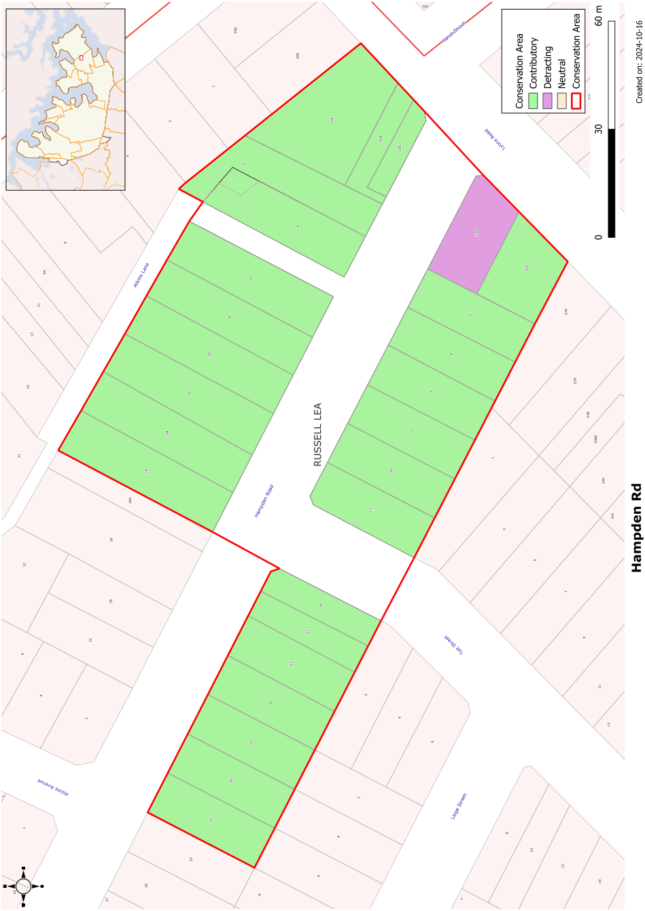

### CA.11  Hampden Road Conservation Area

#### Future Character

#### History

The Federation to Inter-war housing should be retained without demolition and in its historic form to the street with retention of facade materials and details. Additions should reflect the character of the existing buildings to retain the streetscape and the heritage value. Garages and carports should not be added in front of the building line.

#### Analysis - Setting

The north and south sides of Hampden Road were subdivided in two separate subdivisions in 1915. The north side of the road was part of the Five Dock Estate subdivision and the south side was part of the Liryclea subdivision. Apart from the Victorian house Faleofa, facing Lyons Road, that preceded the 1915 subdivisions, most of the development of this conservation area followed soon after the subdivisions. Faleofa was further subdivided in 1928 prior to the construction of shops on the corner of Lyons and Hampden Roads.

The houses in this group have reasonably deep setbacks from the street. Street trees and the slope of Hampden Road contribute to the setting of this group.

#### Description

#### Scale

This is a predominantly residential group with largely intact houses from the late Federation and Inter-War periods as well as the Victorian house Feleofa and some Inter-War shops on the corner of Lyons Road.

This conservation area has a consistent single storey scale to Hampden Road with the larger two storey residence Faleofa on a larger site fronting Lyons Road.

#### Form

The front of the houses are generally broken down with a verandah section and a projecting room with a gabled or hipped roof.  Roofs include low to medium pitched hipped and gabled forms, most clad with terracotta tiles or slate. The commercial building contrasts with a solid parapeted form.

The houses include a very fine group of c1915 houses of matching style with terracotta shingle roofs, well set back from the road in garden settings. The group represents the mix of development that took place in the Edwardian period with houses ranging from modest but well detailed semi-detached residences to more impressive two storey houses through to idiosyncratic arts and crafts cottages. The shops on Lyons Road are typical of the Inter-War period. As a substantial Victorian house, Faleofa provides a contrast to the group.

The facades typically incorporate verandahs with heavy masonry piers. Awnings are also used to provide interest in the street facades.

#### Statement of Significance

#### Siting

Houses fronting Hampden Road have regular front and side setbacks. The commercial building at the corner of Lyons Road contrasts with these and with Faleofa by having no street setback.

#### Materials and Colours

The Hampden Road, Drummoyne Conservation area is one of the rare surviving streetscapes on a main road in the municipality. Located on the main road through Drummoyne and Five Dock this group is of high visual value. The group also includes a substantial and attractive Victorian residence, Faleofa, illustrating the earlier development of the area.  The commercial building on the corner of Lyons Road and Hampden Road demonstrates the importance of these roads in the local transport network.

Dark face brickwork is almost exclusively used in this conservation area. This blends well with the terracotta and slate roofs.

#### Doors and Windows

Windows are usually timber casements in pairs or groups of three or double hung windows in groups.

#### Carparking

Single driveways with garages or carports located well behind the building line.

#### Fencing

Surviving original fencing is generally low brick or sandstone fencing.

Landscape Elements including Paving and

#### Driveways

Most houses in the group have established gardens with trees and shrubs in the front garden.

#### Subdivision

The houses in this group fronting Hampden Road have a reasonably regular allotment size.

#### Refer to Figure App1.12

Development Control Plan

Appendix 1 Conservation Areas

> [Picture on page 29: a picture, saved as a picture (images/appendix-01-conservation-areas-page-29-3.gif, 150 dpi).]

Figure App1.12

Hampden Road Conservation Area
