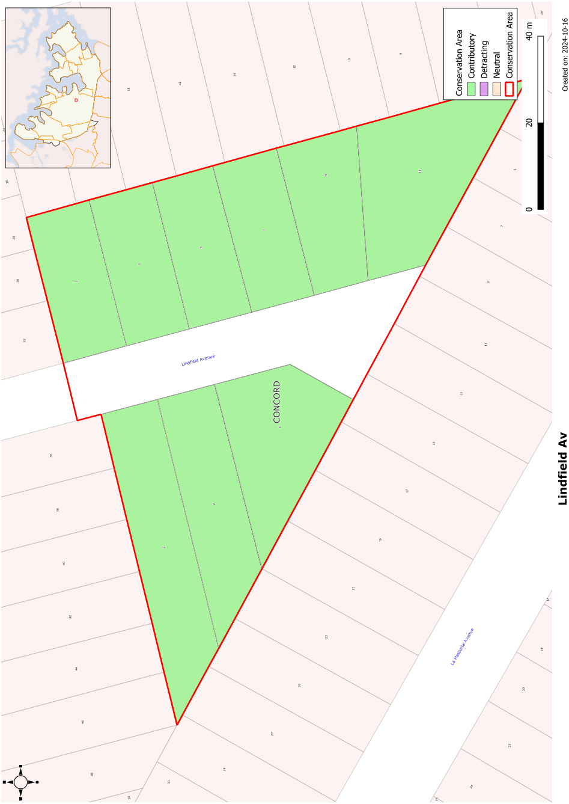

### CA.12  Lindfield Avenue Conservation Area

#### History

Lindfield Avenue was created by a 1928 subdivision and was originally called Ardath Avenue. The Inter-War California Bungalows that line this street were built soon after.

#### Description

Lindfield Avenue is a short cul-de-sac featuring facing rows of consistent Inter-War California Bungalows, set in period gardens. The buildings display a high degree of integrity, with one notable exception. The street facades of the buildings are remarkably intact, as are fences and period garden features.

#### Statement of Significance

The Lindfield Avenue Conservation Area is an excellent local example of an Inter-War subdivision, in an area noted for its 1920s and 1930s streetscapes. It is also considered one of the best examples in the Sydney region of a streetscape of Inter-War California Bungalows. The high consistency of design suggests development within a very short time span. The street facades of the buildings are remarkably intact, as are fences and period garden features. The subdivision consists of a street and is unusual locally for its cul-de-sac design.

#### Analysis - Setting

Designed as a cul-de-sac, Lindfield Avenue is an enclosed streetscape. Street plantings are mixed with some clipped hedges and more recent plantings of native plants.

#### Scale

Apart from one rear addition, this is a street of single storey houses.

#### Form

The Inter-War California Bungalow form is exclusively used in this area. It features low to medium pitched gables facing the street with a front verandah an important part of the main elevation of the house.

#### Siting

The houses have regular setbacks from the street. A deeper setback from one side allows vehicular access to the rear of the allotments.

#### Materials and Colours

Houses that have not been altered have face brick trimmed with render to lintels and battened fibro to the gables complemented by terracotta tiled roofs.

#### Doors and Windows

Windows are usually timber casements sashes in groups of two or three, often with horizontal sun hoods. Later houses have groups of double hung windows, sometimes in a chamfered bay. Doors are often glazed and sometimes are paired.

#### Carparking

Garages and carports are usually set well back from the front building alignment.

#### Fencing

Original fencing is usually low brick panels between brick piers. Metal rails or wrought metal panels are sometimes used between piers.

Landscape Elements including Paving and

#### Driveways

Street trees are important in this conservation area. Front gardens are usually dominated by lawn with low plantings of shrubs to provide interest.

#### Refer to Figure App1.13

Development Control Plan

Appendix 1 Conservation Areas

> [Picture on page 31: a picture, saved as a picture (images/appendix-01-conservation-areas-page-31-3.gif, 150 dpi).]

Figure App1.13

Lindfield Avenue Conservation Area
