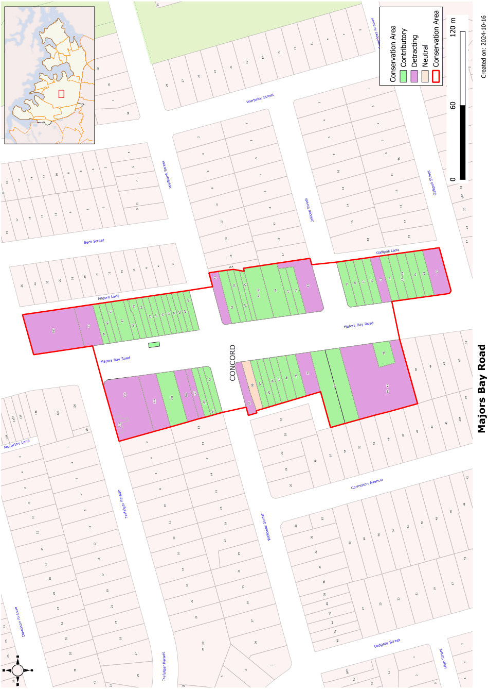

### CA.13  Majors Bay Road Conservation Area

#### History

Commercial development in the early twentieth century tended to be in ribbons lining major transport routes. The development along Majors Bay Road followed this pattern, taking advantage of the importance of the road in connecting Queens Road to the industrial areas at Mortlake. It also relied on the importance of Wellbank Street to provide a direct link to North Strathfield Railway Station.

On the east side of Majors Bay Road between Wellbank Street and Jones Street the Terrabona Estate subdivision of 1915 appears to have provided the impetus for commercial development along Majors Bay Road. The precinct was planned as a commercial boulevard to complement the Inter-War housing boom in Concord.

#### Description

The commercial precinct of Majors Bay Road between 48-114 Majors Bay Road on the west side and 23-95 Majors Bay Road on the east side is dominated by Inter-War commercial development. The buildings are generally two storey with retail premises on the ground floor and offices or flats on the upper floor. Parapet walls front the street on most buildings and the floors are divided on the facades by cantilevered awnings. Some residential buildings survive on the west side of Majors Bay Road.

#### Statement of Significance

This commercial precinct reflects the importance of Majors Bay Road and Wellbank Street in providing connections from the main transport links of Queens Road to the south and Strathfield North Railway station to the west with the industrial area of Mortlake and with the growing residential development of Cabarita from the Inter-War period to the late twentieth century.

The Majors Bay Road commercial precinct is a good quality streetscape dominated by Inter-War commercial buildings. The consistent scale and rhythm of facades, and use of materials contributes to an attractive streetscape.

The Majors Bay Road commercial precinct provides a focal point for the local community and continues to function as a popular meeting place.

#### Analysis - Setting

This conservation area derives its importance from its location at the junction of two important local roads.

#### Scale

Two storey development is dominant with ground floor used for retailing and the upper floor for office or residential use. A few single storey shops and houses are scattered through the group.

#### Form

These are two storey buildings usually with no setback from the street or side boundaries creating a continuous wall to the street. The buildings are usually parapeted. Roofs are usually tiled. The buildings have engaged piers at regular intervals reflecting traditional structural spans.

Recessed verandahs were incorporated into the upper floor of many of the commercial buildings, some of these have been filled in. The lower floors of the earlier buildings in the group generally have commercial shopfronts.

The freestanding buildings in the conservation area are more residential in form with hipped and gabled roofs and usually with front verandahs.

#### Siting

Most buildings in this group have no setbacks from the front and side boundaries.

#### Materials and Colours

Masonry is used for most buildings. Face brickwork trimmed with rendered or decorative details was the most common wall treatment. Rendered panels in the parapet provide space for signs. Other buildings have rendered facades with decorative rendered details.

#### Doors and Windows

Windows to the upper floors are often in square or arched openings, infilling the original open verandahs. Some buildings retain the French doors opening to the upper verandahs.

#### Refer to Figure App1.14

Development Control Plan

Appendix 1 Conservation Areas

> [Picture on page 33: a picture, saved as a picture (images/appendix-01-conservation-areas-page-33-3.gif, 150 dpi).]

Figure App1.14

Majors Bay Road Conservation Area
