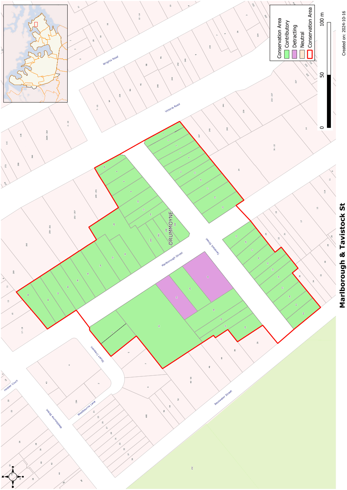
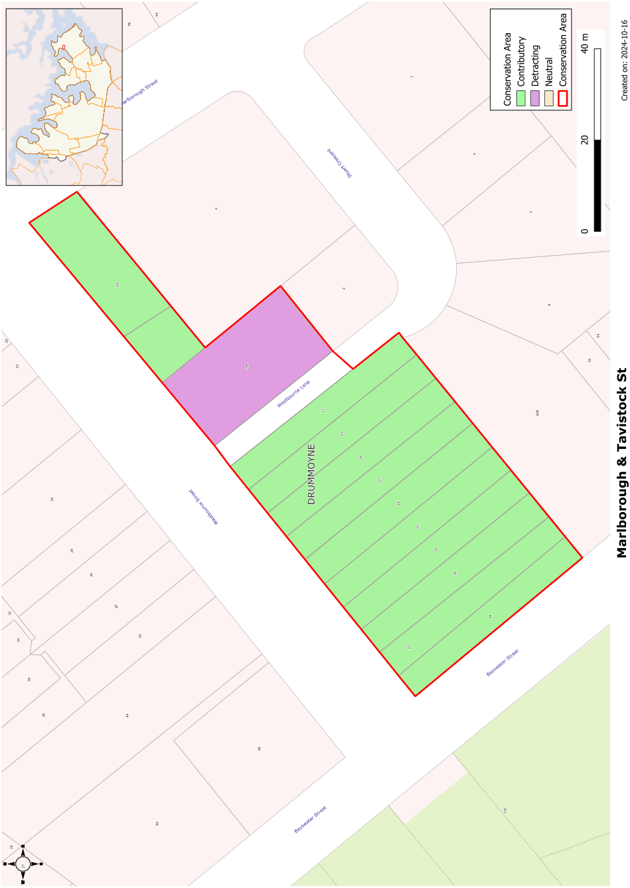

### CA.14  Marlborough and Tavistock Streets Conservation Area

#### History

The South Hythe subdivision of the 1870s included all the land west of Lyons Road, between the present Victoria Road and Bayswater Road. It included Tavistock, Marlborough and Westbourne Streets, establishing the general street layout that survives to the present day. Many of the initial purchases were for a number of allotments. Speculative development and subsequent subdivision in the Federation and Inter-War periods created rows of housing of similar scale, form and materials.

The housing on the southeast side of Tavistock Street and from 21 to 39 Westbourne Street appear to have been groups of speculative development built in the Federation period. Groups of semi-detached houses have since been subdivided to allow individual ownership. 43 Marlborough Street also dates from this period.

The houses at 4-8 Tavistock Street were probably built soon after a re-subdivision of land fronting the present Victoria Road in 1915. Those at 10-12 Tavistock Street along with 26-28 Marlborough Street are also part of one development comprising detached and semi-detached houses.

#### Description

The character of the Marlborough and Tavistock Streets Conservation Area is defined by:

• a consistent row of speculative semi-detached Federation houses in Westbourne Street,

• consistent Federation housing, both semi-detached and free standing, on the southeastern side of Tavistock Street including a very good group of speculative semi-detached Edwardian houses towards Victoria Road.

• a group of Inter-War bungalows on the northwest side of Tavistock Street between Victoria Road and Marlborough Street, extending along Marlborough Street.

• consistent Federation housing on the northeast side of Marlborough Street.

The housing in the Conservation Area is predominantly of c.1910 to 1930 construction. It has a consistent character dominated by single storey housing of dark face brick, terracotta and slate roofing, hipped and gabled roof forms and front verandahs.

#### Statement of Significance

The Marlborough and Tavistock Streets, Drummoyne Conservation Area is of significance for its largely intact early twentieth century residential development. The group has an overall homogeneity due to consistent use of materials, scale, setbacks and forms. Groups of speculative development also contribute to the regular rhythms in the streetscape.

#### Objectives

To retain the high level of integrity and homogenous character of the group.

To ensure new development does not detract from established rhythms in the streetscape created by the group.

#### Analysis - Setting

Groups of houses within each block have regular setbacks. The setbacks of the groups of semi-detached houses are usually less than for the free standing houses.

Plantings of street trees as well as trees in front gardens adds to the amenity of this conservation area.

#### Scale

This conservation area has a dominant single storey scale facing the street.

#### Form

The groups of houses within this conservation area have regular form and massing. Front verandahs are an important element of the front of the houses. Gabled elements are used in most of the roofs as either a complement to the main hipped roof or as the main roof form facing the street.

#### Materials and Colours

Terracotta and/or slate are the dominant materials for roofs and are complemented by face brick walls with some rendered and/or battened fibro sheet for contrast. Verandahs have face brick piers and balustrades with timber posts. Driveways are formed with concrete strips.

#### Doors and Windows

Casement windows are common with some use of double hung sashes. French doors are also used to provide access to verandahs. Front doors usually have toplights and, where space permits, might have sidelights.

#### Carparking

Some freestanding houses have space for parking at the rear of the allotment. Many of the semi-detached houses have no space for on-site parking that does not intrude on the front garden.

#### Fencing

Original fencing is usually low allowing good views from the footpath to the houses. Fencing often incorporates masonry elements including sandstone and low face brick walls, often with pipe rails. More recent fencing has a variety of picket fencing.

Landscape Elements including Paving and

#### Driveways

Street trees are important to the character of this area and are reinforced with mature trees in front gardens. Front gardens should incorporate low shrubs and lawn areas.

#### Refer to Figure App1.15 and Figure App1.16

Development Control Plan

Appendix 1 Conservation Areas

> [Picture on page 36: a picture, saved as a picture (images/appendix-01-conservation-areas-page-36-3.gif, 150 dpi).]

Figure App1.15

Marlborough and Tavistock Streets Conservation Area

Development Control Plan

Appendix 1 Conservation Areas

> [Picture on page 37: a picture, saved as a picture (images/appendix-01-conservation-areas-page-37-3.gif, 150 dpi).]

Figure App1.16

Marlborough and Tavistock Streets Conservation Area - Sheet 2
