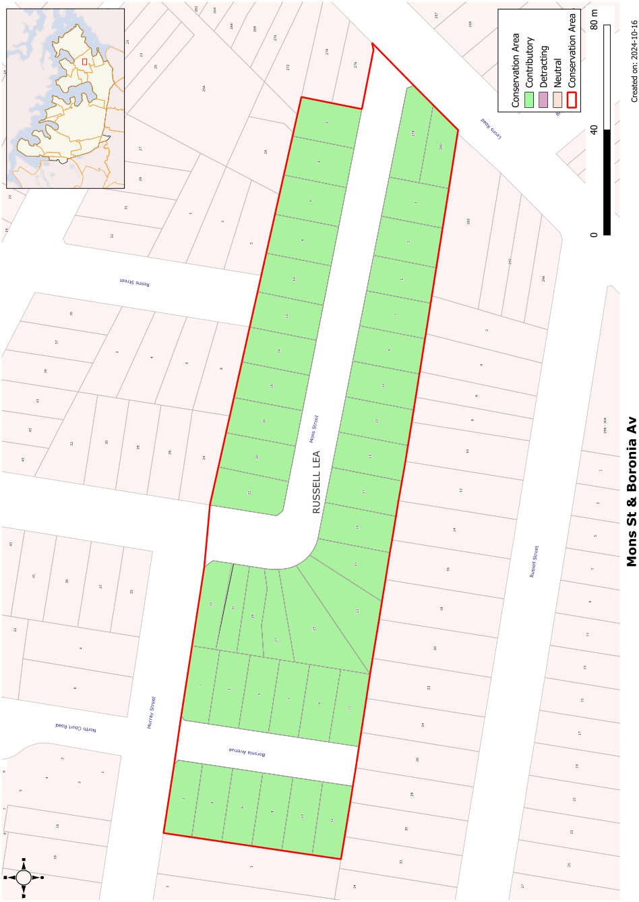

### CA.15  Mons Street and Boronia Avenue Conservation Area

#### History

This conservation area comprised two subdivisions; the Sunlight Estate subdivision of 1926 creating Mons Road and the Boronia Avenue subdivision of 1927.

#### Description

The Mons Street and Boronia Avenue Conservation Area is dominated by Inter-War California Bungalow style housing creating a regular rhythm of gables in the streetscape. Street plantings of box hedge in Mons Street have been pruned ensuring the houses have a close relationship to the street.

#### Statement of Significance

The Mons St and Boronia Avenue Conservation Area contains a very intact group of Inter-war houses representing the major sub-division of the Municipality that took place during this period. The group is one of a small number of excellent groups in the Five Dock/ Russell Lea area that demonstrate the pattern of sub-division of the Municipality and which contain a very fine representative group of houses from one period, mostly with intact settings and detailing. Most houses in the area have not been substantially altered.

#### Objectives

The high level of integrity of this group is a key feature, which should be retained. With only one or two significant alterations to significant properties there should be no demolition of existing early housing, controls on first floor additions to retain the character of housing and retention of façade details such as windows and wall treatments. Garages and carports should not be added in front of the building line.

#### Analysis - Setting

The houses in this conservation area have regular setbacks from front boundaries. Side setbacks are wider on one side to allow vehicular access.

Street trees are restricted to clipped box hedges.

#### Scale

The housing in this conservation area was originally single storey development, consistent with the low horizontal character of the Inter-War California Bungalow style.

#### Form

The Inter-War California Bungalow style that dominates this Conservation Area has strong low-medium pitched gabled roof forms facing the street. Verandahs are incorporated into the front elevations and emphasise the low horizontal lines of the houses.

#### Materials and Colours

Face brick walls trimmed with rendered lintels and battened fibro gables. Original roofs are of terracotta tiles.

#### Doors and Windows

Windows facing the street are grouped sets of casement sashes, often with horizontal sunhoods. Front doors are simple glazed doors, sometimes in pairs.

#### Carparking

Carparking is provided well behind the building line of most houses.

#### Fencing

Original surviving fencing is low face brick fencing of piers and panels. The low brick panels usually had a metal pipe or panel above.

Landscape Elements including Paving and

#### Driveways

Single driveways to the side of the house. Front gardens are dominated by lawns with low shrubs providing interest. Street plantings are restricted to clipped hedges.

#### Refer to Figure App1.17

Development Control Plan

Appendix 1 Conservation Areas

> [Picture on page 39: a picture, saved as a picture (images/appendix-01-conservation-areas-page-39-3.gif, 150 dpi).]

Figure App1.17

Mons Street and Boronia Avenue Conservation Area
