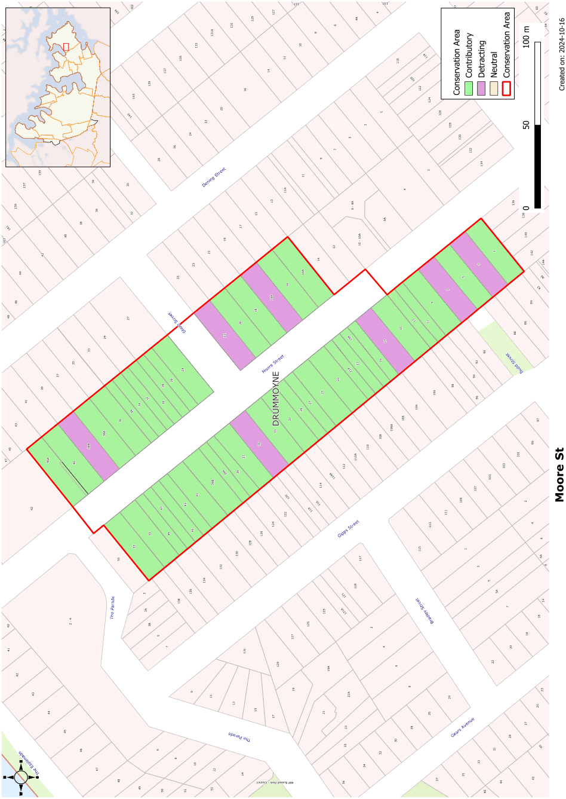

### CA.16  Moore Street Conservation Area

#### History

#### Form

The Lyonsville subdivision of the 1880s created Moore Street and Short Street. Development of small cottages followed through to the Inter-War period.

Most houses have simple rectangular forms with hipped roof forms relieved by gabled elements. Verandahs provide depth to the front elevations of the houses.

#### Description

#### Materials and Colours

Weatherboard and face brick are the common wall materials in this group. Roofs were originally either corrugated steel or terracotta tiles.

#### Doors and Windows

Windows are usually in vertically proportioned openings. Double hung windows are most common with sets of casement windows used in some later houses. Front doorcases usually incorporate toplights and, on larger houses, sidelights.

The Moore Street Conservation area encompasses a range of building styles and periods of construction, typifying the pattern of development of the central areas of Drummoyne. The earlier development relates to waterfront activity and extends from late nineteenth century through to the Inter-War period with several fine bungalow influenced cottages and semi-detached buildings. The street also contains a very good range of timber buildings from the first decade of the twentieth century or possibly earlier. On the corner of Short Street is a two storey store and commercial building that provides a focal point in the streetscape.

#### Carparking

#### Statement of Significance

Where space allows, car parking has been set behind the building line. Few carports and garages have been located in front of the main building line in this conservation area.

#### Fencing

Original surviving fencing includes low masonry fencing of either sandstone or face brick. Some reproduction picket fencing has been introduced.

The Moore Street Conservation Area includes a variety of houses that, while modest, display fine detailing and varied forms that are not generally seen in Drummoyne. Buildings of particular interest in this conservation area are the large timber house at no 40, the two storey corner store and residence, one of three very good examples in the municipality, the fine timber houses, and several very modest timber and fibro cottages. Together, these buildings represent the early development of the street and its lower status than the south side of Lyons Rd.

Landscaping Elements including Paving and

#### Driveways

#### Analysis - Setting

Front gardens are usually dominated by lawn with low plantings of shrubs to provide interest.

#### Refer to Figure App1.18

Moore Street has a gradual slope down from Lyons Road. Groups of cottages have fairly regular setbacks from the street. The two storey shop at the corner of Short Street provides contrast with no setback from the street frontages. Street trees also contribute to the amenity of the street.

#### Scale

Single storey scale is dominant in this conservation area.

Development Control Plan

Appendix 1 Conservation Areas

> [Picture on page 41: a picture, saved as a picture (images/appendix-01-conservation-areas-page-41-3.gif, 150 dpi).]

Figure App1.18

Moore Street Conservation Area
