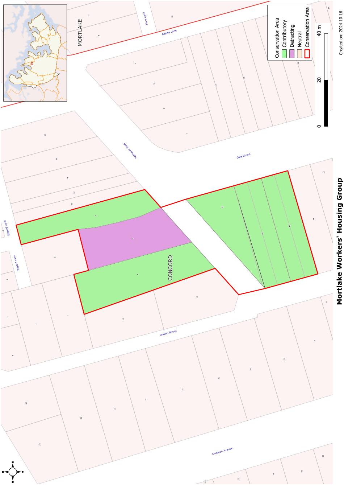

### CA.17  Mortlake Workers' Housing Group

#### Siting

#### History

The front setbacks vary due to the angled nature of the lots with small gardens to the front.

#### Materials and Colours

Mortlake township began with the establishment of the Australian Gas Light Company’s works at Mortlake in

1886\. Subdivision of the township took place in the following 2 years. The houses at 46-50 Gale Street were built soon after the subdivision of the township closely followed by the houses at 4-8 Tennyson Road.

#### Description

A group of single storey houses from the late Victorian and Federation periods.

The houses are in a variety of materials with timber weatherboards, rendered masonry and stone. Roofs are in tile and corrugated metal. 8 Tennyson Street is unusual in being in timber with the boards cut to appear as stone. 48 Gale Street is in sandstone with an Italianate style verandah with decorative lacework.

#### Statement of Significance

#### Car parking

The rear lanes provide car access to rear garages and carports.

#### Fencing

The front fencing varies with masonry walls, picket and timber fences or with the garden open to the footpath.

The Tennyson Road conservation area is an interesting group of workers’ housing from the late Victorian and Federation period directly relating to the development of the AGL gasworks and the establishment of the Mortlake township. The group makes an important contribution to the streetscape and forms a precinct of great charm and character.

#### Analysis - Setting

Landscape Elements including Paving and

#### Driveways

Small front gardens generally laid to lawn with some shrub planting

#### Refer to Figure App1.19

The group is set on various size blocks at the corner of the two streets with rear lane access to garages and carports. The adjoining scale is predominantly single storey with a mix of Victorian and Federation cottages with some later infill development.

#### Scale

The houses are single storey with no second floor additions. There is some later, two storey development close by.

#### Form

The group is in the Victorian and Federation cottage form style with double fronted elevations and front verandahs or gables.

Development Control Plan

Appendix 1 Conservation Areas

> [Picture on page 43: a picture, saved as a picture (images/appendix-01-conservation-areas-page-43-3.gif, 150 dpi).]

Figure App1.19

Mortlake Workers' Housing Group
