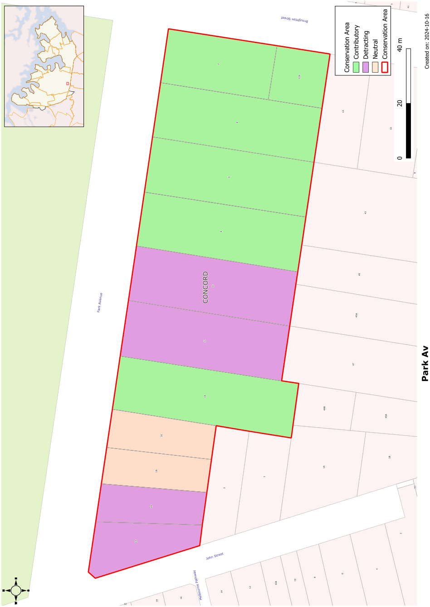

### CA.18  Park Avenue Conservation Area

#### History

Longbottom Stockade was established in the eighteenth century as an overnight detention centre for convicts on their journey between Sydney and Parramatta. From 1840 to 1842 it was used to house 58 French speaking Canadian rebels. A ramshackle settlement gradually grew around the stockade that was gradually falling into disrepair. In 1843 the Village of Longbottom was laid out to formalise the settlement and included the south side of the present Park Avenue. The large allotments from this settlement generally survive on the south side of Park Avenue, although the west end was re-subdivided in 1927.

#### Description

A grouping of early homes on large allotments, generally well set back from the street. The group includes a number of Victorian villas, all enjoying an outlook over the park opposite.

#### Statement of Significance

Park Avenue, Concord is a notable group of heritage homes on large allotments, enjoying an outlook over public parkland. It includes a number of outstanding Victorian villas with large front gardens, rare for Concord. The large lots and deep setbacks are unique in the Council area. The group has considerable aesthetic and historical significance.

#### Analysis - Setting

Goddard Park on the north side of Park Avenue provides a setting for this conservation area. Street plantings and large front gardens reinforce the amenity provided by the park.

#### Scale

Park Avenue includes larger one and two storey houses, usually on large allotments.

#### Form

The houses in this conservation area have a variety of forms. Most of the original houses in the group were built with generous verandahs on the front of the house taking advantage of the northerly aspect and view of Goddard Park.

#### Siting

Most of the contributory houses in this group have generous setbacks from the front boundaries.

#### Materials and Colours

Masonry is the dominant wall material with render used on some of the earlier homes. Roofs are either slate or tiled.

#### Doors and Windows

Vertically proportioned double hung windows are most common in this conservation area. Front doorcases incorporate toplights and sidelights. French doors are also used with verandahs.

#### Carparking

Garages and carports have usually been set behind the front building line of contributory houses.

#### Fencing

Only one original fence survives in this group, an iron palisade fence with sandstone gateposts at 2 Park Avenue.

Landscape Elements including Paving and

#### Driveways

Street trees add to the amenity of the area. Gardens are usually generous and incorporate lawns with mature trees and shrubs.

#### Refer to Figure App1.20

Development Control Plan

Appendix 1 Conservation Areas

> [Picture on page 45: a picture, saved as a picture (images/appendix-01-conservation-areas-page-45-3.gif, 150 dpi).]

Figure App1.20

Park Avenue Conservation Area
