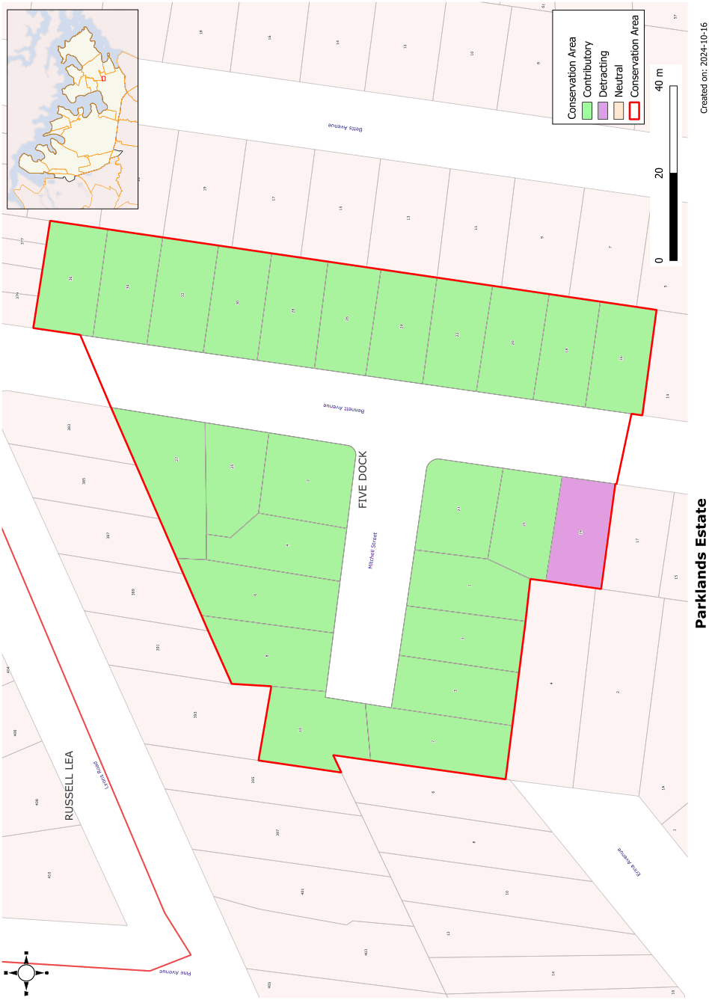

### CA.19  Parklands Estate Conservation Area

#### History

Parklands Estate, between Lyons Road and Barnstaple Road, was subdivided in 1927 creating Bennett Avenue and a cul-de-sac, Mitchell Street. This small group of houses were developed between 1927 and the late 1930s.

#### Description

The buildings stylistically are predominantly derivatives of Californian Bungalows with several later houses from the immediate post World War Two period at the end of the cul-de-sac which add to the group. All are fine if modest examples of the style and reflect the pattern of further sub-division that took place as larger estates were gradually broken up.

#### Statement of Significance

Developed in a short period from 1927, Parklands Estate has high heritage value locally as an intact group within an intact streetscape setting reflecting an excellent range of Inter-war housing types. The group is complemented by street planting, fencing and gardens.

#### Future Character

The high level of integrity of this group is a key feature which should be retained. With only one or two significant alterations to significant properties there should be no demolition of existing Inter-war housing, controls on first floor additions to retain the character of housing and retention of facade details such as windows and wall treatments. The important street planting should be retained. Garages and carports should not be added in front of the building line.

#### Analysis - Setting

The Parklands Estate has a relatively enclosed streetscape dominated by mature street trees.

#### Scale

Single storey scale is dominant, consistent with the low horizontal emphasis of the Inter-war housing styles in this estate.

#### Form

The houses in the Parklands Estate usually have multiple gables and include a deep verandah to offset a projecting room on one side of the street front.

Low-medium pitched roofs of terracotta tiles with multiple gables provide rhythm to the streetscape. Houses in the group from the later part of the Inter-war period have simple hipped roofs with glazed tiles.

#### Siting

Development in the Parklands Estate has a regular street setback. Side setbacks include a wider setback on one side to allow for vehicular access.

#### Doors and Windows

Windows are usually arranged in groups with bungalows having sets of casement windows. Later houses in the Parklands Estate have grouped double hung sash windows.

#### Materials and Colours

Terracotta roof tiles and dark face brick walls with light coloured rendered trim are typical of this streetscape. Windows are generally timber framed.

#### Carparking

Garages are usually located well behind the building line so that they are not visible in the streetscape.

#### Fencing

Many houses have reproduction picket fencing which, while not authentic to the Inter-war character of the houses, provides cohesion to the streetscape.

Landscape Elements including Paving and

#### Driveways

Front gardens incorporate large areas of lawn with some planting of shrubs. Driveways are single width usually located to the side of the allotments.

#### Subdivision

The regularity of the original subdivision is important in establishing the rhythm of the streetscape.

#### Refer to Figure App1.21

Development Control Plan

Appendix 1 Conservation Areas

> [Picture on page 47: a picture, saved as a picture (images/appendix-01-conservation-areas-page-47-3.gif, 150 dpi).]

Figure App1.21

Parklands Estate Conservation Area
