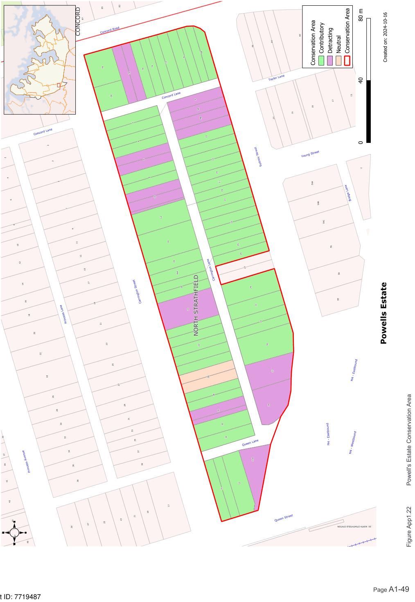

### CA.20  Powell's Estate Conservation Area

#### History

Powell’s Estate was subdivided in 1886 and included housing allotments with regular frontages. The allotments were wider further away from Parramatta Road. Rear lanes were incorporated into the subdivision, originally providing access for night soil collection. Due to the narrow allotment width (20 feet), many houses were built on double allotments. The main period of development of the estate continued through the late Victorian and Federation period. Much of this housing has survived through to the twenty-first century, except where removed to make way for the development of the M4.

#### Description

Powell’s Estate is an area of late Victorian housing interspersed with Federation and Inter-War period housing on small allotments. The development includes a mixture of large individual homes and semi-detached housing. Street plantings add to the amenity of the area.

#### Statement of Significance

The Powell’s Estate Conservation Area is a rare local example of Victorian period development. A number of the original Victorian homes survive, including some fine villas. The area retains considerable historical significance.

#### Analysis - Setting

The Powell’s Estate has regular sized allotments on a rectilinear street layout. Street trees provide amenity to the area. Lanes now allow vehicular access to the rear of the allotments.

#### Scale

Single storey housing is dominant. A few one and a half and two storey houses are located on double allotments. A notable one and a half storey group faces Concord Road.

#### Form

The houses in this conservation area include free standing and semi-detached forms. Most have a simple rectilinear footprint to the main front wing and incorporate a verandah in the street elevation. Roofs are usually hipped, sometimes incorporating a gable as a feature.

#### Siting

Front setbacks are reasonably uniform along each street. Some larger houses have greater setbacks. Side setbacks are small, possibly as a result of the small allotments.

#### Materials and Colours

Rendered masonry is used for most of the Victorian houses and is complemented by slate roofs (where the original roofing survives). Later houses are face brick with tiled roofs. There are a small number of weatherboard houses with corrugated steel roofs.

#### Doors and Windows

Windows are vertically proportioned usually with timber double hung sashes. Some of the Victorian houses incorporate bay window elements. A few later homes have sets of timber casement sashes. Front doors usually incorporate a toplight and, in larger homes, sidelights.

#### Carparking

The rear lanes provide access for parking at the rear of the properties.

#### Fencing

Few original fences survive. Iron palisades might be expected for some of the larger Victorian houses. Smaller cottages could be expected to have timber picket fences. Later houses appear to have used brick fencing with low brick panels between brick piers.

Landscape Elements including Paving and

#### Driveways

Front gardens are dominated by lawns with plantings of low shrubs.

#### Refer to Figure App1.22

Development Control Plan

Appendix 1 Conservation Areas

> [Picture on page 49: a picture, saved as a picture (images/appendix-01-conservation-areas-page-49-3.gif, 150 dpi).]
> Words printed on the picture (copied from the PDF):
> Figure App1.22
> Powell's Estate Conservation Area
