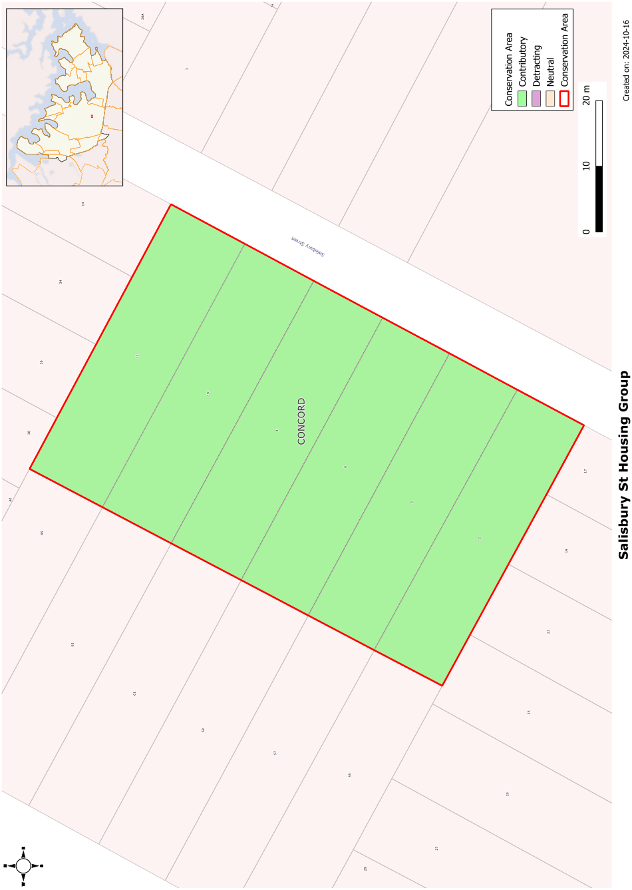

### CA.21  Sailsbury Street Housing Group

#### History

This group of houses is located on the 1886 Beaconsfield Square subdivision. They include cottages built soon after the subdivision through to the Inter-War period.

#### Description

This is a group of single storey verandahed cottages from the 1880s to the Inter-War period. The narrow setback from the street and the consistent scale and simple forms of these houses creates a cohesive streetscape.

#### Statement of Significance

This is a cohesive streetscape of cottages built soon after the 1886 Beaconsfield Square subdivision. They include cottages built soon after the subdivision through to the Inter-War period.

#### Analysis - Setting

The group is set on similar blocks with narrow setbacks from the street. The group contrasts with the open space and larger scale building of the public school on the opposite side of the street.

#### Scale

The houses are originally single storey, with one now having a first floor addition. This is consistent with the narrow width of the street

#### Form

The group have a range of cottage forms. All are based on simple rectangular cottages with hipped roofs and a front verandah. The later examples have a gabled element on the front elevation to provide interest.

#### Siting

The front setbacks are quite narrow. Some have a wider setback on one side to allow vehicular access.

#### Materials and Colours

The houses are in different materials. Traditional materials of weatherboard or face brick is used for walls and, originally, corrugated steel or terracotta tiles for the roof.

#### Car parking

Some of the cottages have sufficient side setbacks to provide access for rear garages. The narrow street setbacks limit parking in front of the houses.

#### Fencing

No original fencing survives. Fencing is low to medium height.

Landscape Elements including Paving and

#### Driveways

The small front gardens are laid to lawn with some shrub planting.

#### Refer to Figure App1.23

Development Control Plan

Appendix 1 Conservation Areas

> [Picture on page 51: a picture, saved as a picture (images/appendix-01-conservation-areas-page-51-3.gif, 150 dpi).]

Figure App1.23

Sailsbury Street Housing Group
