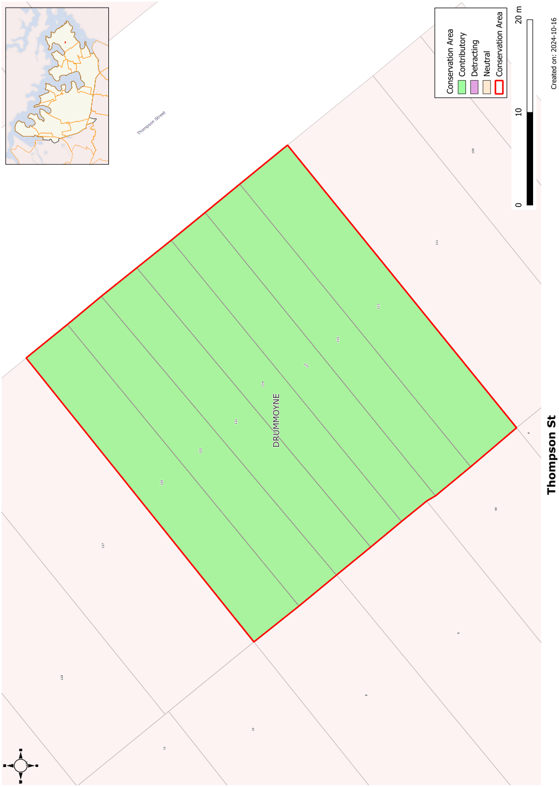

### CA.22  Thompson Street Conservation Area

#### History

This terrace of seven houses was built on the 1904 subdivision of the Cometrowe Estate. The terrace remained under one title until 1958 when it was subdivided into individual allotments for each house.

#### Description

This small group comprises a row of single level terrace style housing with narrow frontages and matching facades. They have a strong Federation Queen Anne character.

#### Statement of Significance

The terrace of seven houses in Thompson Street is a very rare building form in Drummoyne. This is the only significant terrace in the Canada Bay Council area and is a strong form in the Thompson Street streetscape and illustrates one of the major stages of Drummoyne’s development.

#### Objectives

The integrity of this row is to be retained without any alterations to the street elevations. No further painting of face brick walls should take place and timber joinery details should be retained.

#### Analysis - Setting

This terrace has a narrow setback from the street. The slope of Thompson Street away from Lyons Road adds interest to the group.

#### Scale

This is a single storey group.

#### Form

The houses have a repetitive pattern of verandahs and gabled fronts in front of a main roof slope.

The terracotta tiled roof is a regular gabled form parallel to the street with individual houses separated by parapet walls. Transverse gables are used on the projecting bays.

#### Siting

This terrace has a small setback from Thompson Street.

#### Materials and Colours

The face brick walls of this group have been painted. The roof is of terracotta tiles with crenellated ridging and rams horn finials.

#### Windows

Double hung windows are used in the projecting gabled fronts.

#### Carparking

No off-street car parking is provided with these houses.

#### Fencing

The street boundaries are marked by consistent low reproduction picket fencing.

Landscape Elements including Paving and

#### Driveways

The houses have small front gardens sometimes incorporating shrubs and hedges. Paving is restricted to pedestrian paths.

#### Subdivision

The subdivision pattern of this group related directly to the individual houses.

#### Refer to Figure App1.24

Development Control Plan

Appendix 1 Conservation Areas

> [Picture on page 53: a picture, saved as a picture (images/appendix-01-conservation-areas-page-53-3.gif, 150 dpi).]

Figure App1.24

Thompson Street Conservation Area
