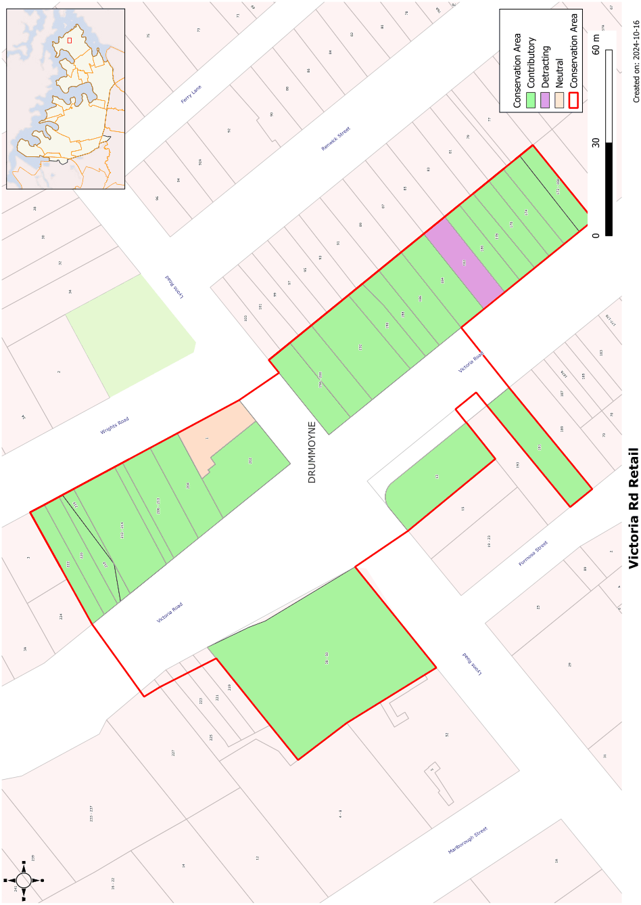

### CA.23  Victoria Road Retail Conservation Area

#### History

Victoria Road can be clearly seen with its two phases of development; the earlier eastern side from the early years of the twentieth century and the western side which is predominantly post World War II development except where buildings were set well back from the street alignment. The eastern side of Victoria Road is of particular interest as it has survived the numerous road widenings that have removed much of the building stock on the opposite side of the road.

#### Description

This small group of retail buildings are a very fine example of Edwardian shopping centre development and form an almost intact streetscape across the crown of the hill. The buildings vary in style but the predominant form is the two storey building with shopfront below and residence over. A number of these have cantilevered balconies to the street of design interest and rarity. The other buildings are the post office, several well detailed buildings originally used for banks and the Inter-War commercial building on the northwestern corner of Lyons Road.

#### Statement of Significance

This Victoria Road, Drummoyne Retail Conservation area is a very good example of early twentieth century retail development, incorporating Edwardian, Classical Revival and Art Deco designs. With the Sutton Place shopping centre and the hotel on the opposite corner, these buildings create a significant townscape at this very busy and prominent corner. All of these buildings form a gateway to Drummoyne and establish a strong and key character. The survival of cantilevered verandahs on a number of the buildings adds particular interest to the group.

#### Objectives

The strong Federation to Inter-war character of these retail buildings should be retained with their masonry facades, often intact shopfronts, upper floor verandahs, parapet forms and overall consistent and intact streetscape setting. Original shopfronts should be retained. Infill buildings should respect the overall scale of the street development.

#### Analysis - Setting

This is an urban group with buildings abutting or separated by narrow walkways. They have visual prominence due to the location at the crest of a hill and the absence of a setback from the street alignment.

#### Scale

Generally two storey buildings, usually divided horizontally by an awning.

#### Form

Continuous street facades are modulated by cantilevered and recessed verandahs, regularly spaced shopfronts, fenestration patterns, use of piers to divide first floor façade and articulation of the parapet walls. Cantilevered balcony roofs are generally corrugated steel and use a skillion form. The main roofs are generally concealed behind parapet walls. This group is distinctive for the incorporation of cantilevered balconies to a number of the buildings. The first floor façade is generally articulated with engaged piers and a shaped parapet.

#### Siting

These commercial buildings usually have no setback from the street boundary and little or no setback from the side boundaries, forming a continuous wall to Victoria Road.

#### Materials and Colours

Walls of masonry contrasting with render. Some Inter- War buildings are finished with render incorporating decorative details. Face brick is important to the character of the Edwardian buildings.

#### Doors and Windows

A range of window openings are used, generally with a vertical emphasis. Larger window openings are avoided ensuring a regular proportion of wall and windows in the facades. Ground floor shopfronts are generally modern, although a few buildings in the conservation area are notable for being designed as a cohesive façade over both floors, undivided by an awning or balcony.

#### Carparking

Where available, car parking is at the rear of the site.

#### Refer to Figure App1.25

Development Control Plan

Appendix 1 Conservation Areas

> [Picture on page 55: a picture, saved as a picture (images/appendix-01-conservation-areas-page-55-3.gif, 150 dpi).]

Figure App1.25

Victoria Road Retail Conservation Area
