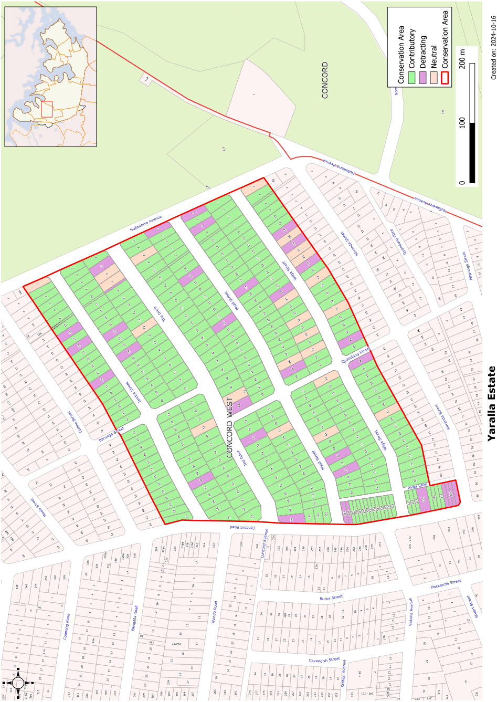

### CA.24  Yaralla Estate Conservation Area

#### History

#### Statement of Significance

This 1920s precinct is representative of Concord’s major developmental period. It is one of the best preserved examples of Inter-War streetscapes in the Council area and includes some of the Sydney region’s best examples and some outstanding rows of typical 1920s bungalows, for which Concord is noted. The Drive has special significance as the alignment of the original entry to the Walker family’s Yaralla estate.

The Yaralla Estate conservation Area comprises a major part of the 1920 release of the Yaralla Park Estate. This was the largest single release of land for urban subdivision in the former Concord Municipality’s history. It included the main entrance driveway to the old Walker Estate, retained on its original alignment as The Drive. The rapid development of the subdivision, closely associated with the Main Northern Railway, produced highly consistent Inter-War streetscapes.

The inclusion of subtle bends in the streetscape and of street planting adds to the distinctive qualities of this Conservation Area.

The 1920 subdivision extended from Colane Street to the northern side of Wilga Street. The southern side of Wilga Street was developed shortly afterwards.

#### Analysis - Setting

#### Description

The Yaralla Estate Conservation Area has long streetscapes of wide streets with subtle bends. Street plantings add to the amenity of the residential streets.

#### Scale

This is an area of regular subdivision and generally uniform Inter-War housing. The repetition of the gabled roof forms of Inter-War bungalows create a strong rhythm in the streetscape and is reinforced by consistent use of dark brick and tiled roofs. Iandra Street at the north of the Conservation Area and Wilga Street at the south of the Conservation Area include groups of Inter-War cottages.

Single storey housing dominates the residential development in this conservation area. Two storey commercial development and flats facing Concord Road reflect the importance of that road as a main traffic route.

#### Form

It includes significant street planting, most notably along The Drive. The area’s original 1920s townscape character survives essentially unaltered. Subtle bends in the parallel street system add visual interest. The area includes a small neighbourhood shopping centre on Concord Road.

The Inter-War California Bungalow style with its strong gabled form dominates this conservation area. Verandahs on the front of the house provide depth to the street facades. Later housing has a similar scale with verandahs incorporated below hipped roof forms.

#### Siting

Housing in the Yaralla Conservation Area has regular front setbacks from the streets. Most houses include a wide setback to one side to allow for vehicular access. This provides space between houses and helps reinforce the rhythm in the streetscape.

#### Materials and Colours

Face brickwork trimmed with render below terracotta or slate roofs is almost uniform in the Yaralla Conservation Area.

#### Doors and Windows

Windows are usually timber casement sashes in groups of two or three, often with horizontal sun hoods. Later houses have groups of double hung windows, sometimes in a chamfered bay. Doors are often glazed and sometimes are paired.

#### Carparking

Garages and carports are usually set well back from the front building alignment.

#### Fencing

Original fencing is usually low brick panels between brick piers. Metal rails or wrought metal panels are sometimes used between piers.

Landscape Elements including Paving and

#### Driveways

Street trees are important in this conservation area. Front gardens are usually dominated by lawn with low plantings of shrubs to provide interest.

#### Refer to Figure App1.26

Development Control Plan

Appendix 1 Conservation Areas

> [Picture on page 58: a picture, saved as a picture (images/appendix-01-conservation-areas-page-58-3.gif, 150 dpi).]

Figure App1.26

Yaralla Estate Conservation Area
