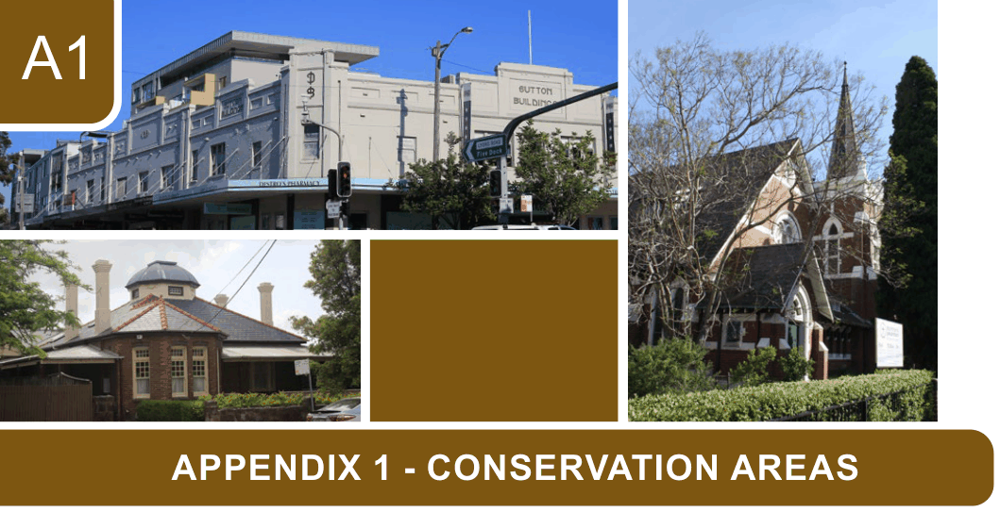

# Canada Bay Development Control Plan - Appendix 1 Conservation Areas

> This chapter is split into 24 section file(s), one per main heading, in the order they appear in the PDF.

Source PDF: [ECM_7719487_v5_CCB-DCP-14_Appendix-1-Conservation-Areas_v2022-05-16.pdf](ECM_7719487_v5_CCB-DCP-14_Appendix-1-Conservation-Areas_v2022-05-16.pdf)

> [Picture on page 1: a picture, saved as a picture (images/appendix-01-conservation-areas-page-1-1.gif, 150 dpi).]

### A1

### APPENDIX 1 - CONSERVATION AREAS

Statements of significance ................................................................................................A1-2 CA.1  Birkenhead and Dawson Estates Conservation Area......................................... A1-2 CA.2  Bourketown Conservation Area ......................................................................... A1-5 CA.3  Creewood Street Conservation Area ................................................................. A1-9 CA.4  Drummoyne Avenue East Conservation Area .................................................. A1-11 CA.5  Drummoyne Avenue West Conservation Area ................................................A1-14 CA.6  Drummoyne Park Conservation Area ............................................................... A1-16 CA.7  Gale Street Inter-War Californian Bungalow Group ......................................... A1-19 CA.8  Gale Street Victorian Housing Group .............................................................. A1-21 CA.9  Gears Avenue Conservation Area ................................................................... A1-23 CA.10  Gipps Street Conservation Area .................................................................... A1-25 CA.11  Hampden Road Conservation Area ................................................................ A1-27 CA.12  Lindfield Avenue Conservation Area .............................................................. A1-30 CA.13  Majors Bay Road Conservation Area ............................................................ A1-32 CA.14  Marlborough and Tavistock Streets Conservation Area.................................. A1-34 CA.15  Mons Street and Boronia Avenue Conservation Area .................................... A1-38 CA.16  Moore Street Conservation Area ................................................................... A1-40 CA.17  Mortlake Workers' Housing Group.................................................................. A1-42 CA.18  Park Avenue Conservation Area..................................................................... A1-44 CA.19  Parklands Estate Conservation Area ............................................................. A1-46 CA.20  Powell's Estate Conservation Area ................................................................ A1-48 CA.21  Sailsbury Street Housing Group ..................................................................... A1-50 CA.22  Thompson Street Conservation Area ............................................................. A1-52 CA.23  Victoria Road Retail Conservation Area ......................................................... A1-54 CA.24  Yaralla Estate Conservation Area ................................................................... A1-56

<!-- sections -->
## Sections

1. [CA.1  Birkenhead and Dawson Estates Conservation Area](01-ca-1-birkenhead-and-dawson-estates.md)
2. [CA.2  Bourketown Conservation Area](02-ca-2-bourketown-conservation-area.md)
3. [CA.3  Creewood Street Conservation Area](03-ca-3-creewood-street-conservation-area.md)
4. [CA.4  Drummoyne Avenue East Conservation Area](04-ca-4-drummoyne-avenue-east-conservation.md)
5. [CA.5  Drummoyne Avenue West Conservation Area](05-ca-5-drummoyne-avenue-west-conservation.md)
6. [CA.6  Drummoyne Park Conservation Area](06-ca-6-drummoyne-park-conservation-area.md)
7. [CA.7  Gale Street Inter-War Californian Bungalow Group](07-ca-7-gale-street-inter-war-californian.md)
8. [CA.8  Gale Street Victorian Housing Group](08-ca-8-gale-street-victorian-housing-group.md)
9. [CA.9  Gears Avenue Conservation Area](09-ca-9-gears-avenue-conservation-area.md)
10. [CA.10  Gipps Street Conservation Area](10-ca-10-gipps-street-conservation-area.md)
11. [CA.11  Hampden Road Conservation Area](11-ca-11-hampden-road-conservation-area.md)
12. [CA.12  Lindfield Avenue Conservation Area](12-ca-12-lindfield-avenue-conservation-area.md)
13. [CA.13  Majors Bay Road Conservation Area](13-ca-13-majors-bay-road-conservation-area.md)
14. [CA.14  Marlborough and Tavistock Streets Conservation Area](14-ca-14-marlborough-and-tavistock-streets.md)
15. [CA.15  Mons Street and Boronia Avenue Conservation Area](15-ca-15-mons-street-and-boronia-avenue.md)
16. [CA.16  Moore Street Conservation Area](16-ca-16-moore-street-conservation-area.md)
17. [CA.17  Mortlake Workers' Housing Group](17-ca-17-mortlake-workers-housing-group.md)
18. [CA.18  Park Avenue Conservation Area](18-ca-18-park-avenue-conservation-area.md)
19. [CA.19  Parklands Estate Conservation Area](19-ca-19-parklands-estate-conservation-area.md)
20. [CA.20  Powell's Estate Conservation Area](20-ca-20-powell-s-estate-conservation-area.md)
21. [CA.21  Sailsbury Street Housing Group](21-ca-21-sailsbury-street-housing-group.md)
22. [CA.22  Thompson Street Conservation Area](22-ca-22-thompson-street-conservation-area.md)
23. [CA.23  Victoria Road Retail Conservation Area](23-ca-23-victoria-road-retail-conservation.md)
24. [CA.24  Yaralla Estate Conservation Area](24-ca-24-yaralla-estate-conservation-area.md)
