### ES4  Appendices

#### Terms of Positive Covenant

#### Existing Allotments

IV. By written notice the Council may require the registered proprietors to attend to any matter and to carry out such work within such time as the Council may require to ensure the proper and efficient performance of the structure and works and to that extent Section 88F(2) (a) of the Act is hereby agreed to be amended accordingly.

A1 The Terms of Positive Covenant - Where there is no land subdivision (no Section 88B instrument required) then the following standard wording for the "The Terms of Positive Covenant" is to be used and attached with the standard NSW Department of Lands form 13RPA.

V. Pursuant to Section 88F(3) of the Act the authority shall have the following additional powers pursuant to this covenant:

Terms of Positive Covenant (Show full details of Positive Covenant)

The registered proprietors covenant with the City of Canada Bay Council (Council) that they will maintain and repair the structure and works on the land in accordance with the following terms and conditions:

I. The registered proprietor will:

i. In the event that the registered proprietor fails to comply with the terms of any written notice issued by the Council as set out above the Council or its authorised agents may enter the land with all necessary equipment and carry out any work which the Council in its discretion considers reasonable to comply with the said notice referred to in l hereof.

i. keep the structure and works clean and free from silt, rubbish and debris

ii. The Council may recover from the registered proprietor in a Court of competent jurisdiction:

ii. maintain and repair at the sole expense of the registered proprietors the whole of the structure and works so that it functions in a safe and efficient manner.

(a) Any expense reasonably incurred by it in exercising its powers under sub-paragraph i hereof. Such expense shall include reasonable wages for the Council's own employees engaged in effecting the said work, supervising the said work and administering the said work together with costs, reasonably estimated by the Council, for the use of machinery, tools and equipment in conjunction with the said work.

II. For the purpose of ensuring observance of the covenant the Council may by its servants or agents at any reasonable time of the day and upon giving to the person against whom the covenant is enforceable not less than two days notice (but at any time without notice in the case of an emergency) enter the land and view the condition of the land and the state of construction maintenance or repair of the structure and works on the land.

(b) Legal costs on an indemnity basis for issue of the said notices and recovery of the said costs and expenses together with the costs and expenses of registration of a covenant charge pursuant to Section 88F of the Act or providing any certificate required pursuant to Section 88G of the Act or obtaining any injunction pursuant to Section 88H of the Act.

Ill. The registered proprietors shall indemnify the Council and any adjoining land owners against any claims for damages arising from the failure of any component of the on-site stormwater detention (OSD), on-site stormwater retention/absorption (OSA), stormwater quality improvement device (SQID) and/ or mechanical pump-out system, or failure to clean, maintain and repair the stormwater management system.

#### Land Subdivision

VI. This covenant shall bind all persons who claim under the registered proprietors as stipulated in Section 88E(5) of the Act.

For the purposes of this covenant:

A2 The Terms of Positive Covenant - Where a subdivision has been lodged and a Section 88B instrument created, then the following standard wording for the "The Terms of Positive Covenant" shall be used.

Terms of Positive Covenant referred to in the above-mentioned Plan The registered proprietors covenant with the City of Canada Bay Council (Council) that they will maintain and repair the structure and works on the land in accordance with the following terms and conditions:

I. The registered proprietor will:

i. keep the structure and works clean and free from silt, rubbish and debris

Structure and Works shall mean the on-site stormwater detention (OSD), on-site stormwater retention/ absorption (OSA), stormwater quality improvement device (SQID) and/or mechanical pump-out system constructed on the land as set out in the plan annexed hereto and marked with the letter "A" or alternatively as detailed on the plans approved by the Principal Certifying Authority (INSERT ORGANISATION/ COMPANY NAME): {INSERT CONSTRUCTION CERTIFICATE NUMBER AND DATE ISSUE BY PRINCIPAL CERTIFYING AUTHORITY, DRAWING NUMBER, DATE, REVISION NUMBER AND DESIGNER DETAILS} including all gutters, pipes, drains, walls, kerbs, pits, grates, tanks, chambers, basins and surfaces designed to temporarily detain stormwater on the land.

ii. maintain and repair at the sole expense of the registered proprietors the whole of the structure and works so that it functions in a safe and efficient manner.

The Act means the Conveyancing Act 1919.

A copy of the construction certificate or complying development certificate is held on Council file “DA number” or “CDC number”.

Name of authority having the power to release, vary or modify the ‘Positive Covenant’ is City of Canada Bay Council.

II. For the purpose of ensuring observance of the covenant the Council may by its servants or agents at any reasonable time of the day and upon giving to the person against whom the covenant is enforceable not less than two days notice (but at any time without notice in the case of an emergency) enter the land and view the condition of the land and the state of construction maintenance or repair of the structure and works on the land.

Ill. The registered proprietors shall indemnify the Council and any adjoining land owners against any claims for damages arising from the failure of any component of the on-site stormwater detention (OSD), on-site stormwater retention/absorption (OSA), stormwater quality improvement device (SQID) and/ or mechanical pump-out  system, or failure to clean, maintain and repair the stormwater management system.

IV. By written notice the Council may require the registered proprietors to attend to any matter and to carry out such work within such time as the Council may require to ensure the proper and efficient performance of the structure and works and to that extent Section 88F(2) (a) of the Act is hereby agreed to be amended accordingly.

For the purposes of this covenant:

V. Pursuant to section 88F(3) of the Act the authority shall have the following additional powers pursuant to this covenant:

i. In the event that the registered proprietor fails to comply with the terms of any written notice issued by the Council as set out above the Council or its authorised agents may enter the land with all necessary equipment and carry out any work which the Council in its discretion considers reasonable to comply with the said notice referred to in I hereof.

ii. The Council may recover from the registered proprietor in a Court of competent jurisdiction:

Structure and Works shall mean the on-site stormwater detention (OSD), on-site stormwater retention/ absorption (OSA), stormwater quality improvement device (SQID) and/or mechanical pump-out system constructed on the land as set out in the plan annexed hereto and marked with the letter "A" or alternatively as detailed on the plans approved by the Principal Certifying Authority (INSERT ORGANISATION/ COMPANY NAME): {INSERT CONSTRUCTION CERTIFICATE NUMBER AND DATE ISSUE BY PRINCIPAL CERTIFYING AUTHORITY, DRAWING NUMBER, DATE, REVISION NUMBER AND DESIGNER DETAILS} including all gutters, pipes, drains, walls, kerbs, pits, grates, tanks, chambers, basins and surfaces designed to temporarily detain stormwater on the land.

The Act means the Conveyancing Act 1919.

(a) Any expense reasonably incurred by it in exercising its powers under sub-paragraph i hereof. Such expense shall include reasonable wages for the Council's own employees engaged in effecting the said work, supervising the said work and administering the said work together with costs, reasonably estimated by the Council, for the use of machinery, tools and equipment in conjunction with the said work.

A copy of the construction certificate or complying development certificate is held on Council file “DA number” or “CDC number”.

Name of authority having the power to release, vary or modify the ‘Positive Covenant’ is City of Canada Bay Council.

(b) Legal costs on an indemnity basis for issue of the said notices and recovery of the said costs and expenses together with the costs and expenses of registration of a covenant charge pursuant to Section 88F of the Act or providing any certificate required pursuant to Section 88G of the Act or obtaining any injunction pursuant to Section 88H of the Act.

VI. This covenant shall bind all persons who claim under the registered proprietors as stipulated in Section 88E(5) of the Act.

The Act means the Conveyancing Act 1919.

#### Restriction on the Use of Land

#### Existing Allotments

Name of Authority having the power to release, vary or modify the ‘Restriction’ is City of Canada Bay Council.

#### Land Subdivision

A3 The Terms of Restriction on the Use of Land - Where there is no land subdivision (no Section 88B instrument required) then the following standard wording is to be used for the "The Terms of Restriction on the Use of Land" and attached with the standard NSW Department of Lands form 13RPA.

A4 The Terms of Restriction on the Use of Land

- Where a subdivision has been lodged and a Section 88B instrument created, then the following standard wording for the "The Terms of Restriction on the Use of Land" shall be used.

Terms of Restriction on the Use of Land (Show full details of the Restriction)

Terms of Restriction on the Use of Land referred to in the above-mentioned Plan

The registered proprietors covenant with the City of Canada Bay Council (Council) that they will not:

I. Do any act, matter or thing which would prevent the structure and works from operating in an efficient manner.

II. Make any alterations or additions to the structure and works or allow any development within the meaning of the Environmental Planning and Assessment Act 1979 to encroach upon the structure and works without the express written consent of the authority.

The registered proprietor covenant with the City of Canada Bay Council (Council) in respect to the structure erected on the land described as "on-site stormwater detention system" (which expression includes all ancillary gutters, pipes, drains, walls, kerbs, pits, grates, tanks, chambers, basins and surfaces designed to temporarily detain stormwater) shown on plans approved by the Principal Certifying Authority: {INSERT DA NUMBER, DRAWING NUMBER, DATE, REVISION NUMBER AND DESIGNER DETAILS} (hereinafter called "the system").

The registered proprietors covenant with the City of Canada Bay Council (Council) that they will not:

Ill. This covenant shall bind all persons who claim under the registered proprietors as stipulated in Section 88E(5) of the Act.

For the purposes of this covenant:

I. Do any act, matter or thing which would prevent the structure and works from operating in an efficient manner.

II. Make any alterations or additions to the structure and works or allow any development within the meaning of the Environmental Planning and Assessment Act 1979 to encroach upon the structure and works without the express written consent of the authority.

Ill. This covenant shall bind all persons who claim under the registered proprietors as stipulated in Section 88E(5) of the Act.

Structure and Works shall mean the on-site stormwater detention (OSD), on-site stormwater retention/ absorption (OSA), stormwater quality improvement device (SQID) and/or mechanical pump-out system constructed on the land as set out in the plan annexed hereto and marked with the letter "A" or alternatively as detailed on the plans approved by the Principal Certifying Authority (INSERT ORGANISATION/ COMPANY NAME): {INSERT CONSTRUCTION CERTIFICATE NUMBER AND DATE ISSUE BY PRINCIPAL CERTIFYING AUTHORITY: {INSERT DA NUMBER, DRAWING NUMBER, DATE, REVISION NUMBER AND DESIGNER DETAILS} including all gutters, pipes, drains, walls, kerbs, pits, grates, tanks, chambers, basins and surfaces designed to temporarily detain stormwater on the land.

For the purposes of this covenant:

Structure and Works shall mean the on-site stormwater detention (OSD), on-site stormwater retention/ absorption (OSA), stormwater quality improvement device (SQID) and/or mechanical pump-out system constructed on the land as set out in the plan annexed hereto and marked with the letter "A" or alternatively as detailed on the plans approved by the Principal Certifying Authority (INSERT ORGANISATION/ COMPANY NAME): {INSERT CONSTRUCTION CERTIFICATE NUMBER AND DATE ISSUE BY PRINCIPAL CERTIFYING AUTHORITY}, including all gutters, pipes, drains, walls, kerbs, pits, grates, tanks, chambers, basins and surfaces designed to temporarily detain stormwater on the land.

The Act shall mean the Conveyancing Act 1919.

Name of Authority having the power to release, vary or modify the ‘Restriction’ is City of Canada Bay Council.

#### Rhodes Peninsula Site Specific Requirements

#### Minimum Standards

#### Jetty

JE1 Prohibited - Jetties or similar structures are prohibited.

MS1 General - The minimum engineering standards given in this Appendix applies to all proposed developments in the Rhodes Peninsular area.

Council is unable to maintain and renew jetties due to financial constraints.

#### Public Domain Lighting

The general standards given in the main body of this Engineering Development Control Plan will still apply where no reference or detail is given in this Appendix.

#### Shared Paths

ST1 Design Requirements – All public domain lighting shall be designed and constructed to the requirements and specification of the City of Canada Bay Council.

#### Tree Planting

SP1 Shared cycle ways and footpaths - shared cycle ways and footpaths shall be provided in all public domain areas. They shall be constructed to the following standards:

TP1 General - Refers to tree planting in road carriageways and footways in general.

• Wearing surface material shall be of concrete 100mm thick, 32MPa compressive strength and reinforced with F72 mesh placed centrally.

• Concrete pavement shall be of uniform colour to match existing area. Coloured black oxide may be used.

TP2 Street Trees - Street trees generally shall be planted within a square reinforced concrete cut-off wall as a structural root barrier. Approved synthetic root barrier systems or equivalent may be used in footway areas (pedestrian access areas only).

• Concrete pavement to have keyed or dowelled joints at 12 metre centres. Control joints shall be saw cut at 3 metre intervals as soon as the concrete has set sufficiently as to not pull stones when cutting.

Where street trees are to be planted in road carriageways (pavement area subject to vehicular loads), it shall be planted within a square reinforced concrete cut-off wall only.

• Concrete pavement shall be laid on a 20mm sand blinding layer on a compacted sub-grade in accordance with the AUSPEC specification.

The root barriers shall be extended 300mm below the road pavement. The purpose of the root barriers is to protect the road pavement from moisture and root ingress.

• Concrete pavement shall be finished with a coving trowel.

#### Design Life of all Structures

#### Seawalls

SE1 Serviceability Level - Seawalls shall be constructed to a serviceable level in accordance with the Australian Standards for Marine Structures.

DL1 General - All public infrastructure shall be designed and selected to provide the least lifecycle costs with respect to maintenance and renewal of the infrastructure throughout its entire serviceable life.

DL2 Seawalls - Seawalls shall be designed and constructed for a minimum design life of 100 years in accordance with the Australian Standards for Marine Structures.

SE2 Sea Level Rise - Seawalls shall be designed and constructed to withstand a 1%AEP storm event with no overtopping inclusive of additional height of 900mm minimum to account for sea level rise due to climate change.

#### Civic Signage

SG1 General - All signage shall be designed and installed in accordance with Canada Bay Council's Signage Manual.

WAE2 Detailed Asset Data - Prior to handing over

#### Garbage Bins

land or assets to Council, the developer is to provide detailed asset data at a component level for importation into Council's Asset Management System.

GR1 General - All garbage bins shall be minimum 240 Litres wheelie bin type and housed in stainless steel and timber surround (model no.

EM235 Bennelong Bin Enclosures by Emerdyn Pty Ltd).

#### Stormwater Drainage

Information required will depend on the components and the developer should submit a component list to Council for further advice. The following list is representative of what would be required:

SD1 General - Stormwater drainage systems shall be designed generally in accordance with Section ES3 Stormwater Management.

• A vector representation of the component and its location on MGA94 coordinates linked to:

– Description.

– Material details.

– Design life.

– Installation date.

SD2 On-site Stormwater Detention - On-site stormwater detention (OSD) shall be required for all proposed development allotments unless drainage from the developed site is discharged directly into the Bay, or that the street trunk drainage system has been designed to cater for the 1%AEP storm event.

– Acquisition date.

– Dimensional and quantity information where

Where OSD is required, the permissible site discharge shall be based on a "greenfields" site during 20%AEP with an impervious area of 0%.

SD3 Sub-surface Water - Sub-surface water collected from basements and all lowered floor areas shall not be discharged directly to the kerb. Refer to Section ES3 Stormwater Management, Sub-surface Water for further guidelines.

it is not defined by the graphic object (e.g. The length of a pipe can be represented by the length of a line object on the plan. A data value representing the diameter needs to be attached to that line object. The area of a segment of road can be defined by a polygon. A data value representing the pavement depth needs to be attached to the polygon.)

– Valuation at installation date.

SD4 Scour and Erosion Control - Refer to Section

ES3 Stormwater Management for further guidelines.

It is recommended that these requirements be considered at the design documentation stage.

#### Works as Executed Drawings and Asset Data

WAE1 Works-As-Executed Drawings - Prior to handing over land or assets to Council, the developer is to provide Works-As-Executed drawings prepared and certified by a registered surveyor.

For more complex and proprietary items, for example pumps or lighting systems, the developer shall provide to Council's satisfaction details of Brand, Model, Supplier, Warranty, Installation Guide, User Guide, Safety Instructions, Servicing Record, Maintenance Manual, Keys etc as appropriate.

The plans are to be provided in the form of:

• A1 size pdf drawings suitable for archiving (vector based, not raster ) and

• A vector format suitable for importing into Council's Land Information Systems (MapInfo) or Cad systems (AutoCAD).

#### Community Land

CL5

CL1 Plan of Management - This Section provides a guideline for the preparation of a Plan of Management for open space land which will be transferred to Council as community land.

CL2 The Local Government Act - The Local Government Act 1993 emphasises that Plans of Management should be prepared for all community land for which Council will be responsible to ensure land it owns or controls is actively and effectively managed.

CL6

CL3 Description of Use - The Plan of Management should describe how public land will be managed, maintained and utilised, who is responsible for its management, its facilities and the uses and activities that occur there.

CL4 Status - The plan should show the status of each park or reserve and the planning of each, meet the other requirements of the Act pertaining to community land management, have informed the community based on a consultative process and establish a framework for meeting community needs regarding open space.

Strategic Document - The plan would be a strategic document with prioritised actions which give Council flexibility to develop strategies consistent with the objectives identified in its Management Plan. Development of Opportunities  - The plan should also enable Council to take advantage of any opportunities that arise during the life of the plan that enable implementation of the strategies in ways that may be more cost-effective, more time efficient, or in some other way provide benefits that were unavailable or not recognised during preparation of the plan.

#### Strathfield Triangle Site Specific

#### Requirements

#### Minimum  Standards

MS1 General - The minimum engineering standards given in this Appendix applies to all proposed developments in the North Strathfield area otherwise known as the Strathfield Triangle. The general standards given in the main body of this Engineering Specification will still apply where no reference or detail is given in this Appendix.

#### Flow Charts Rainwater Reuse

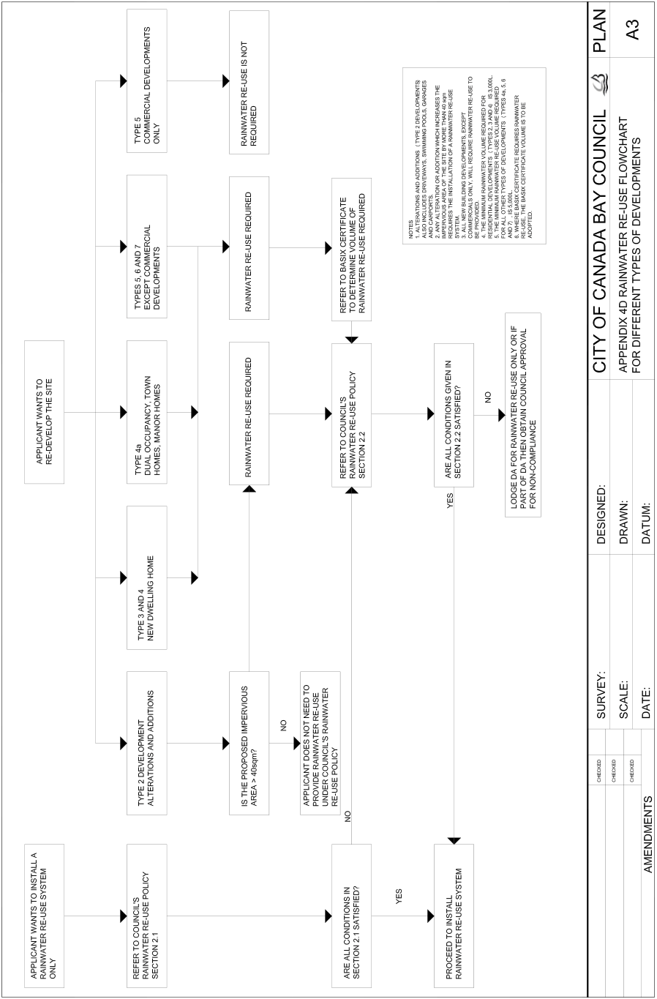

> [Picture on page 71: a picture, saved as a picture (images/appendix-02-engineering-specifications-page-71-2.gif, 150 dpi).]

#### Stormwater Management Type 2 Developments

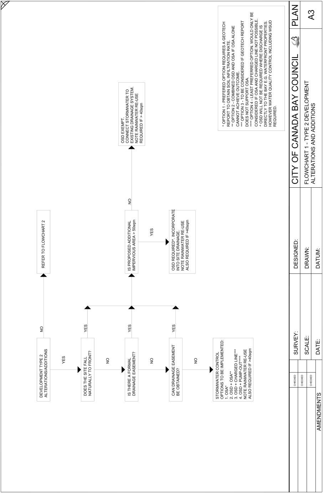

> [Picture on page 72: a picture, saved as a picture (images/appendix-02-engineering-specifications-page-72-2.gif, 150 dpi).]

#### Stormwater Management Type 3 to 9 Developments

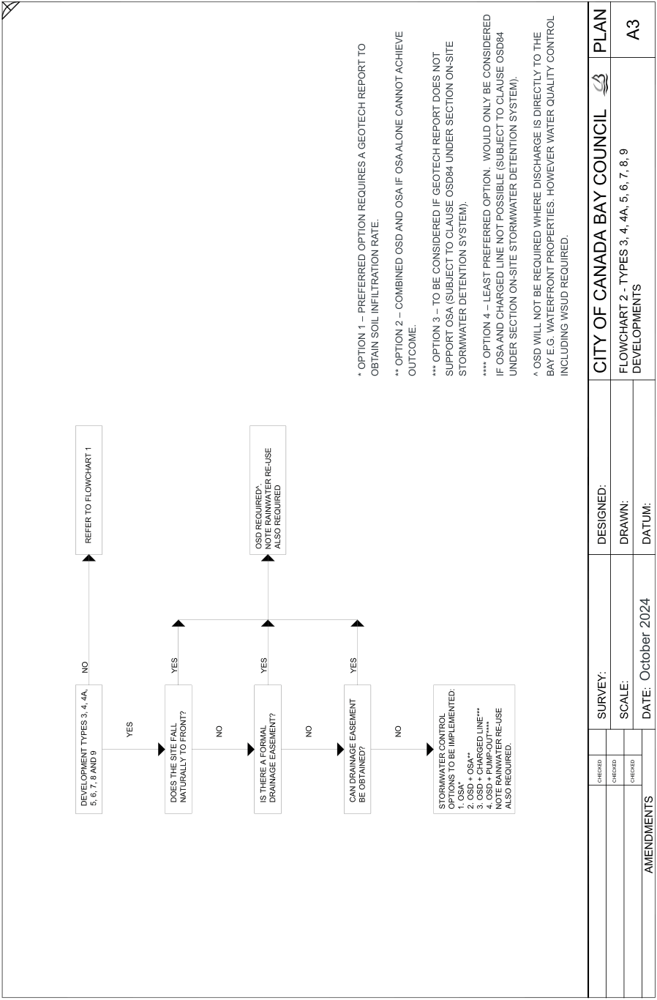

> [Picture on page 73: a picture, saved as a picture (images/appendix-02-engineering-specifications-page-73-2.gif, 150 dpi).]

| TO REPORT GEOTECH A REQUIRES OPTION RATE. PREFERRED INFILTRATION – SOIL 1 OPTION OBTAIN * | ACHIEVE CANNOT ALONE OSA IF OSA AND OSD COMBINED – 2 OPTION ** | OUTCOME. | NOT DOES REPORT GEOTECH IF CONSIDERED BE TO – 3 OPTION *** | ON-SITE SECTION UNDER OSD84 CLAUSE TO (SUBJECT OSA SUPPORT | SYSTEM). DETENTION STORMWATER | CONSIDERED BE ONLY WOULD OPTION. PREFERRED LEAST – 4 OPTION **** | OSD84 CLAUSE TO (SUBJECT POSSIBLE NOT LINE CHARGED AND OSA IF | SYSTEM). DETENTION STORMWATER ON-SITE SECTION UNDER | THE TO DIRECTLY IS DISCHARGE WHERE REQUIRED BE NOT WILL OSD ^ | CONTROL QUALITY WATER HOWEVER PROPERTIES. REQUIRED. WATERFRONT WSUD E.G. BAY INCLUDING |
|---|---|---|---|---|---|---|---|---|---|---|
|  |  |  |  |  |  |  |  |  |  | 2024 October |

#### Driveway and Ancillary Works

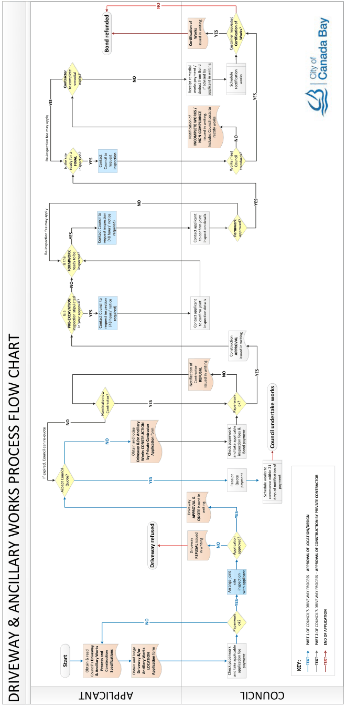

> [Picture on page 74: a map, saved as a picture (images/appendix-02-engineering-specifications-page-74-2.gif, 150 dpi); the street names and other small labels are on the picture.]
> Labels printed on the map (copied from the PDF, in no particular order):
> NO · YES · Works Works? · Certification of Certification of · issued in writing · Customer requested · Bond refunded · NO · works · works? · remedial · Schedule · Contractor · rectification · to complete · if advised by · Receipt remedial · works payment / · deduct from Bond applicant in writing · YES · YES · rectify works · Notification of issued in writing. NO · NON-COMPLIANCE · INCOMPLETE WORKS / Includes Council costs to · Re-inspection fee may apply · YES · FINAL · Council · request · Contact · Is the site Council to inspection · ready for a · standards? · inspection? · Works meet · YES · NO · required) · Formwork · approved? · to confirm joint · (48 hours’ notice · inspection details · Contact applicant · Contact Council to · request inspection · Re-inspection fee may apply · Is the · inspected? · ready to be · FORMWORK · NO · YES · Is a YES · required) · to confirm joint · (48 hours’ notice · inspection details · Contact applicant · In your approval? · PRE-EXCAVATION Contact Council to · request inspection · inspection stipulated · APPROVAL · Construction · issued in writing · YES · NO · REFUSAL · Contractor · Notification of issued in writing · ok? · YES · Paperwork · Contractor? · Nominate new · NO · NO · Council undertake works · Bond payment · Application form · Obtain and lodge · inspection fees & · Check paperwork · and take applicable · by Private Contractor · Works CONSTRUCTION · Driveway &/or Ancillary · If expired, Council can re-quote · YES · Quote · Quote? · Receipt payment payment · Accept Council · Schedule works to · commence within 21 · days of notification of · writing · Driveway · YES · APPROVAL & · QUOTE issued in · NO · Driveway in writing approved? · Application · REFUSAL issued · Driveway refused · site · inspection · Arrange joint with applicant · YES · NO · ok? · Paperwork · TEXT · PART 1 OF COUNCIL’S DRIVEWAY PROCESS – APPROVAL OF LOCATION/DESIGN · TEXT · PART 2 OF COUNCIL’S DRIVEWAY PROCESS – APPROVAL OF CONSTRUCTION BY PRIVATE CONTRACTOR · TEXT · END OF APPLICATION · Start · payment · LOCATION · Process and · KEY: · Construction · Specifications · Obtain & read · application fee · Driveway &/or · Ancillary Works Application form · Obtain and lodge · Check paperwork · & Ancillary Works · Council’s Driveway · and take applicable

### DRIVEWAY & ANCILLARY WORKS PROCESS FLOW CHART

#### APPLICANT

#### COUNCIL

#### Standard Engineering Drawings

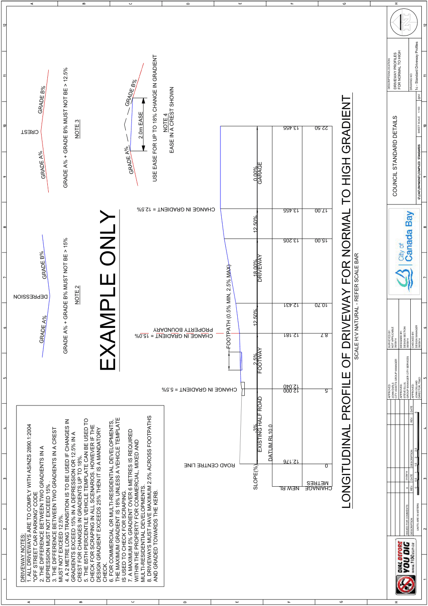

> [Picture on page 75: a picture, saved as a picture (images/appendix-02-engineering-specifications-page-75-2.gif, 150 dpi).]

Development Control Plan

Appendix 2 Engineering Specifications

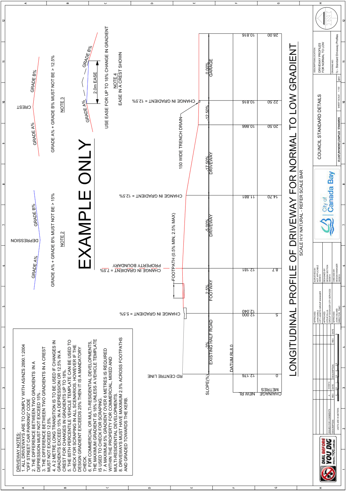

> [Picture on page 76: a picture, saved as a picture (images/appendix-02-engineering-specifications-page-76-3.gif, 150 dpi).]

Development Control Plan

Appendix 2 Engineering Specifications

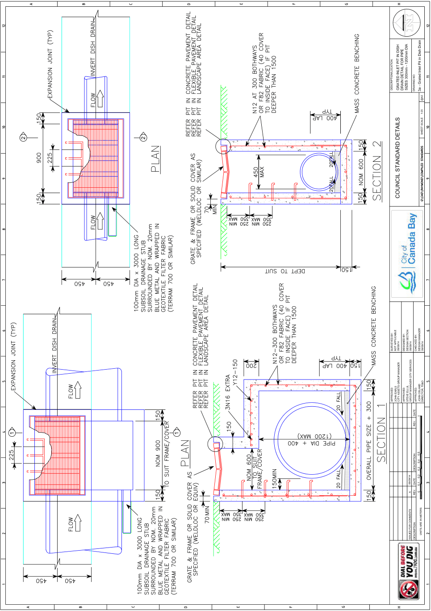

> [Picture on page 77: a picture, saved as a picture (images/appendix-02-engineering-specifications-page-77-3.gif, 150 dpi).]

Development Control Plan

Appendix 2 Engineering Specifications

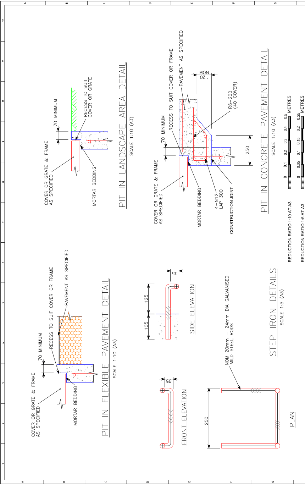

> [Picture on page 78: a picture, saved as a picture (images/appendix-02-engineering-specifications-page-78-3.gif, 150 dpi).]

Development Control Plan

Appendix 2 Engineering Specifications

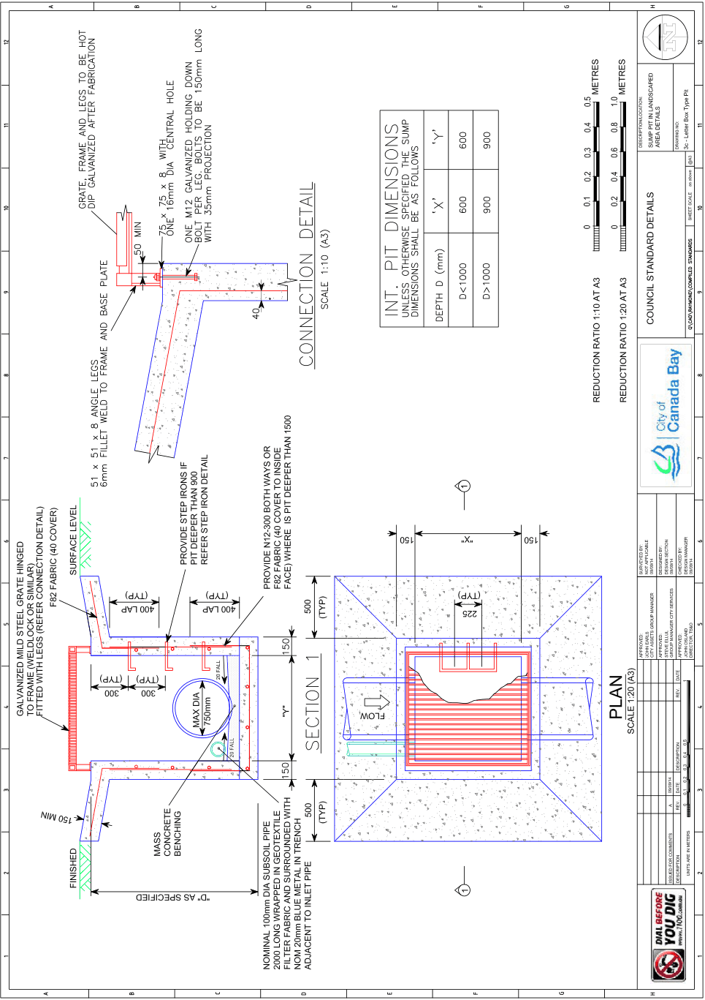

> [Picture on page 79: a picture, saved as a picture (images/appendix-02-engineering-specifications-page-79-3.gif, 150 dpi).]

Development Control Plan

Appendix 2 Engineering Specifications

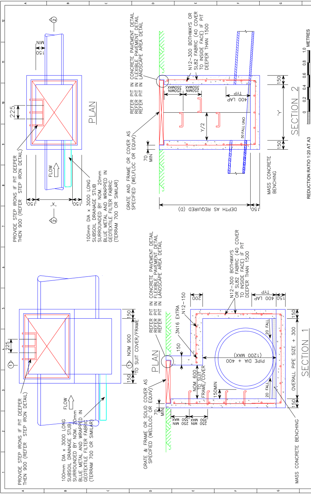

> [Picture on page 80: a picture, saved as a picture (images/appendix-02-engineering-specifications-page-80-3.gif, 150 dpi).]

Development Control Plan

Appendix 2 Engineering Specifications

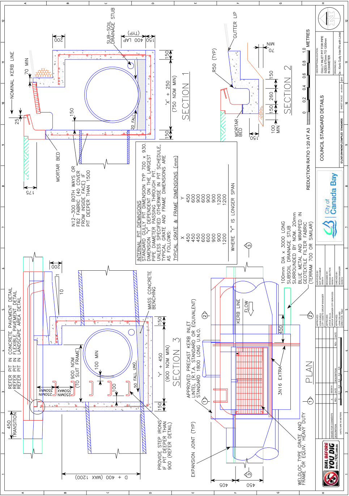

> [Picture on page 81: a picture, saved as a picture (images/appendix-02-engineering-specifications-page-81-3.gif, 150 dpi).]

Development Control Plan

Appendix 2 Engineering Specifications

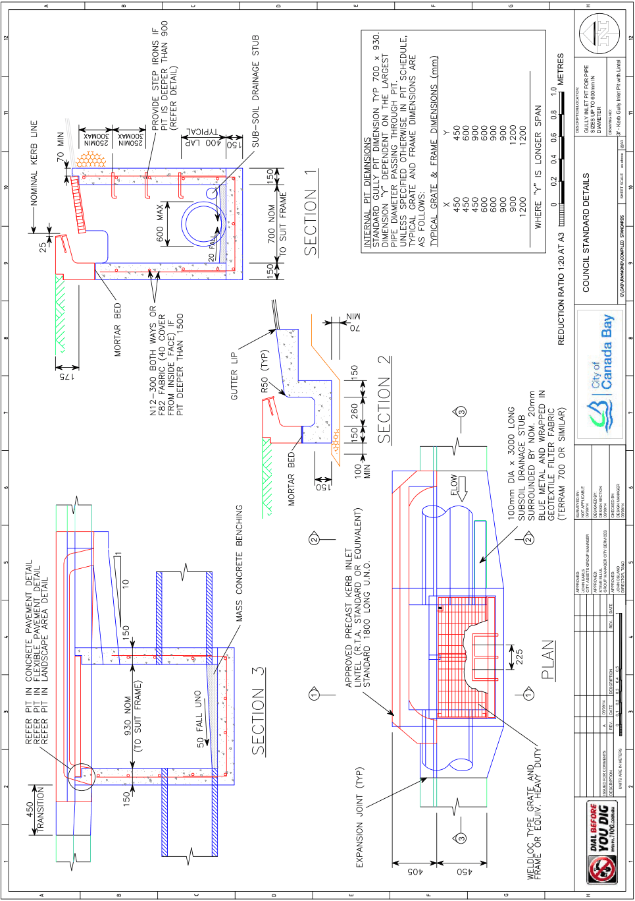

> [Picture on page 82: a picture, saved as a picture (images/appendix-02-engineering-specifications-page-82-3.gif, 150 dpi).]

Development Control Plan

Appendix 2 Engineering Specifications

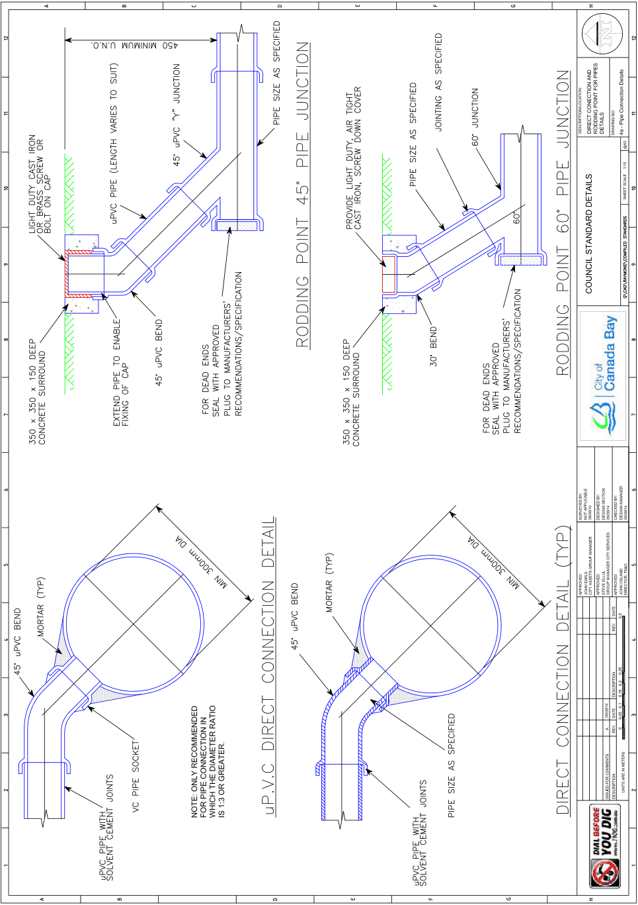

> [Picture on page 83: a picture, saved as a picture (images/appendix-02-engineering-specifications-page-83-3.gif, 150 dpi).]

Development Control Plan

Appendix 2 Engineering Specifications

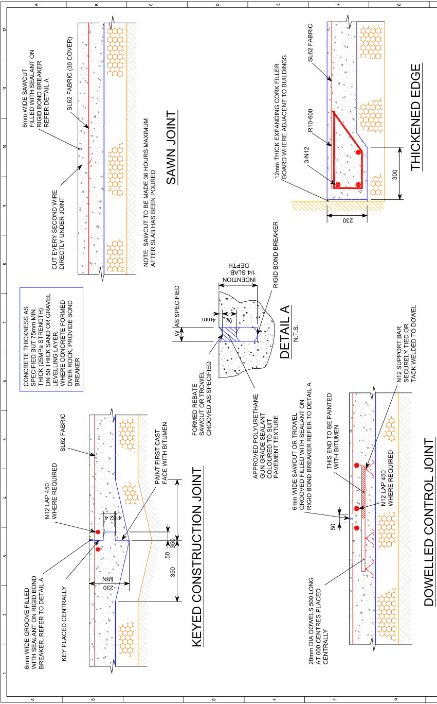

> [Picture on page 84: a picture, saved as a picture (images/appendix-02-engineering-specifications-page-84-3.gif, 150 dpi).]

Development Control Plan

Appendix 2 Engineering Specifications

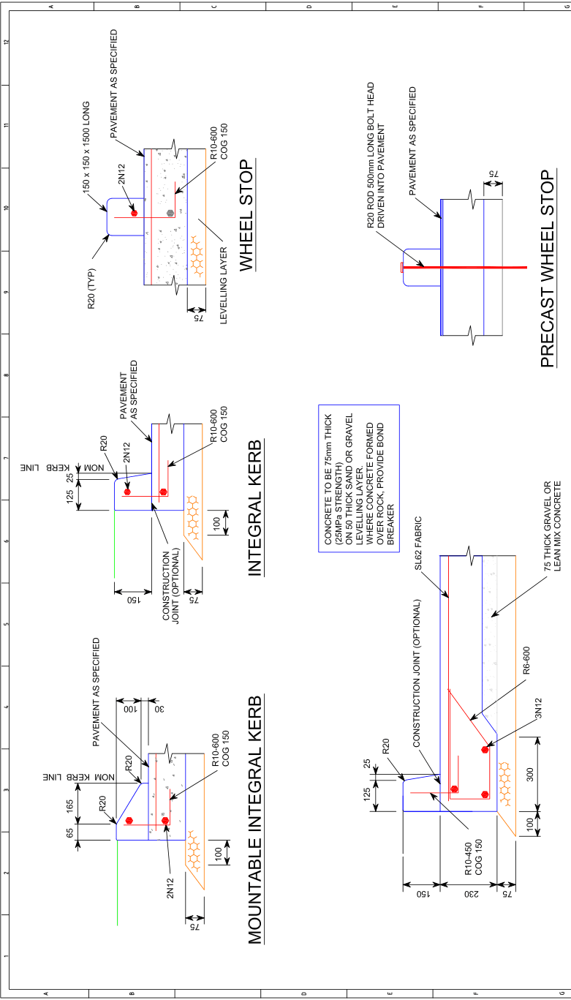

> [Picture on page 85: a picture, saved as a picture (images/appendix-02-engineering-specifications-page-85-3.gif, 150 dpi).]

Development Control Plan

Appendix 2 Engineering Specifications

> [Picture on page 86: a picture, saved as a picture (images/appendix-02-engineering-specifications-page-86-3.gif, 150 dpi).]

Development Control Plan

Appendix 2 Engineering Specifications

Development Control Plan

Appendix 2 Engineering Specifications

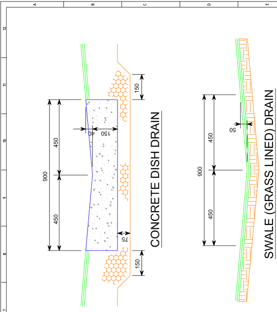

> [Picture on page 88: a picture, saved as a picture (images/appendix-02-engineering-specifications-page-88-3.gif, 150 dpi).]

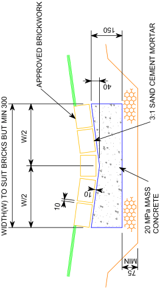

> [Picture on page 88: a picture, saved as a picture (images/appendix-02-engineering-specifications-page-88-4.gif, 150 dpi).]

Development Control Plan

Appendix 2 Engineering Specifications

Development Control Plan

Appendix 2 Engineering Specifications

#### This page was intentionally left blank
