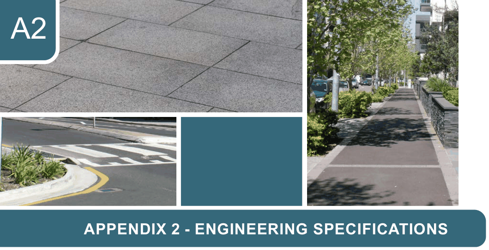

# Canada Bay Development Control Plan - Appendix 2 Engineering Specifications

> This chapter is split into 4 section file(s), one per numbered heading, in the order they appear in the PDF.

Source PDF: [ECM_7719488_v5_CCB-DCP-15 - Appendix-2 - Engineering Specifications.pdf](ECM_7719488_v5_CCB-DCP-15%20-%20Appendix-2%20-%20Engineering%20Specifications.pdf)

> [Picture on page 1: a picture, saved as a picture (images/appendix-02-engineering-specifications-page-1-1.gif, 150 dpi).]

### A2

### APPENDIX 2 - ENGINEERING SPECIFICATIONS

ES1  Road and Footpath Works.........................................................................................A2-2 Footway.........................................................................................................................A2-3 Footpath ........................................................................................................................A2-5 Kerb and Gutter.............................................................................................................A2-7 Road Carriageway ........................................................................................................A2-8 Ancillaries......................................................................................................................A2-9

ES2  Vehicular Access ......................................................................................................A2-12 Statutory and Design Requirements ........................................................................... A2-12

ES3  Stormwater Management ........................................................................................A2-21 On-site Stormwater Detention Systems...................................................................... A2-24 On-site Stormwater Absorption Systems .................................................................... A2-33 Charged Systems........................................................................................................A2-34 Mechanical Pump-out Systems...................................................................................A2-36 Scouring, Erosion and Water Quality Control ............................................................. A2-38 Rainwater Re-use .......................................................................................................A2-40 Stormwater Drainage Design......................................................................................A2-41 Stormwater Pollution and Erosion Control.................................................................. A2-54 Water Sensitive Urban Design....................................................................................A2-55 Document Submission ................................................................................................A2-57

ES4  Appendices ...............................................................................................................A2-62 Terms of Positive Covenant ....................................................................................... A2-62 Restriction on the Use of Land .................................................................................. A2-65 Rhodes Peninsula Site Specific Requirements........................................................... A2-67 Strathfield Triangle Site Specific Requirements.......................................................... A2-70 Flow Charts Rainwater Reuse ....................................................................................A2-71 Stormwater Management Type 2 Developments........................................................ A2-72 Stormwater Management Type 3 to 9 Developments ................................................A2-73 Driveway and Ancillary Works .................................................................................... A2-74 Standard Engineering Drawings .................................................................................A2-75

<!-- sections -->
## Sections

1. [ES1 Road and Footpath Works](01-es1-road-and-footpath-works.md)
2. [ES2 Vehicular Access](02-es2-vehicular-access.md)
3. [ES3 Stormwater Management](03-es3-stormwater-management.md)
4. [ES4 Appendices](04-es4-appendices.md)
