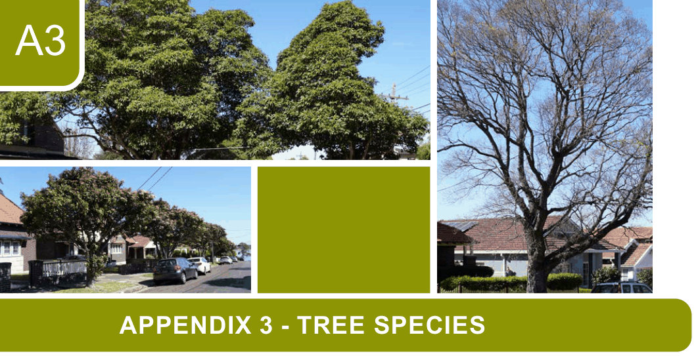

# Canada Bay Development Control Plan - Appendix 3 Tree Species

> This chapter is split into 3 section file(s), one per main heading, in the order they appear in the PDF.

Source PDF: [CCB-DCP-16_Appendix-3-Tree-Species.pdf](CCB-DCP-16_Appendix-3-Tree-Species.pdf)

> [Picture on page 1: a picture, saved as a picture (images/appendix-03-tree-species-page-1-1.gif, 150 dpi).]

### A3

### APPENDIX 3

### APPENDIX 3 - TREE SPECIES

TS.1  Locally native flora for landscaped areas ........................................................... A3-2 TS.2  Locally native trees for replacement planting ..................................................... A3-5 TS.3  Native and exotic trees for replacement planting ............................................... A3-7

<!-- sections -->
## Sections

1. [TS.1  Locally native flora for landscaped areas](01-ts-1-locally-native-flora-for-landscaped.md)
2. [TS.2  Locally native trees for replacement planting](02-ts-2-locally-native-trees-for.md)
3. [TS.3  Native and exotic trees for replacement planting](03-ts-3-native-and-exotic-trees-for.md)
