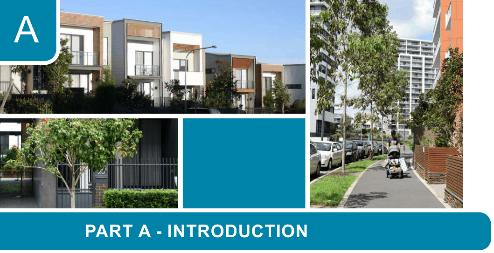

# Canada Bay Development Control Plan - Part A Introduction

> This chapter is split into 8 section file(s), one per numbered heading, in the order they appear in the PDF.

Source PDF: [ECM_7719475_v3_CCB-DCP-02_Part-A-Introduction_v2022-05-16.pdf](ECM_7719475_v3_CCB-DCP-02_Part-A-Introduction_v2022-05-16.pdf)

> [Picture on page 1: a picture, saved as a picture (images/part-a-introduction-page-1-1.gif, 150 dpi).]

### A

### PART A - INTRODUCTION

A1  Introduction........................................................................................................................A-2

A1.1  DCP name and commencement ........................................................................... A-2

A1.2  The purpose of this Development Control Plan .................................................... A-2

A1.3  Savings and transitional arrangements................................................................. A-2

A1.4  Land covered by this Plan..................................................................................... A-2

A1.5  Relationship of this DCP to the LEP...................................................................... A-2

A1.6  Aims of this DCP....................................................................................................A-2

A1.7  Relationship to other documents........................................................................... A-3

A1.8  Background information on this document............................................................ A-4

<!-- sections -->
## Sections

1. [A1.1 DCP name and commencement](01-a1-1-dcp-name-and-commencement.md)
2. [A1.2 The purpose of this Development](02-a1-2-the-purpose-of-this-development.md)
3. [A1.3 Savings and transitional](03-a1-3-savings-and-transitional.md)
4. [A1.4 Land covered by this Plan](04-a1-4-land-covered-by-this-plan.md)
5. [A1.5 Relationship of this DCP to the LEP](05-a1-5-relationship-of-this-dcp-to-the-lep.md)
6. [A1.6 Aims of this DCP](06-a1-6-aims-of-this-dcp.md)
7. [A1.7 Relationship to other documents](07-a1-7-relationship-to-other-documents.md)
8. [A1.8 Background information on this](08-a1-8-background-information-on-this.md)
