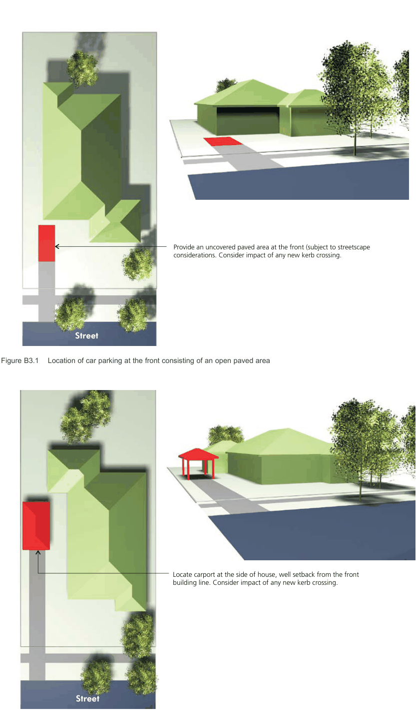
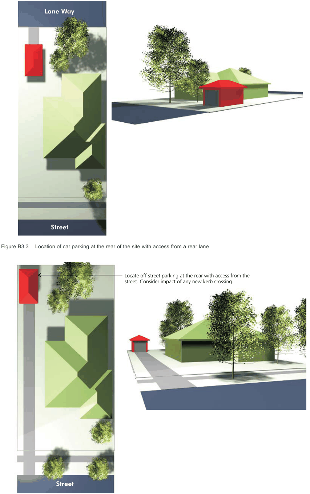

#### B3.2  Single Dwellings, Semi-Detached

#### Dwellings and Dual Occupancies

| Controls |  |
|---|---|
| C1. | A landscaped area at least 0.6m wide (1m preferred) is to be provided between a driveway and a side boundary. |
| C2. | Garages for each dwelling within an attached dual occupancy should be single fronted only. |

#### Car spaces Controls

C3. For existing and new dwellings, a garage or carport in order of priority should be:

a) Located at the rear of the site with access from a rear lane;

b) Located at the rear of the site with access from the street frontage; and

c) Located at the side of the dwelling house, behind the front building alignment.

d) Located in a basement with access from a rear lane;

e) Located in a basement with access from the street frontage.

#### Hardstand Controls

C4. Where a garage/carport cannot be provided at the side or rear of a dwelling house or semi, a hardstand area forward of the building alignment which is integrated into the landscape character of the front yard may be considered by Council. The distance between the front property boundary and building is to be a minimum of 5.5m.

New detached garages and carports to

existing dwellings

| Controls |  |
|---|---|
| C5. | Locate detached garages and carports either at the rear of the site where rear access is available or between the side elevation and the side property boundary. Note: Rear and side access is considered available where there is an existing side boundary setback of 2.6 metres or more or where there is rear lane or secondary street access. |
| C6. | No outdoor spaces are permitted on garage roofs, such as terraces, patio, gardens and the like. |

#### Carports

| Controls |  |
|---|---|
| C7. | Council may consider a carport forward of the front building alignment where: a) It is a single carport with an external width of no more than 3.0 metres; b) The site is of a sufficient width that the carport will not obscure the existing building; c) The distance between the building and the front property boundary is a minimum of 5.5 metres; d) It is of a simple post design, with no side panel infill; is not elaborate in its decoration and colour and does not detract from the existing building; e) There is no solid panel lift or roller shutter door proposed; f) Does not significantly affect the landscaped front garden; g) Is within a varied visual catchment that currently has carports forward of the building alignment; h) The roof is either flat or of a pitch that relates to the existing house; i) The views of the house from the public domain will not be adversely affected; and j) There is no rear lane access or side access of 2.6 metres or more available. k) Where existing car parking is available, no new structures are permitted forward of the building line. |

#### Access Aisles Controls

| C8. | A 4.0 metre wide access handle is to be provided to detached dual occupancy development to enable access to the rear dwelling. |
|---|---|

> [Picture on page 16: a picture, saved as a picture (images/part-b-general-controls-page-16-1.gif, 150 dpi).]
> Words printed on the picture (title and legend, copied from the PDF):
> Provide an uncovered paved area at the front (subject to streetscape
> considerations. Consider impact of any new kerb crossing.
> Illustration 5.32 Location at the front consisting of an open paved
> area
> Street

© www.

2009 | integrated solutions.com.au

design

> Words printed on the picture (title and legend, copied from the PDF):
> Figure B3.1 Location of car parking at the front consisting of an open paved area
> Locate carport at the side of house, well setback from the front
> building line. Consider impact of any new kerb crossing.
> Illustration 5.33 Location at the side behind the front alignment
> 2009 | integrated solutions.com.au

Figure B3.2 Location of car parking at the side behind the front alignment

> [Picture on page 17: a picture, saved as a picture (images/part-b-general-controls-page-17-1.gif, 150 dpi).]
> Words printed on the picture (title and legend, copied from the PDF):
> Lane Way
> Illustration 5.34 Location of car parking at the rear of the site
> with access from a rear lane
> © www.
> 2009 | integrated solutions.com.au
> design
> Street

Figure B3.3 Location of car parking at the rear of the site with access from a rear lane

> Words printed on the picture (title and legend, copied from the PDF):
> Locate off street parking at the rear with access from the
> street. Consider impact of any new kerb crossing.
> Illustration 5.35 Location of car parking at the rear of a site with
> access from street frontage
> 2009 | integrated solutions.com.au

Figure B3.4 Location of car parking at the rear of the site with access from street frontage

B3.3  Multi-dwelling housing, multi dwelling housing (terraces), manor houses and

#### residential flat buildings.

#### Car spaces Controls

C1. For existing and new development the location of a garage or carport, in order of high to low priority, is to be:

a) Located in a basement with access from a rear lane;

b) Located at the rear of the site with access from a rear lane;

c) Located in a basement with access from the street frontage;

d) Located at the rear of the site with access from the street frontage; and

e) Located at the side of the development, behind the front building alignment.

C2. All multi unit development and residential flat buildings should ensure that all vehicle parking is behind the building line and arranged so that all vehicles may be driven in a forward direction during both ingress and egress from the site.

C3. Car Share schemes, carpark decoupling and the like should be utilised wherever possible to reduce the amount of on-site carparking.
