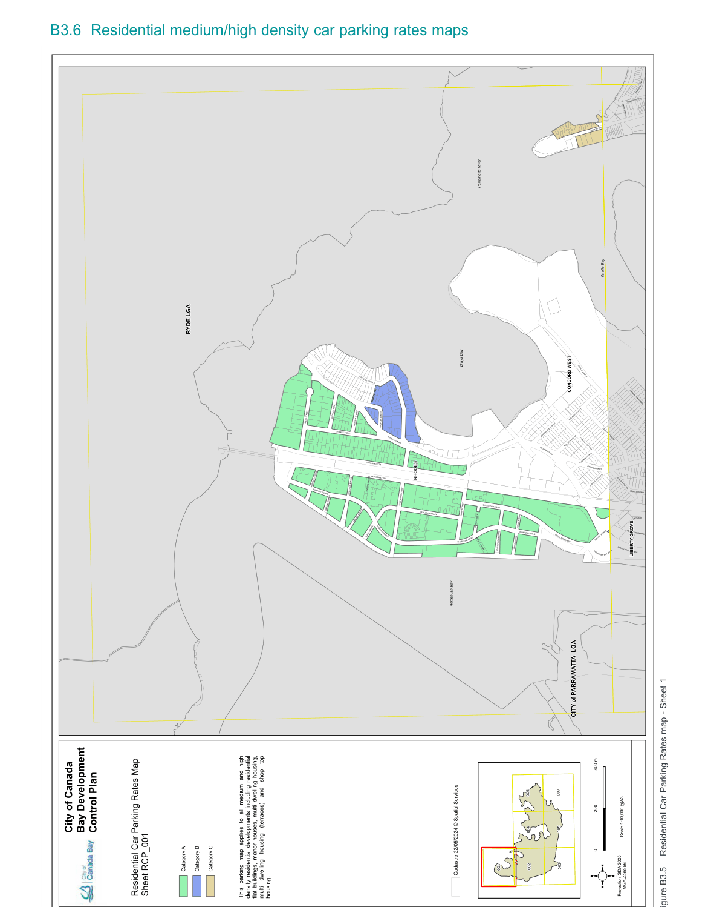

#### B3.5  Residential medium/high density car parking rates

Residential parking requirements - Residential flat buildings, Manor houses, Multi dwelling housing,

#### Multi dwelling housing (terraces) and Shop top housing

Table B-C Residential parking requirements (medium/high density) - Residential flat buildings, Manor houses,

#### Multi dwelling housing, Multi dwelling housing (terraces) and Shop top housing

Residential Parking Category A The following parking rates apply to any residential flat buildings, multi dwelling housing or shop top housing on any land parcel wholly or partly located within Category A on the Residential (Medium/High Density) Car Parking Rates Map.

| Resident parking |  |
|---|---|
| Number of bedrooms per dwelling | Maximum number of car parking spaces |
| Studio | 0.6 |
| 1 | 0.6 |
| 2 | 0.9 |
| 3 + | 1.4 |
| Visitor parking |  |
| Number of dwellings | Maximum number of car parking spaces |
| Any | 1 space per 7 dwellings |

Note: Category A generally applies to residential development located within the following areas:

• Rhodes West and Rhodes East Table B-C Residential Parking Requirements Additional Information

1\) Any parking in excess of the above requirements will be counted as Gross Floor Area (GFA) (refer to definition in Canada Bay LEP).

2\) In calculating the total number of car parking spaces required for a development, the total should:

a) Be rounded up if the fraction of the total calculation is equal or more than half (0.5 of a space); and

b) Include a room that is capable of being converted to a bedroom (it has a minimum internal area of 12sqm and includes a window).

3\) Refer to Residential (Medium/High Density) Car Parking Rates Map (Figure B3.5 to Figure B3.11) to understand where the above car parking requirements apply.

4\) If a site falls within Category C and also Category A or B then the Category C parking requirements will prevail.

5\) If a site falls within Category D and also Category A or B then the Category D parking requirements will prevail.

6\) If there is a discrepancy between Category C and the Parramatta Road Corridor Urban Transformation Strategy then the Parramatta Road Corridor Urban Transformation Strategy parking requirements will prevail.

Residential Parking Category B The following parking rates apply to any residential flat buildings, manor houses, multi dwelling housing, multi dwelling housing (terraces) or shop top housing on any land parcel wholly or partly located within Category B on the Residential Car Parking Rates Map.

| Resident parking |  |
|---|---|
| Number of bedrooms per dwelling | Maximum number of car parking spaces |
| Studio | 0.3 |
| 1 | 0.5 |
| 2 | 0.9 |
| 3 | 1.2 |
| Visitor parking |  |
| Number of dwellings | Maximum number of car parking spaces |
| Any | 0.1 spaces per dwelling |

Note: Category B generally applies to residential development located within the following areas:

• Homebush TOD Precinct (Accelerated TOD Precinct)

• Parramatta Road Corridor Urban Transformation Strategy

• MU1 Mixed Use zone

• Within 400m of a MU1 Mixed Use zone

• Within 800m of a railway or metro station

Residential Parking Category C The following parking rates apply to any residential flat buildings, manor houses, multi dwelling housing, multi dwelling housing (terraces) or shop top housing on any land parcel wholly or partly located within Category C on the Residential Car Parking Rates Map.

| Resident parking |  |
|---|---|
| Number of bedrooms per dwelling | Maximum number of car parking spaces |
| 0 - 1 | 1 |
| 2 | 1 |
| 3 | 1.5 |
| 4 + | 2 |
| Visitor parking |  |
| Number of dwellings | Maximum number of car parking spaces |
| Any | 1 space per 5 dwellings |

Note: Category C generally applies to residential development located within the following areas that are not within Category A or B:

• E1 Local Centre zone

• E3 Productivity Support zone

• R1 General Residential zone

• R3 Medium Density Residential zone

• R4 High Density Residential zone

> [Picture on page 22: a picture, saved as a picture (images/part-b-general-controls-page-22-1.gif, 150 dpi).]
> Words printed on the picture (title and legend, copied from the PDF):
> Figure B3.5
> Residential Car Parking Rates map - Sheet 1
