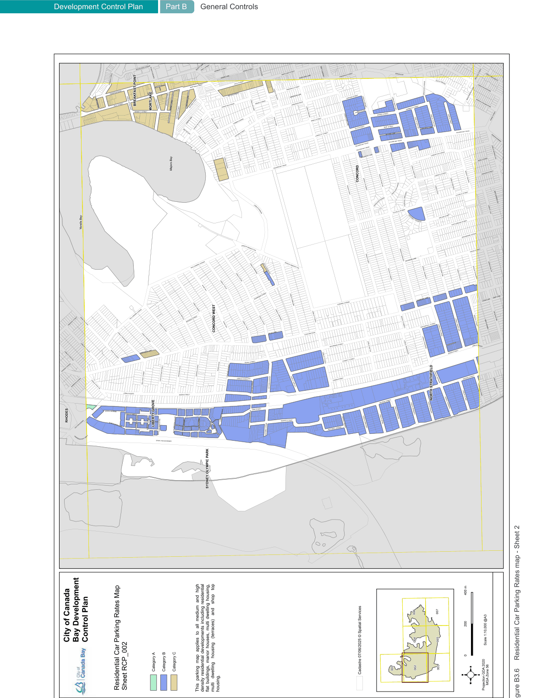
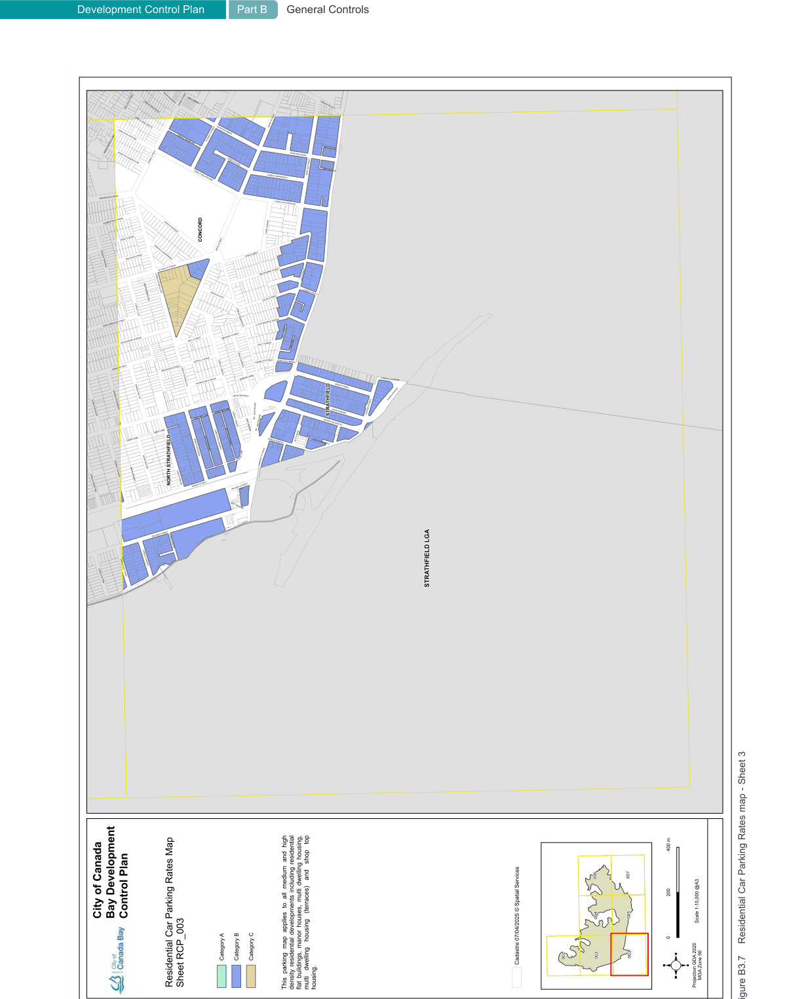
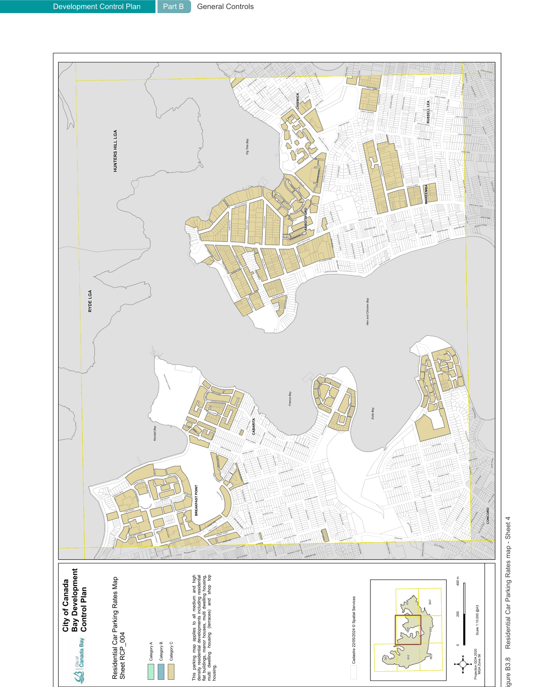
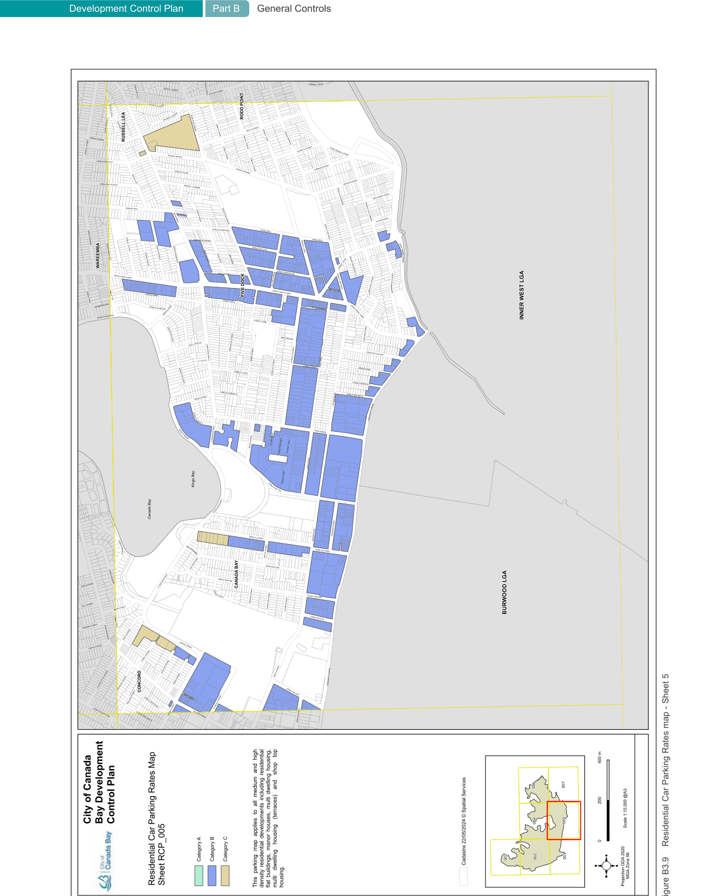
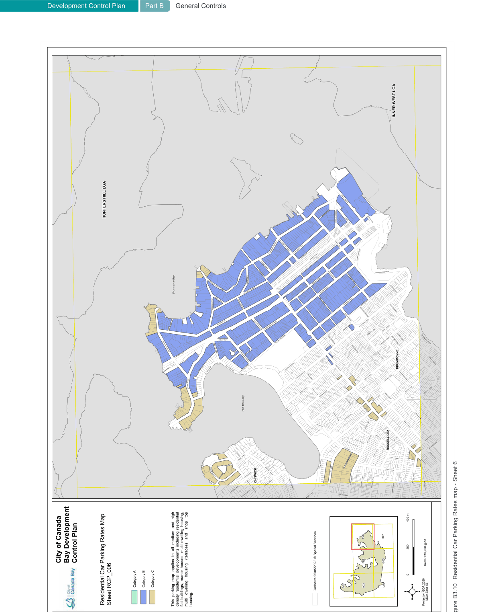
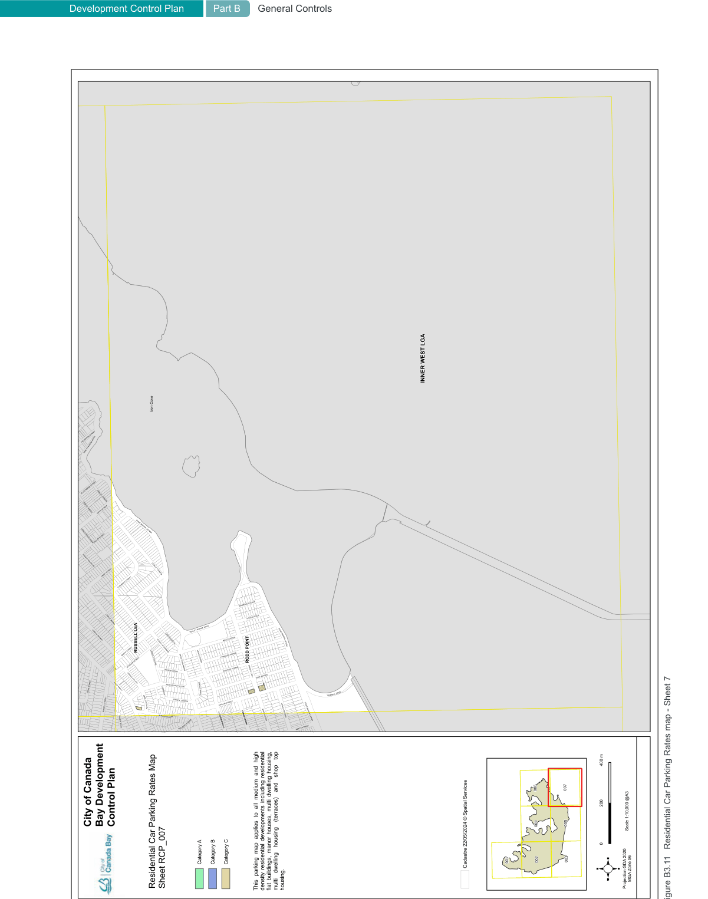

#### B3.6  Residential medium/high density car parking rates maps

> [Picture on page 23: a picture, saved as a picture (images/part-b-general-controls-page-23-1.gif, 150 dpi).]
> Words printed on the picture (title and legend, copied from the PDF):
> Development Control Plan
> Part B General Controls
> Figure B3.6
> Residential Car Parking Rates map - Sheet 2

> [Picture on page 24: a picture, saved as a picture (images/part-b-general-controls-page-24-1.gif, 150 dpi).]
> Words printed on the picture (title and legend, copied from the PDF):
> Development Control Plan
> Part B General Controls
> Figure B3.7
> Residential Car Parking Rates map - Sheet 3

> [Picture on page 25: a picture, saved as a picture (images/part-b-general-controls-page-25-1.gif, 150 dpi).]
> Words printed on the picture (title and legend, copied from the PDF):
> Development Control Plan
> Part B General Controls
> Figure B3.8
> Residential Car Parking Rates map - Sheet 4

> [Picture on page 26: a picture, saved as a picture (images/part-b-general-controls-page-26-1.gif, 150 dpi).]
> Words printed on the picture (title and legend, copied from the PDF):
> Development Control Plan
> Part B General Controls
> Figure B3.9
> Residential Car Parking Rates map - Sheet 5

> [Picture on page 27: a picture, saved as a picture (images/part-b-general-controls-page-27-1.gif, 150 dpi).]
> Words printed on the picture (title and legend, copied from the PDF):
> Development Control Plan
> Part B General Controls
> Figure B3.10 Residential Car Parking Rates map - Sheet 6

> [Picture on page 28: a picture, saved as a picture (images/part-b-general-controls-page-28-1.gif, 150 dpi).]
> Words printed on the picture (title and legend, copied from the PDF):
> Development Control Plan
> Part B General Controls
> Figure B3.11 Residential Car Parking Rates map - Sheet 7
