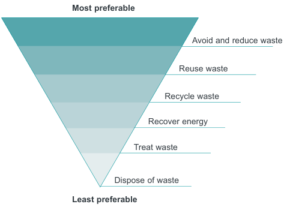

### B4  Waste Management

#### Objectives

O1. Assist in achieving Federal and State Government waste minimisation targets in accordance with regional waste plans.

O2. Minimise overall environmental impacts of waste and foster the principles of ecologically sustainable development (ESD). O3. Facilitate source separation and provide design standards that complement waste collection and management services offered by Council and private service providers. O4. Manage waste in accordance with the Waste Hierarchy to:

i) Avoid producing waste in the first place;

ii) Minimise the amount of waste produced;

iii) Re-use waste materials wherever possible;

iv) Recycle once re-use options have been exhausted; and

v) Dispose of what is left, as a last resort, in a responsible way to appropriate waste disposal facilities;

O5. Ensure waste management systems are effective, efficient, convenient and safe for residents and waste collection personnel.

#### Most preferable

> [Picture on page 45: a picture, saved as a picture (images/part-b-general-controls-page-45-27.gif, 150 dpi).]
> Words printed on the picture (title and legend, copied from the PDF):
> Avoid and reduce waste
> Reuse waste
> Recycle waste
> Recover energy
> Treat waste
> Dispose of waste

#### Least preferable

Waste Hierarchy diagram
