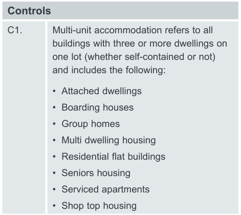

#### B4.3  Multi-unit Dwelling Residential

#### Development

> [Picture on page 47: a picture, saved as a picture (images/part-b-general-controls-page-47-6.gif, 150 dpi).]

#### Controls

C1. Multi-unit accommodation refers to all buildings with three or more dwellings on one lot (whether self-contained or not) and includes the following:

• Attached dwellings

• Boarding houses

• Group homes

• Multi dwelling housing

• Residential flat buildings

• Seniors housing

• Serviced apartments

• Shop top housing

#### Bin Allocation

| Controls |  |
|---|---|
| C2. | Multi-unit dwellings may be permitted to have allocated one set of bins per dwelling, on approval by council, in accordance with the following: Allocated 1x 120L Waste Bin (1 per dwelling), 1 x 240L Recycling Bin (1 per dwelling, collected fortnightly) and 1 x 240L Garden Organics (Food Organics/ Garden Organics bin)*. *future proofing |

#### Controls

Approval for allocation of one set of bins per dwelling will only be permitted where:

• Each dwelling has direct access at ground level

• Bin storage is provided at each dwelling, and the bin storage location is specified on the application.

• A kerbside presentation point is nominated on the application

• The space required for presentation at kerb does not exceed one-third of the width of the property frontage

• Kerbside collection activity does not create an obstruction of the pathway or roadway or cause an illegal hazard

• Kerbside presentation point is to be located so as to minimise the impacts from noise and odour during collection

• The path for wheeling bins between each and every dwelling bin storage location and the kerbside presentation point is a maximum of 30m and does not exceed a grade of 1:14 at any point.

C3. In all other cases, multi-unit dwellings with less than 20 dwellings are to provide storage space for waste, recyclables and garden organics / food organics in accordance with the following:

Either:

Allocated 1x 240L Waste Bin (per 2 residential units), 1 x 240L Recycling Bin (per 2 residential units) and 1 x 240L Organics/ Food Organics Bin* (per 10 residential units up to a maximum of 20 residential units). *future proofing

Or:

Allocated 660L or 1100L bins, in accordance with waste generation requirements.

C4. In multi-unit dwelling residential development containing 20 or more dwellings, a bulk waste and recycling collection service is required. Council supplies 660L and 1100L bulk recycling and waste bins.

#### Waste Collection and Vehicle Access Controls

C5. Presentation to kerb

Presentation to kerb is only permitted where council approval has been provided for one set of bins per dwelling, as per the Bin Allocation section above.

Presentation to kerb will only be permitted where:

• A kerbside presentation point is nominated on the application

• The space required for presentation at kerb does not exceed one-third of the width of the property frontage

• Kerbside collection activity does not create an obstruction of the pathway or roadway or cause a hazard

• Kerbside collection point is to be located so as to minimise the impacts from noise and odour during collection

• The path for wheeling bins between dwelling storage and the kerbside collection point is a maximum of 30m and does not exceed a grade of 1:14 at any point.

#### Controls

C6. On-Site Collection

All multi-unit dwellings that are not approved for ‘presentation to kerb’ or ‘collect and return’ collection must provide on-site collection for Council vehicles, where the collection vehicle enters the property and services the development within the property boundary from a designated loading area.

A nominated collection point must be designated where waste, recyclables and garden organics are loaded onto the collection vehicle. The location of the nominated collection point is to be illustrated on the DA plans.  Nominated collection points are to be located, in order of preference:

1\) In the building’s basement

2\) At grade within the building in a dedicated collection or loading bay The nominated collection point is required to be within 15m of the bin presentation

area. Note that all bins for collection must be located in the bin presentation area prior to collection (see ‘Bin Storage Areas’ for further details).

The nominated collection point is to be level, free of obstructions and with sufficient height clearance to enable the safe mechanical pick up and set down of bins.

In all cases, vehicles will enter and exit the premises in a forward direction. The following allowances are required for collection vehicle access:

• An unimpeded minimum vertical clearance of 4.5 metres throughout the entire onsite approach, including clearances of all ducts, pipes and other services

• A minimum width of driveway of 3.6 m

• A minimum turning circle radius as per the vehicle dimensions provided, or provision for changing the facing direction of a waste or recycling collection vehicle.

• The grades of entry and exit ramps must not exceed the capabilities of the waste collection vehicle compliant with

AS2890.2 Parking Facilities: Off-Street Commercial Vehicle Facilities. A swept path analysis must be provided with the application demonstrating that paths of vehicles travelling in the forward direction when negotiating access driveways and circulation roadways can be accommodated within the proposed development. Swept path analysis must also be used to establish that sufficient width is provided for the vehicle swept path, including manoeuvring clearances.

The following must be provided in a swept path analysis:

• Details of road geometry (details dimension of the driveway, width of the road (carriage way), footpath, kerb and gutter, median and on-street parking where applicable.)

• Dimension details of the design vehicle

• Turning radius and operable speed

• Three clear swept paths line namely wheel path, vehicle body path and 0.6m clearance path.

#### Controls

C7. Where collection staff or collection vehicles are required to enter a site a Servicing Agreement will be required to be entered into with Council giving power and authority to Council collectors to enter the site for the purpose of waste services.

C8. Collect and Return Collection

If the requirements for onsite-collection cannot be met for multi dwelling housing with 20 or less units, Council may consider a Collect and Return collection service (also known as a wheel-out wheel-in service). The Collect and Return service involves Council’s waste collection vehicle parking at a designated kerbside collection point, parallel to kerbside (see collection vehicle dimensions above). Collection staff will enter the bin storage area on foot and collect waste, recycling or garden organics* bins. The bins are wheeled to the rear of the vehicle to be emptied. Once emptied the bins are placed back within the bin storage area and the driver leaves the development. (*food organics)

The following design elements must be demonstrated in order for Council to approve a collect and return collection.

• Communal bin storage area large enough to accommodate all bins assigned to the development.

• Maximum walking distance from the front of each and every dwelling to the communal bin storage area is not to exceed 30m (excluding travel via lift)

• The access pathway for wheeling bins between the bin storage area and kerbside collection point is to be level and free of steps.

• The maximum manual handling distance between the bin storage area and kerbside collection point is 15m.

• The bin storage area is constructed to allow physical separation from the bulky household waste area.

• Minimum doorway width of 1400 mm.

• The location of the proposed kerbside collection point is to be illustrated on the DA plans, and is to be level, free of obstructions and with sufficient height clearance to enable the safe mechanical pick up and set down of bins.

Kerbside collection points should not be located:

• near intersections;

• near roundabouts or slow-points;

• along busy arterial roads;

• in narrow lanes;

• near possible obstructions, including trees, overhanging buildings, and overhead powerlines; or

• where they pose a traffic hazard. On approval from Council, bin storage areas may be locked via a PIN lock in order to reduce access by non-residents. The PIN code must be provided to council two weeks prior to the first service occurring. Any changes to the PIN code or access must be notified to council 24 hours prior.

All lockable doors and gates, both pedestrian and vehicular, that are required to be opened by Council’s waste collection contractor in the provision of waste collection services, must be able to be opened using a pin code. That is, locks requiring keys, remote controls, key fobs

etc. are not acceptable.

#### Controls

C9. Truck Turntables

Turntables provide for the safe exit of vehicles in a forward direction where space is limited.

Any development that is seeking to utilise turntables needs to demonstrate compliance with the required dimensions for a 12.5m HRV vehicle (provided for a standard heavy rigid vehicle as identified in Australian Standard 2890.2:2018): including the diameter for the turntable and required clearance heights and width.

In addition, the following needs to be addressed:

a) If a vehicle turntable is used, it is to have a minimum 30 tonne capacity.

b) The use of the turntable is always to be available to Council’s waste collection vehicles

c) The installation, operation and on-going servicing is to be at no cost to Council

d) Establishment of a sinking fund contribution by the developer to ensure the turntable continues to work and property has funds up front to fund repairs once operational.

e) A servicing, maintenance and inspection plan are to be prepared by the service provider, before the Occupation Certificate is issued

f) A Contingency plan is to be prepared by the service provider for submission to the Principal Certifier, before the Occupation Certificate is issued and to include the use of a manual system to be available in case of breakdown, Breakdown assistance is to be provided within 4 hours.

#### Waste and Recycling Chutes

| Controls |  |
|---|---|
| C10. | For developments of 4-9 storeys either bins or chutes can be provided. Where chutes are used there must be separate waste and recycling chutes. All developments above 9 storeys must have separate chutes for waste and recycling. All waste chutes serviced by 240 litre or 660L bins must discharge into a compaction unit. Compaction units shall not compact above the ratio of 2:1. Recycling bins and 1100 litre bins must not be compacted. |

#### Controls

Chute requirements include:

• Each floor will have a chute inlet with clear instructions on how to use the system.

• residual waste and recycling chutes will be co-located side by side for ease of use and to reduce the likelihood of contamination

• waste disposal points (chute inlets) on each residential level enclosed in a chute room

• the chute is to terminate in a dedicated waste and recycling room and discharge directly into a receptacle

• protective skirting between chute and bins is encouraged to prevent spillage and minimise dust or spray

• chute must be completely enclosed and fire-rated, compliant with the Building Code of Australia

• chutes must be cylindrical in section to avoid waste being caught within the chute, and with a diameter of 500mm or more

• chutes must be ventilated to ensure that air does not flow from the chute through any service opening

• access to residential chutes is not permitted for commercial properties within a mixed development. Residential chutes must operate separately to commercial chutes

• residents are not to be given access to the area where the chute discharges

• total maximum travel distance from any residential dwelling entry to a chute system on any given storey is not to exceed 30 metres.

• chute inlets must be designed to:

- effectively close off the service opening in the chute when the device is opened for loading

- automatically return to the closed position after use

- permit free flow of waste into the chute

- not project into the chute

- permit easy cleaning of the device and connection between the service opening and the chute

- be no less than one metre (1 m) or more than one and one-half metres (1.5 m) above the floor level

C11. Chute outlets must discharge into a waste and recycling chute collection

room. Chute collection rooms must be able to accommodate at minimum two days waste volume from the number of units it is servicing. The distance between chute collection room and central waste and recycling room must be minimised wherever possible. All transferring of waste from the central waste and recycling room to the collection point must occur underground.

#### Waste Servicing on individual levels Controls

C12. Developments that propose the use of a waste chute system must also plan for a waste service cupboard on each individual residential level that caters for additional streams including a food organics * (*future proofing) 120L bin adjacent to the waste and recycling chutes.

Developments that propose to use a waste, recycling and organics bin system must also plan for a waste service cupboard on each individual residential level. The waste service cupboards should have an opening large enough for material to be placed into the bins located within the cupboard.  To prevent occupants from dumping excess rubbish, the cupboard should be locked, accessible only to the caretaker.

A caretaker will need to rotate recycling bins from the recycling cupboard to the bin storage area/s, at a minimum every three days.

The waste storage cupboard is to be designed to:

a) Be located on each residential level with maximum distance of 30m from each residence.

b) Access is to be in accordance with

AS1428 (Set) – 2003: Design for access and mobility

c) Be of adequate size and dimensions to accommodate the required number and size of bins

d) Provide space for all bins to be accessed, rotated and manoeuvred for cleaning and disposal.

e) Signage is to be placed on the waste service cupboard on each residential level indicating how to use the system effectively and material that can be accepted.

f) A service lift is required to transfer bins between the waste service cupboards and the  bin storage area and/or collection point.

g) Allow for future waste stream separation.

#### Bin Storage Areas Controls

C13. A bin storage room is to be provided within the basement footprint for each residential block or tower within the development that caters for all three waste streams general waste, recycling and food organics/garden organics.

All waste and recycling bins must be located in a dedicated bin storage area within the boundary of the development.

Distances between bin storage areas and the bin presentation area must be minimised, and the access pathways between bin storage areas and the bin presentation area is to be level and free of lips, steps, kerbs and other obstructions/ hazards.

Bin storage areas are to be detailed on DA plans and drawings submitted to Council, with clear floor space dimensions.

If more than one bin storage area is required the Waste Management Plan must specify the number of units serviced by each bin storage area and the number of bins required for that storage area, with reference to waste generation rates and bin capacities.

For developments with on-site collection, a single bin presentation area must be designated for presentation of all bins prior to collection. This bin presentation area must have sufficient storage space for all development bins and be located within 15m of the nominated collection point. It may be suitable for the bin presentation area to also be a bin storage area.

Dimensions of bin storage areas and bin presentation areas must be calculated using City of Canada Bay waste generation rates, bin dimensions, and a minimum manoeuvrability factor of 20%, using the following equation as a basis:

(no.of bins x bin footprint(area)) + (waste equipment footprint (area)) x 1.2

For example, four 660 L MGB (with dimensions (m): 1.2 H x 1.26 W x 0.78 D) with no specific waste equipment would need an area of at least:

(4 x (1.26 x 0.78)) + (0) x 1.2 = 4.72 m2

All waste, recycling and organics bins are to be stored at all times within the boundary of the development. Distances between bin storage areas and the bin presentation area must be minimised, and the access pathways between bin storage areas and the bin presentation area are to be level and free of steps, kerbs or obstructions.

Where a residential development and non-residential development occupy the same site, the waste and recycling handling and storage systems for residential waste and non-residential (such as commercial) waste are to be separate and self-contained, and capable of being secured.

#### Controls

The bin storage room is to be designed to meet the following design requirements:

• Where a development does not include waste and recycling chutes, the maximum travel distance from any dwelling to a bin storage area must not exceed 30m, excluding the distance travelled by lift.

• Bin storage areas are not to be located adjacent to a habitable room.

• Bin storage areas should be out of sight or well screened from the street

• Ensures the waste storage room has minimum door width of 1400mm and height dimensions allow for all bins to be accessed, rotated and manoeuvred for cleaning and transfer to the nominated collection point free of lips, steps and other obstructions/hazards with no stacking of bins

• The floor is to be constructed with concrete to a minimum thickness of 75 mm, non-slip and smooth/even surface covered at all intersections.

• Bin storage areas must be easy to clean, providing a smooth, cleanable and impervious floor and wall surfaces that extend up the wall to a height equivalent to any containers held within the area with access to water (a tap and a hose) and adequate drainage.

• Wash areas must be designed in accordance with relevant EPA requirements including a hose cock and floor graded to a 100mm diameter floor drain outlet to the sewer. Water from washing bins and/or bin storage areas should not flow into the stormwater drain.

• Incorporate lighting that is controllable from the inside and outside

• Incorporating temperature control devices.

• Providing a separate ventilation system to comply with AS 1668 – The use of mechanical ventilation and air-conditioning in buildings.

• Satisfies the requirement of the Building Code of Australia.

A bin lifting machine will be required to empty 240L bins into 660 or 1100l bins for collection. Storage of the bin lifting equipment needs to be shown on site plans.

Best practice design of storage rooms ensures flexibility and future-proofing is integrated into every aspect of the development. This is particularly important for a waste management system as waste contractors are likely to vary over the lifetime of any development; therefore the design should not be limited to one type of vehicle, bin, or equipment. Examples of how flexibility can be considered include:

• Ensuring bin storage areas are kept clear of potential obstacles that would make it difficult to modify existing bin sizes. For example, in communal bin areas, using fixed structures to separate individual bins should be avoided, as bin sizes and/or configurations may change

• Designing access paths and doorways greater than the minimum width requirements to allow for possible future changes in bin sizes.

• Sizing communal bin storage areas to allow for a potential increase in waste generation from the development or a change in allocated council services per dwelling.

C14. In high rise residential developments where there is a full-time caretaker on site, it is advisable that access to waste facilities by residents is limited to only the service compartments located on each floor, and the bulky items storage area. This is to help prevent contamination of recycling bins. Council will not collect recycling bins that are contaminated with unacceptable materials.

#### Bulky Household Waste Storage Room

#### Controls

C15. A bulky household waste storage room must be located within the boundary of the development and must be located no more than 30 m walking distance from any dwelling, excluding travel via lift.

For developments of 19 dwellings or less, a minimum area of 3m2 is to be provided. For developments of 20 or more dwellings, the size of the bulky household goods area is based upon the following calculation:

Bulky Household Goods Area (m2)  = [Number of units x 8] ÷ 52

Note: All calculations are rounded up to next whole number (i.e. 4.1 m2 = 5 m2).

Bulky household waste storage must be separated from bin storage areas, and located within the boundary of the development. There should be unobstructed access to the bulky household waste storage area for residents, to eliminate the movement through other equipment and storage rooms for access to bulky household waste storage.

The floor is to be constructed with concrete to a minimum thickness of 75 mm, non-slip and smooth/even surface covered at all intersections. A minimum door width of 1800 mm is required to allow for easy movement of large items in and out of the room. Bulky storage rooms are required to be indoors or under cover to reduce weather damage to potentially reusable items.

The floor must be graded to a central drainage point connected to the sewer and have a supply of water through a centralised mixing valve with hose cock.

For all multi-unit dwellings of more than 20 units, additional space is required for recycling textile waste such as a clothes bin.

The size required is 1m2 per 50 units to a maximum 2m2. This space should be in or attached to the storage area. Consideration should be given to allocating space for printer cartridge, toner bottle and mobile phone recovery bins as these items are able to be recovered by the private sector at no charge. Implementation of these types of recovery options will reduce the overall waste generated in these development sites.

Wherever possible, bulky household materials should be segregated, with separate areas for recyclable metals, mattresses, garden waste and furniture. Each separate area should be clearly signposted.

#### Bin Carting Route for Caretakers

#### Controls

C16. The bin carting route from the bin storage area to the temporary holding area is:

a) To be direct and as short as possible

– no more than 3m if bins are 1100L or no more than 5m if bins are 240 – 660L

b) Wholly within property boundaries

c) Without crossing a private lot

d) To be solid, concrete and non-slip

e) A minimum of 2m wide

f) To be free of obstructions and steps and kerbs

g) A maximum grade of 1:14 (or a maximum grade of 3% (1:30) where larger bins 660L and /or 1100L are used)

Where bin tugs or other equipment is used, the bin carting route is to minimise manual handling and if used, plans are to outline when bin-handling equipment will be used eg: a bin tug and where it will be stored when not in use. Where bin tugs are used carting distances may be longer than specified above in a).

In addition:

a) A contingency plan to be prepared before the Occupation Certificate is issued and to include the use of a manual system to be available in case of breakdown,

b) Establishment of a sinking fund contribution by the developer to ensure the bin moving equipment is operational and the property has funds up front to fund repairs once operational, if required.

#### Residential amenity

#### Controls

C17. Noise

Residential dwellings must be adequately insulated from noise and smell if they are adjacent to or above:

• chutes or waste storage facilities, or

• chute discharge, or

• waste compaction equipment, or

• waste collection vehicle access points. Better practice principles that should be incorporated to reduce noise include:

• Locating bin bays and collection points far enough away from residents as to reduce the impact of noise during waste collection.

• Eliminating the need for collection vehicles to reverse.

• Chutes, if installed, should be well insulated to avoid noise disturbing neighbouring units.

• Select appropriate surfacing materials that will assist in minimising noise for pathways and driveways that bins will need to be wheeled over. Provide detail on how material will be transferred into bins at storage points to reduce noise impacts.

C18. Chute Acoustic Requirements

For all buildings with waste and recycling chutes, where possible chutes should not be situated adjacent to habitable rooms due to the noise from hopper use and waste falling down the shaft.

#### Controls

Chutes must be designed to meet the minimum acoustic requirements for both airborne and impact noise protection. Note that a condition of consent will require a report from a specialist acoustic consultant demonstrating compliance with acoustic performance requirements. Performance requirements are given for both airborne and impact noise protection respectively in terms of a Weighted Sound Reduction Index with Spectrum Adaption Term (RW + Ctr) and a Normalised Impact

Sound Pressure level with Spectrum Adaption Term (Ln,W + CI) as follows for

waste chutes in residential premises.

Any chute, duct or service carrying only residential waste and located in a building to serve, pass through or near a separate habitable area (non-residential or residential), is to be designed and built to be separated by a construction methodology that achieves the following minimum performance requirements:

• Be of a discontinuous/vibration isolated construction methodology.

• Be certified in design by an appropriately qualified acoustic consultant to the satisfaction of a lawful certifying authority to achieve an RW +

Ctr of not less than 55 if the adjacent

rooms are habitable rooms (includes a kitchen, laundry and hallway) and achieve a DnT,w + Ctr of not less than 50

in verification prior to occupation.

• Be certified in design by an appropriately qualified acoustic consultant to the satisfaction of a lawful certifying authority to achieve an Ln,W +

Cl of not more than 55 if the adjacent rooms are habitable rooms (includes a kitchen, laundry and hallway) and achieve a LnT,w + Cl of not more than 55

in verification prior to occupation.

C19. Odour

• For enclosed storage and service areas, the air flowing from interim storage areas and central residual waste rooms should not exit close to units.

• Ventilation openings should be protected against flies and vermin and located as near the ceiling and floor as possible, but away from the windows of dwellings.

• If a forced ventilation or air conditioning system is used for enclosed storage areas, it should:

- be in accordance with the ventilation requirements of the Building Code of Australia and Australian Standard

### 1668.2 The use of Ventilation and Air

Conditioning in Buildings; and

- not be connected to the same ventilation system supplying air to the units.

C20. Visual

All waste management facilities and storage areas should be adequately screened, not readily visible from any public place and should blend in with the development. A poorly designed and located storage area can detract from the overall development, encourage misuse of the facilities provided and affect recycling outcomes.

#### Waste Management Controls

C21. For all multi-unit dwellings, the developer must provide an Operational Waste Management Plan that establishes responsibility for the tasks involved in ongoing waste management, including:

• Moving bins to and from the bin storage areas to the bin presentation area (if required) on collection day.

• Moving recycling bins to bin storage areas as required.

• Washing bins and maintaining storage areas to be kept in a serviceable condition that maximises amenity.

• Managing communal composting/food recycling areas (if applicable).

• Ensuring all residents are informed of the residual waste, recycling, organics and bulky waste arrangements.

• Displaying and maintaining consistent signs on all bins and in all communal storage areas.

• Keeping waste collection and storage areas free of clutter and dumped waste to minimise odour and vermin issues. It is required that body corporate or a facilities caretaker is responsible for the movement of bins to their collection point and their subsequent return, particularly if on-site collection is occurring.

C22. Signage in waste storage compartments must encourage residents to wrap waste prior to placement in chutes, specify that no dangerous or bulky items be placed in chutes and provide information about what is acceptable in the recycling system.

C23. Note that design of waste management systems must be in accordance with The Disability Discrimination Act (1992). Consider people with special needs when designing waste facilities, particularly for height and design of waste chutes inlets.
