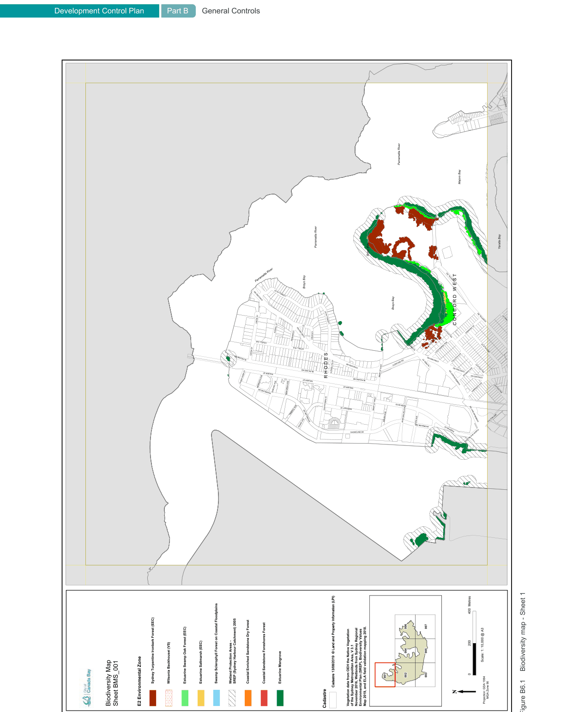
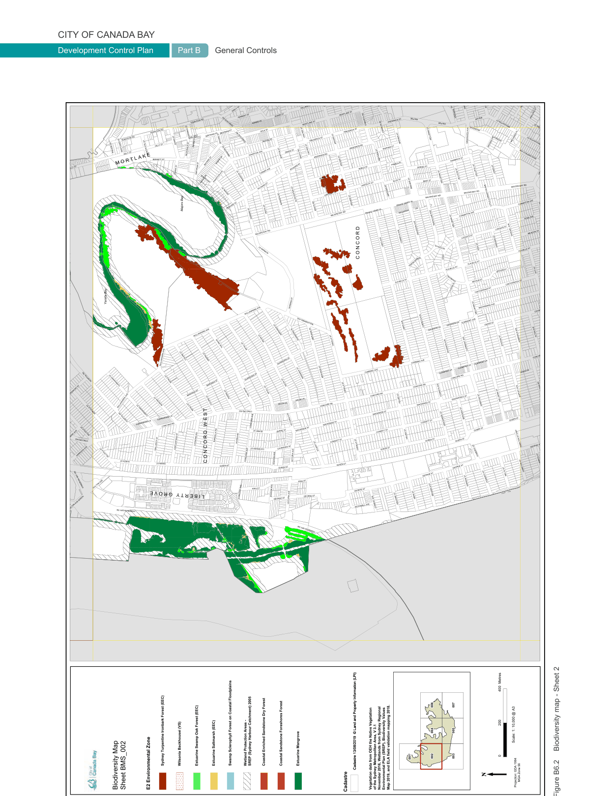
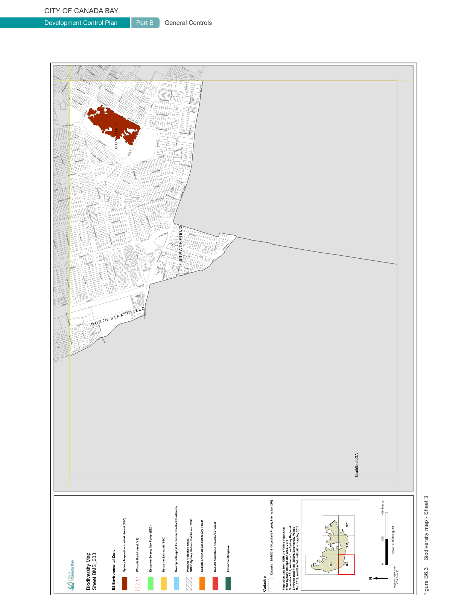
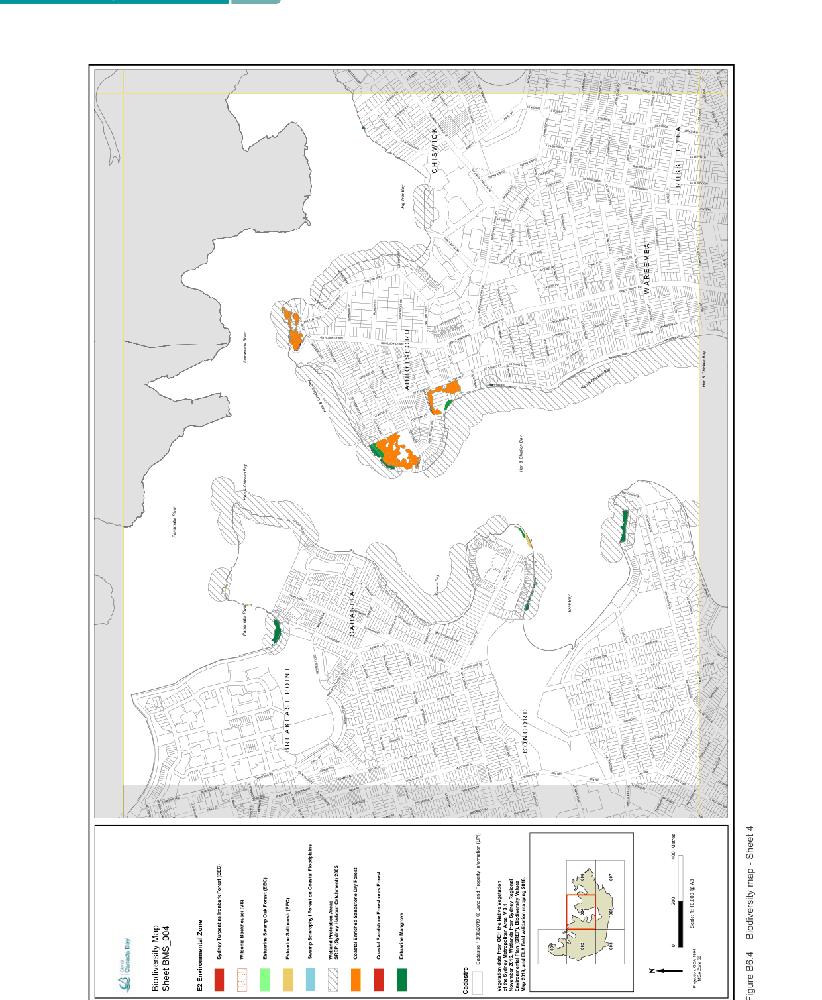
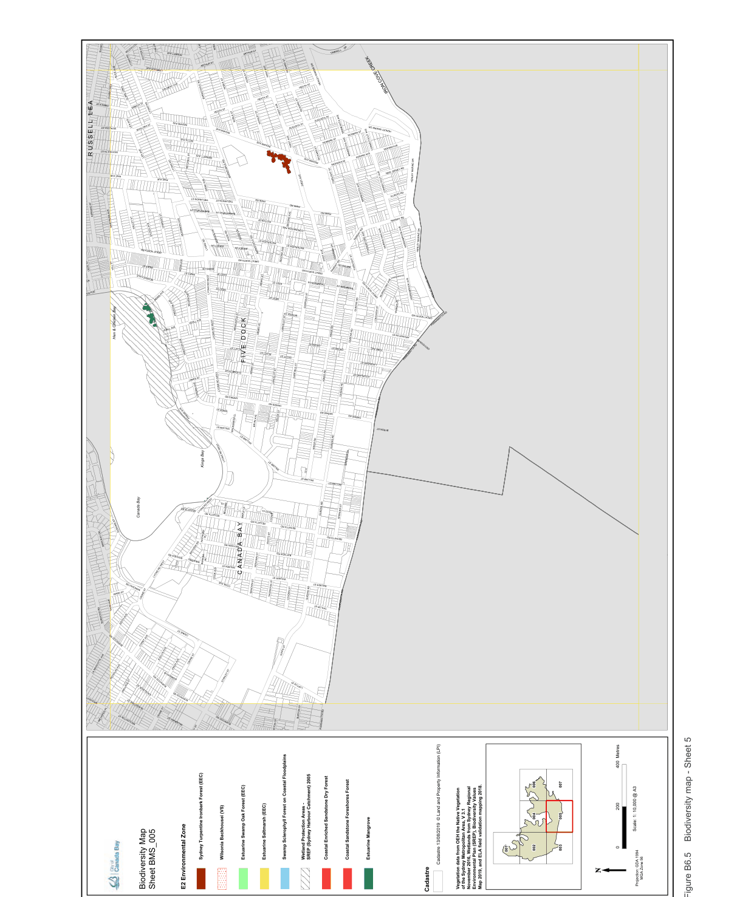
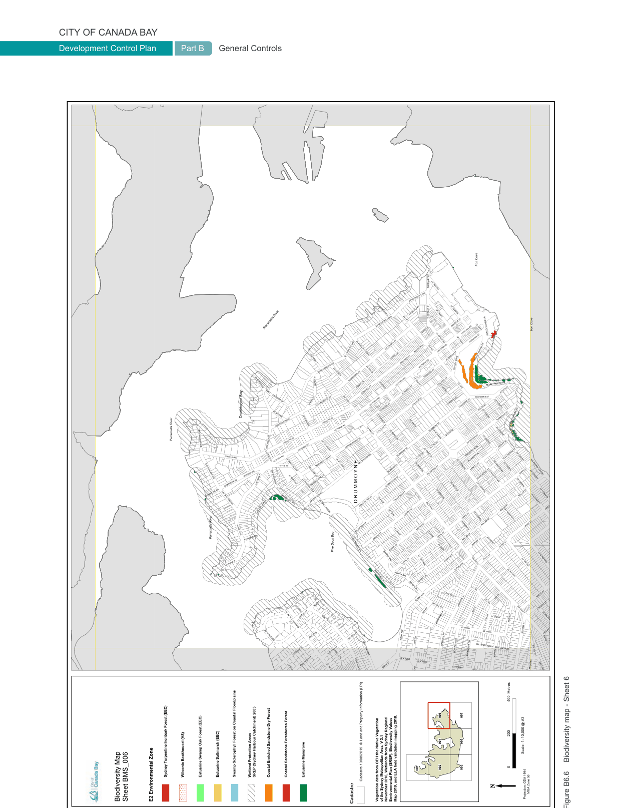
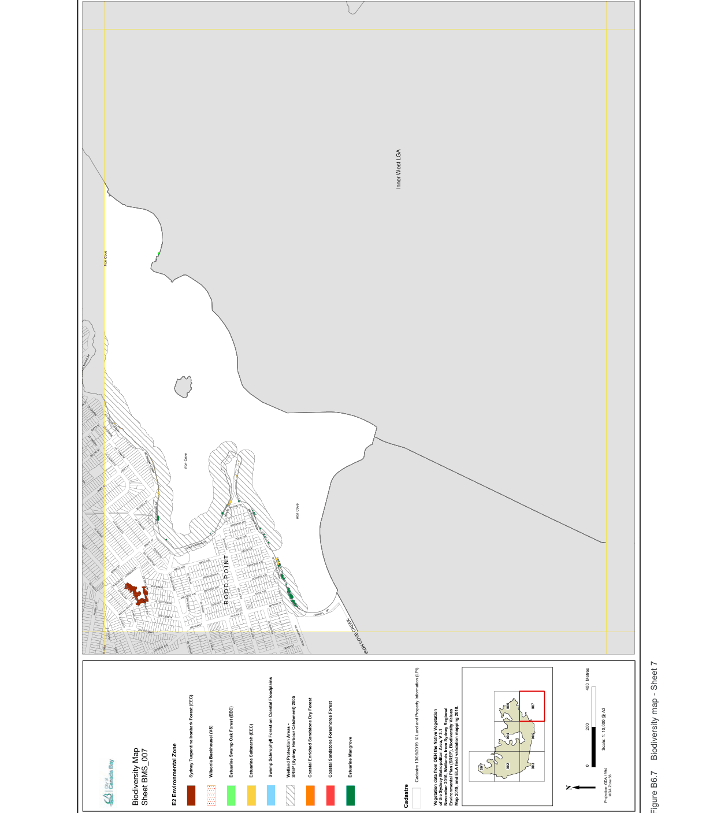

#### B6.3  Biodiversity

Biodiversity is the variety of life, including vegetation communities and individual plants and animals. Council is committed to protecting and enhancing our biodiversity to ensure social, economic, environmental and health outcomes for the community of today and tomorrow.

This Section establishes Council’s approach to biodiversity during the development process. The approach is led by Council’s Community Strategic Plan and Biodiversity Framework.

All development involving the removal, replacement and addition of vegetation and landscaped elements is affected by this Section.

#### Objectives

O1. Maintain natural areas and biodiversity by protecting locally native flora and native fauna in our urban and river foreshore environment. O2. Priortise the planting, retention, and restoration of locally native vegetation in our urban and river foreshore environment. O3. Enhance biodiversity through creation and plantings of habitat connectivity for locally native flora and fauna on private land whilst integrating the built form with the locality.

| Controls |  |
|---|---|
| C1. | Development must be consistent with Council strategic documents concerning biodiversity, including the Biodiversity Strategy, Environmental Strategy and Urban Tree Canopy Strategy. |
| C2. | Existing habitat features for locally native fauna including protected trees, locally native shrubs, groundcovers, waterbodies and rock outcrops are to be retained. |
| C3. | Locally native species from Appendix 3 are to be selected for landscaped areas in the first instance. |
| C4. | Where locally native vegetation is identified for removal, replacement flora species are to be selected from Appendix 3 in the first instance and replacement tree planting is to comply with the replacement requirements in Part B6.6. |
| C5. | Shrubs, groundcovers, grasses and sedges must be densely planted, and trees are to be spaced out per Table B-T. |

Note: Refer to Clause 6.3 of the Canada Bay LEP and Part 2.3 of SEPP (Biodiversity and Conservation) 2021.

> [Picture on page 72: a map, saved as a picture (images/part-b-general-controls-page-72-1.gif, 150 dpi); the street names and other small labels are on the picture.]
> Words printed on the picture (title and legend, copied from the PDF):
> C O N C O R D   W E S T
> LOCH MAREE PDE
> Insert Map frame here
> R H O D E S
> POINT PARK ST
> HOMEBUSH BAY DR
> SHORELINE DR NINA GRAY AVE
> MARY ST EAST
> MARY ST WEST
> HOMEBUSH BAY DR
> JEAN WAILES AVE
> OULTON AVE NORTH
> Scale: 1: 10,000 @ A3
> Swamp Sclerophyll Forest on Coastal Floodplains
> Sydney Turpentine Ironbark Forest (EEC) Wilsonia Backhousei (VS) Estuarine Swamp Oak Forest (EEC) Estuarine Saltmarsh (EEC) Wetland Protection Areas -
> SREP (Sydney Harbour Catchment) 2005 Coastal Enriched Sandstone Dry Forest Coastal Sandstone Foreshores Forest Estuarine Mangrove
> Cadastre 13/08/2019  © Land and Property Information (LPI)
> Cadastre 13/08/2019  © Land and Property Information (LPI)
> MGA Zone 56
> Projection: GDA 1994
> Vegetation data from OEH the Native Vegetation
> of the Sydney Metropolitan Area, V 3.1
> November 2016, Wetlands from Sydney Regional
> Environmental Plan (SREP), Biodiversity Values
> Sheet BMS_001 E2 Environmental Zone
> Biodiversity map - Sheet 1

Map 2019, and ELA field validation mapping 2018.

> [Picture on page 73: a map, saved as a picture (images/part-b-general-controls-page-73-1.gif, 150 dpi); the street names and other small labels are on the picture.]
> Words printed on the picture (title and legend, copied from the PDF):
> PL EMPIRE AVE
> VAN HEE ST
> RHONDA PL RICHARDS PL
> DRAKE ST VAN HEE ST
> BARTON ST BRAYS RD
> M O R T L A K E
> EDWIN ST BERTRAM ST
> ELLIS ST BENT ST
> MAJORS BAY RD
> MAJORS BAY RD
> MAJORS BAY RD
> ARCHER ST PRINCE HENRY PL
> LITTLE CORMISTON AVE
> PRINCE HENRY PL
> MAJORS BAY RD
> TRAFALGAR PDE WELLBANK ST
> MAJORS BAY RD
> VICTORY PL HIGH ST FLAVELLE ST
> C O N C O R D
> FLAVELLE ST ARTHUR ST PITT ST
> CHURCHILL ARTHUR ST
> CURTIN PL CASTLEREAGH ST
> LINKS AVE DAVIDSON LN
> THE DRIVE MYALL ST
> COLANE ST IANDRA ST
> MOALA ST CONCORD RD
> Insert Map frame here
> VICTORIA AVE MACKENZIE ST
> BURKE ST BURKE ST
> QUEEN ST QUEEN ST
> HAMILTON ST EAST GEORGE ST
> CONCORD AVE VICTORIA AVE
> C O N C O R D   W E S T
> HOMEBUSH BAY DR OULTON AVE
> STATION AVE GEORGE ST
> L I B E R T Y
> G R O V E
> ROTHWELL AVE CONWAY AVE
> OULTON AVE NORTH HOMEBUSH BAY DR
> HOMEBUSH BAY DR
> Scale: 1: 10,000 @ A3
> Swamp Sclerophyll Forest on Coastal Floodplains
> Sydney Turpentine Ironbark Forest (EEC) Wilsonia Backhousei (VS) Estuarine Swamp Oak Forest (EEC) Estuarine Saltmarsh (EEC) Wetland Protection Areas -
> SREP (Sydney Harbour Catchment) 2005 Coastal Enriched Sandstone Dry Forest Coastal Sandstone Foreshores Forest Estuarine Mangrove
> Cadastre 13/08/2019  © Land and Property Information (LPI)
> Cadastre 13/08/2019  © Land and Property Information (LPI)
> MGA Zone 56
> Projection: GDA 1994
> Vegetation data from OEH the Native Vegetation
> of the Sydney Metropolitan Area, V 3.1
> November 2016, Wetlands from Sydney Regional
> Environmental Plan (SREP), Biodiversity Values
> Sheet BMS_002 E2 Environmental Zone
> Biodiversity map - Sheet 2

Map 2019, and ELA field validation mapping 2018.

Figure B6.3

Biodiversity map - Sheet 3

> [Picture on page 74: a map, saved as a picture (images/part-b-general-controls-page-74-3.gif, 150 dpi); the street names and other small labels are on the picture.]
> Words printed on the picture (title and legend, copied from the PDF):
> NICHOLAS AVE GORDON LN STANLEY ST
> RHONDA PL RICHARDS PL
> MORETON ST LN
> BEACONSFIELD AVE BROUGHTON ST
> MAJORS BAY RD
> PATTERSON ST C O N C O R D
> MEADOW ST WORDSWORTH AVE
> LLOYD GEORGE AVE
> LLOYD GEORGE AVE
> CROSS ST KEPPEL AVE EDWARD ST ALEXANDRA ST ADA ST
> COOPER ST EVERTON RD
> S T R A T H F I E L D
> BRIDGE ST CHAPMAN ST
> Insert Map frame here
> HAMILTON ST EAST GEORGE ST N O R T H
> S T R A T H F I E L D
> Swamp Sclerophyll Forest on Coastal Floodplains
> Sydney Turpentine Ironbark Forest (EEC) Wilsonia Backhousei (VS) Estuarine Swamp Oak Forest (EEC) Estuarine Saltmarsh (EEC) Wetland Protection Areas -
> SREP (Sydney Harbour Catchment) 2005 Coastal Enriched Sandstone Dry Forest Coastal Sandstone Foreshores Forest Estuarine Mangrove
> Sheet BMS_003 E2 Environmental Zone
> Cadastre 13/08/2019  © Land and Property Information (LPI)
> Cadastre 13/08/2019  © Land and Property Information (LPI)
> Vegetation data from OEH the Native Vegetation
> of the Sydney Metropolitan Area, V 3.1
> November 2016, Wetlands from Sydney Regional
> Environmental Plan (SREP), Biodiversity Values
> Scale: 1: 10,000 @ A3
> MGA Zone 56
> Projection: GDA 1994

Map 2019, and ELA field validation mapping 2018.

> [Picture on page 75: a map, saved as a picture (images/part-b-general-controls-page-75-1.gif, 150 dpi); the street names and other small labels are on the picture.]
> Words printed on the picture (title and legend, copied from the PDF):
> EATON PL WITHERS ST BYRNE AVE
> HAMPDEN RD NORTH COURT RD BORONIA AVE
> WITHERS ST SWANNELL AVE
> EDENHOLME RD MURRAY ST
> BLACKWALL POINT RD
> BOUVARDIA ST EDENHOLME RD
> C H I S W I C K
> R U S S E L L   L E A
> BLACKWALL POINT RD
> HAMPDEN RD EDENHOLME RD
> Fig Tree Bay
> BLACKWALL POINT RD
> CORALIE ST CORANTO ST
> GREAT NORTH RD W A R E E M B A
> BLACKWALL POINT RD
> CAMPBELL ST WYMSTON LN
> GREAT NORTH RD
> GREAT NORTH RD
> GREAT NORTH RD
> GREAT NORTH RD
> HENRY LAWSON AVE WERONA AVE
> GLEN ORMOND AVE
> ST ALBANS ST WYMSTON PDE
> GOW ST ST ALBANS ST
> ST ALBANS ST
> ALTONA ST ABBOTSFORD PDE
> ST ALBANS ST
> Hen & Chicken Bay
> A B B O T S F O R D
> Hen & Chicken Bay
> ST ALBANS ST
> Hen & Chicken Bay
> BATTERSEA ST HUNTER ST
> SPRING ST ABBOTSFORD PDE
> Hen & Chicken Bay
> Insert Map frame here
> Hen & Chicken Bay
> C A B A R I T A
> SALT ST WARD ST
> BISHOP ST ELPHINSTONE ST
> BREAKFAST POINT BLVD
> BURWOOD RD EDITH AVE
> DENISON LN KITCHENER AVE
> B R E A K F A S T   P O I N T
> LA MASCOTTE AVE
> C O N C O R D
> PL EMPIRE AVE
> FREDERICK ST JOSSELYN PL
> VAN HEE ST
> RHONDA PL RICHARDS PL
> ANDERSON RD SHIPHAM ST
> DRAKE ST VAN HEE ST
> BARTON ST BRAYS RD
> Scale: 1: 10,000 @ A3
> Swamp Sclerophyll Forest on Coastal Floodplains
> Sydney Turpentine Ironbark Forest (EEC) Wilsonia Backhousei (VS) Estuarine Swamp Oak Forest (EEC) Estuarine Saltmarsh (EEC) Wetland Protection Areas -
> SREP (Sydney Harbour Catchment) 2005 Coastal Enriched Sandstone Dry Forest Coastal Sandstone Foreshores Forest Estuarine Mangrove
> Cadastre 13/08/2019  © Land and Property Information (LPI)
> MGA Zone 56
> Projection: GDA 1994
> Vegetation data from OEH the Native Vegetation
> of the Sydney Metropolitan Area, V 3.1
> November 2016, Wetlands from Sydney Regional
> Environmental Plan (SREP), Biodiversity Values
> Sheet BMS_004 E2 Environmental Zone
> Biodiversity map - Sheet 4

Map 2019, and ELA field validation mapping 2018.

Figure B6.5

Biodiversity map - Sheet 5

> [Picture on page 76: a map, saved as a picture (images/part-b-general-controls-page-76-3.gif, 150 dpi); the street names and other small labels are on the picture.]
> Words printed on the picture (title and legend, copied from the PDF):
> RUSSELL ST MCCULLOCH ST
> HENLEY MARINE DR
> IRON COVE CREEK
> SIBBICK ST SIBBICK ST
> MYALORA ST MYALORA ST
> HENLEY MARINE DR
> R U S S E L L   L E A
> INGHAM AVE INGHAM AVE
> NEW JERSEY RD
> HENLEY MARINE DR
> BARNSTAPLE LN BARNSTAPLE LN
> GARTFERN AVE CHARLES ST
> SERVICE LN WATERVIEW ST
> HENLEY MARINE DR
> GREAT NORTH RD
> GREAT NORTH RD
> GREAT NORTH RD
> INNES ST EAST ST
> HENRY ST THOMPSON LN
> LYONS RD WEST
> HENLEY MARINE DR
> GREAT NORTH RD HARRABROOK AVE
> QUEENS RD WANGAL PL
> GREAT NORTH RD
> NEWCASTLE ST LANCELOT ST
> Hen & Chicken Bay
> LYONS RD WEST
> CROSS ST YORK AVE
> GARFIELD ST KINGS RD
> LYONS RD WEST
> CORDEN AVE HARRIS RD
> HARRIS RD PARRAMATTA RD
> Insert Map frame here
> LYONS RD WEST
> REGATTA RD LYONS RD WEST DOO CL
> BELLBIRD R QUEENS RD
> BAYVIEW RD PL
> F I V E   D O C K
> C A N A D A   B A Y
> LYONS RD WEST COOK AVE WALKER ST
> BURWOOD RD EDITH AVE
> LA MASCOTTE AVE
> NICHOLAS AVE GORDON LN STANLEY ST
> RHONDA PL RICHARDS PL
> Swamp Sclerophyll Forest on Coastal Floodplains
> Sydney Turpentine Ironbark Forest (EEC) Wilsonia Backhousei (VS) Estuarine Swamp Oak Forest (EEC) Estuarine Saltmarsh (EEC) Wetland Protection Areas -
> SREP (Sydney Harbour Catchment) 2005 Coastal Enriched Sandstone Dry Forest Coastal Sandstone Foreshores Forest Estuarine Mangrove
> Cadastre 13/08/2019  © Land and Property Information (LPI)
> Vegetation data from OEH the Native Vegetation
> of the Sydney Metropolitan Area, V 3.1
> November 2016, Wetlands from Sydney Regional
> Environmental Plan (SREP), Biodiversity Values
> Sheet BMS_005 E2 Environmental Zone
> Scale: 1: 10,000 @ A3
> MGA Zone 56
> Projection: GDA 1994

Map 2019, and ELA field validation mapping 2018.

> [Picture on page 77: a map, saved as a picture (images/part-b-general-controls-page-77-1.gif, 150 dpi); the street names and other small labels are on the picture.]
> Words printed on the picture (title and legend, copied from the PDF):
> THORNLEY ST ROSEBY ST
> ST GEORGES CRES
> DAWSON LN PARK AVE
> ST GEORGES CRES
> CARY ST Iron Cove
> FERRY LN VICTORIA RD HENLEY MARINE DR
> THORNLEY ST PARK AVE
> ALEXANDRA ST DAY ST VICTORIA RD
> QUEEN VICTORIA ST
> ST GEORGES CRES FERRY LN FORMOSA ST HENLEY MARINE DR
> VICTORIA RD SISTERS CRES
> ST GEORGES CRES EDWIN ST
> HENLEY MARINE DR
> VICTORIA RD CHURCH ST
> COLLINGWOOD ST VICTORIA RD
> TRANMERE ST DUNCAN ST
> Drummoyne Bay RAGLAN ST
> Insert Map frame here
> HENLEY MARINE DR
> VICTORIA RD COLLEGE ST
> TRANMERE ST POLDING ST
> HENLEY ST THERRY ST
> MC CLEERS LN
> GIPPS ST HENLEY MARINE DR
> HENRICKS AVE HINKLER CT
> BAYSWATER RD D R U M M O Y N E BRAY ST
> GIPPS ST RICHARDS AVE
> MILLAR ST JANET ST
> BUDD ST GIPPS ST
> BARNEY ST JANET ST
> Five Dock Bay THE ESPLANADE
> THE ESPLANADE GEARS AVE
> ATKINS AVE TAIT LN
> REIMS ST POTTER ST
> TAIT ST MONS ST
> BLACKWALL POINT RD
> EATON PL WITHERS ST BYRNE AVE
> HAMPDEN RD NORTH COURT RD BORONIA AVE
> WITHERS ST SWANNELL AVE
> EDENHOLME RD MURRAY ST
> BLACKWALL POINT RD
> Scale: 1: 10,000 @ A3
> Swamp Sclerophyll Forest on Coastal Floodplains
> Sydney Turpentine Ironbark Forest (EEC) Wilsonia Backhousei (VS) Estuarine Swamp Oak Forest (EEC) Estuarine Saltmarsh (EEC) Wetland Protection Areas -
> SREP (Sydney Harbour Catchment) 2005 Coastal Enriched Sandstone Dry Forest Coastal Sandstone Foreshores Forest Estuarine Mangrove
> Cadastre 13/08/2019  © Land and Property Information (LPI)
> MGA Zone 56
> Projection: GDA 1994
> Vegetation data from OEH the Native Vegetation
> of the Sydney Metropolitan Area, V 3.1
> November 2016, Wetlands from Sydney Regional
> Environmental Plan (SREP), Biodiversity Values
> Sheet BMS_006 E2 Environmental Zone
> Biodiversity map - Sheet 6

Map 2019, and ELA field validation mapping 2018.

Figure B6.7

Biodiversity map - Sheet 7

> [Picture on page 78: a map, saved as a picture (images/part-b-general-controls-page-78-3.gif, 150 dpi); the street names and other small labels are on the picture.]
> Words printed on the picture (title and legend, copied from the PDF):
> Inner West LGA
> Insert Map frame here
> HENLEY MARINE DR
> GIPPS ST HENLEY MARINE DR
> MILLAR ST BURNELL ST
> JANET ST HENLEY MARINE DR
> HENLEY MARINE DR
> HENLEY MARINE DR
> HENLEY MARINE DR
> HENLEY MARINE DR
> PRINCESS AVE DUCHESS AVE
> LITHGOW ST SPEED AVE
> WHITTALL ST BARNSTAPLE RD
> DUCHESS AVE DUKE AVE
> DUCHESS AVE FIRST AVE
> R O D D   P O I N T
> MCCULLOCH ST DUKE AVE ARTHUR ST
> RUSSELL ST MCCULLOCH ST
> HENLEY MARINE DR
> IRON COVE CREEK
> Swamp Sclerophyll Forest on Coastal Floodplains
> Sydney Turpentine Ironbark Forest (EEC) Wilsonia Backhousei (VS) Estuarine Swamp Oak Forest (EEC) Estuarine Saltmarsh (EEC) Wetland Protection Areas -
> SREP (Sydney Harbour Catchment) 2005 Coastal Enriched Sandstone Dry Forest Coastal Sandstone Foreshores Forest Estuarine Mangrove
> Cadastre 13/08/2019  © Land and Property Information (LPI)
> Vegetation data from OEH the Native Vegetation
> of the Sydney Metropolitan Area, V 3.1
> November 2016, Wetlands from Sydney Regional
> Environmental Plan (SREP), Biodiversity Values
> Sheet BMS_007 E2 Environmental Zone
> Scale: 1: 10,000 @ A3
> MGA Zone 56
> Projection: GDA 1994

Map 2019, and ELA field validation mapping 2018.
