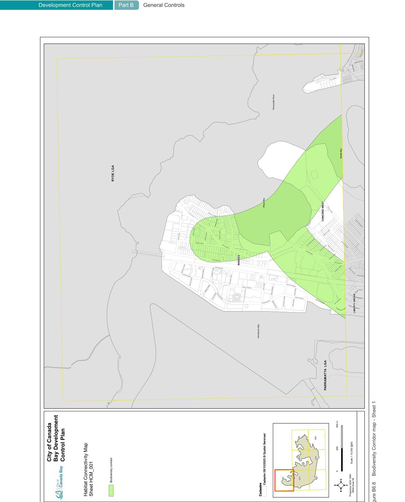
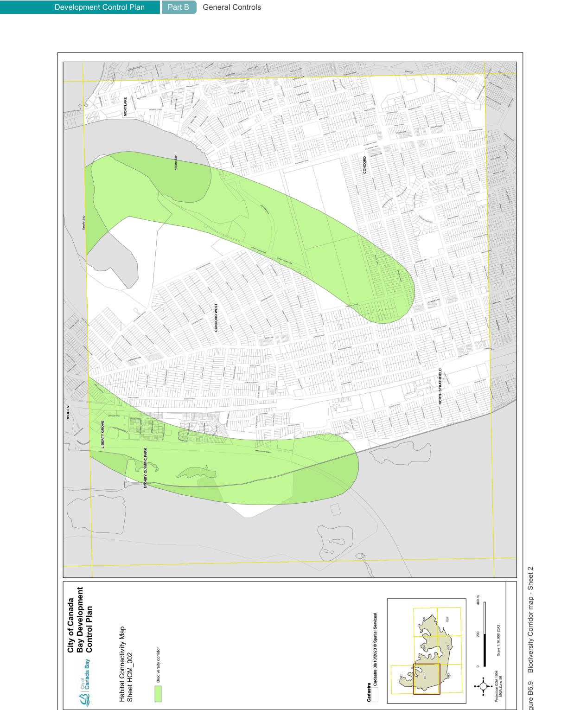
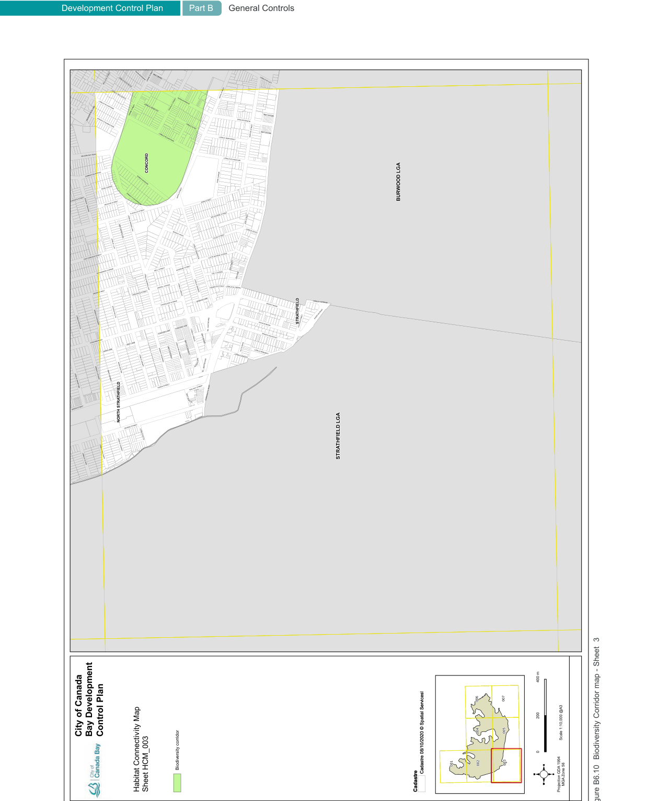
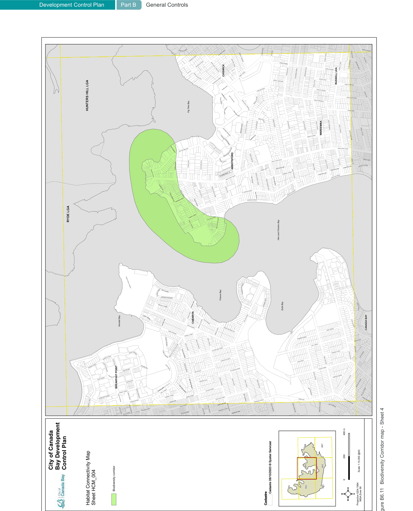
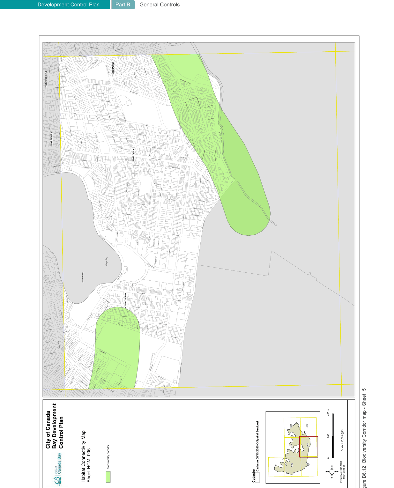
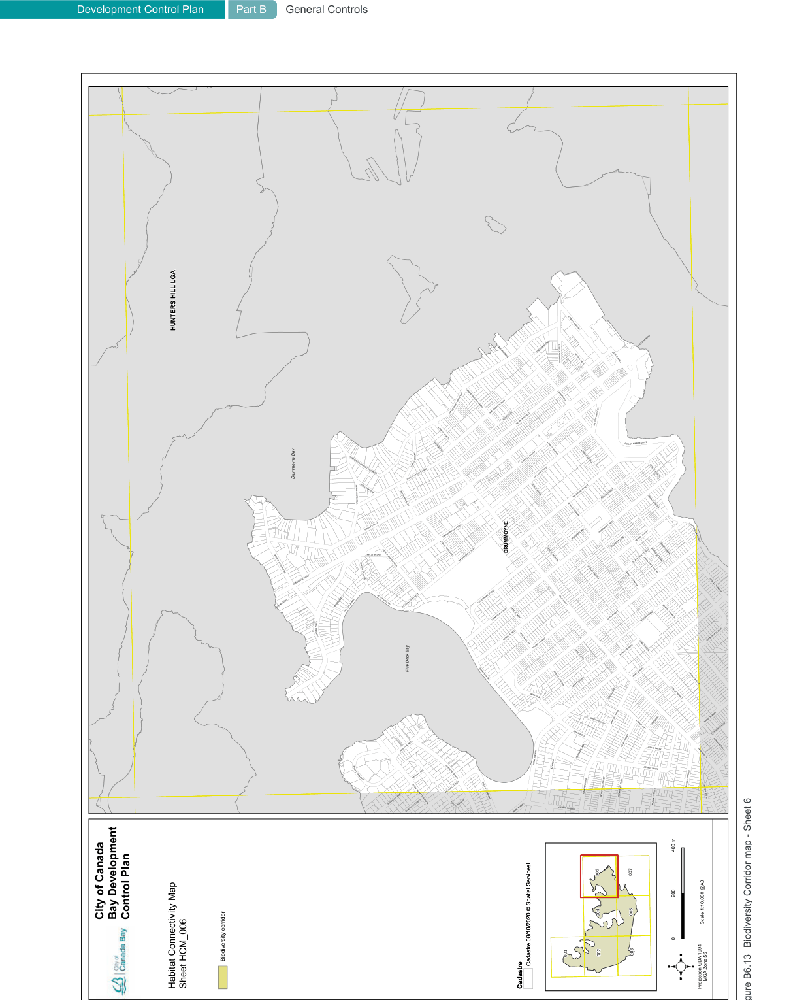
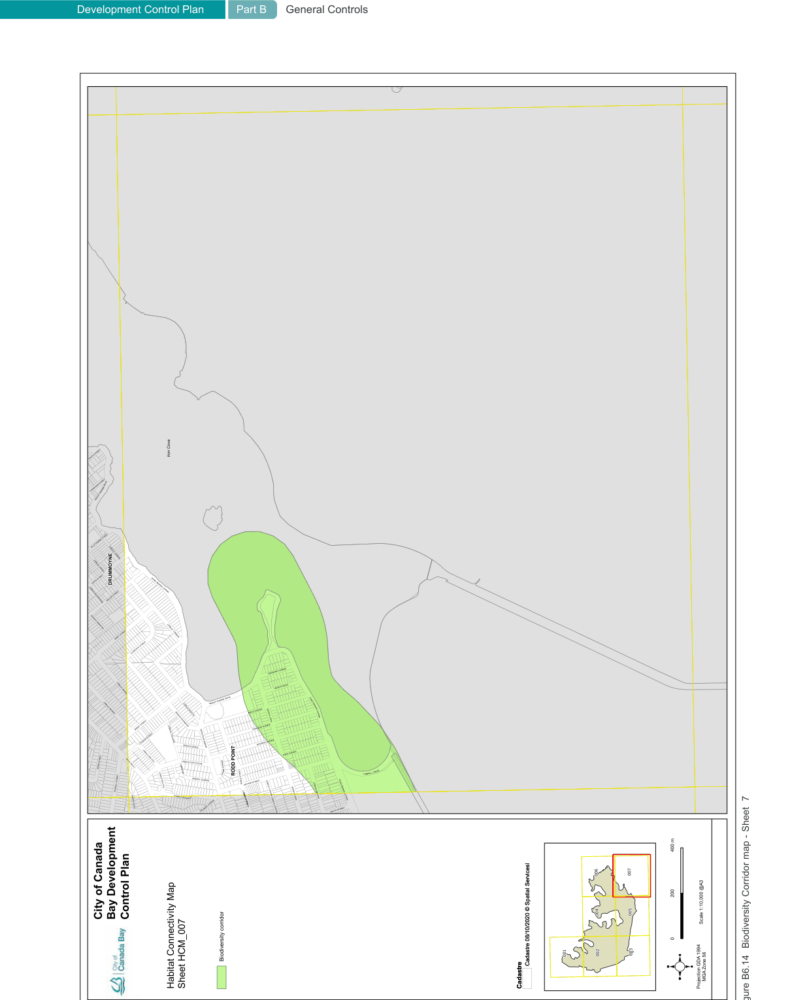

#### B6.4  Biodiversity Corridors

Biodiversity corridors provide linkages through urban areas to connect significant plant and animal communities remaining as threatened ecological communities, threatened populations, threatened or migratory species and their habitats. It is recognised that linkages to critical habitats may require reconstruction to play a significant role as part of a wildlife corridor or stepping stone for native flora and fauna.

#### Objectives

O1. Enhance and connect remnant and fragmented habitat on public and private land. O2. Encourage plantings which increase habitat connectivity and tree canopy, shrubs and understorey.

O3. Improve habitat, biodiversity and environmental performance of developments through landscaping.

O4. To preserve and enhance native wildlife populations and habitat through appropriate planting of locally native vegetation. O5. Retain existing native vegetation.

| Controls |  |
|---|---|
| C1. | Where development is located within a Biodiversity Corridor (refer to Figure B6.8 to Figure B6.14), locally native species (including canopy trees, shrubs and groundcovers) from Appendix 3 are to be included in landscaped area. |
| C2. | Where development is located within a Biodiversity Corridor (refer to Figure B6.8 to Figure B6.14), landscaped areas of Single Dwellings, Semi-Detached Dwellings, Dual Occupancies and Secondary Dwellings must comprise a minimum of 40% of the parent lot site area for the planting of a canopy tree. |
| C3. | Where development is located within a Biodiversity Corridor (refer to Figure B6.8 to Figure B6.14), new habitat features comprising 50% of the landscaped area including trees, shrubs, sedges, groundcovers, rockeries, insect hotels, artificial waterbodies, raingardens, green roofs and green walls are to be added to the site. Green roofs and green walls can be used particularly in high density urban environments where opportunities for ground level landscaping are limited and/ or where large walls face active areas of private and public use. |
| C4. | Where development is located within a Biodiversity Corridor or a PRCUTS precinct, the development must demonstrate at least 25% of the accessible roof area of surfaces on rooftops used for community open space is a green roof comprising vegetation, including tree canopy. Remaining rooftop surfaces not used for community open space must demonstrate at least 75% of the remaining roof area is a green roof comprising vegetation, including tree canopy. |
| C5. | Trees selected for planting should comprise vegetation locally native to Canada Bay, chosen from Appendix 3 in the first instance. |

> [Picture on page 80: a picture, saved as a picture (images/part-b-general-controls-page-80-1.gif, 150 dpi).]
> Words printed on the picture (title and legend, copied from the PDF):
> Development Control Plan
> City of Canada Bay Development Control Plan
> Habitat Connectivity Map Sheet HCM_001
> Part B General Controls
> Biodiversity corridor
> Biodiversity corridor
> Scale 1:10,000 @A3
> Cadastre 08/10/2020 © Spatial Servicesl
> MGA Zone 56
> Cadastre
> Cadastre 08/10/2020 © Spatial Servicesl
> Cadastre
> Projection GDA 1994
> Figure B6.8
> Biodiversity Corridor map - Sheet 1

> [Picture on page 81: a picture, saved as a picture (images/part-b-general-controls-page-81-1.gif, 150 dpi).]
> Words printed on the picture (title and legend, copied from the PDF):
> Development Control Plan
> City of Canada Bay Development Control Plan
> Habitat Connectivity Map Sheet HCM_002
> Part B General Controls
> Biodiversity corridor
> Biodiversity corridor
> Scale 1:10,000 @A3
> Cadastre 08/10/2020 © Spatial Servicesl
> MGA Zone 56
> Cadastre
> Cadastre 08/10/2020 © Spatial Servicesl
> Cadastre
> Projection GDA 1994
> Figure B6.9
> Biodiversity Corridor map - Sheet 2

> [Picture on page 82: a picture, saved as a picture (images/part-b-general-controls-page-82-1.gif, 150 dpi).]
> Words printed on the picture (title and legend, copied from the PDF):
> Development Control Plan
> City of Canada Bay Development Control Plan
> Habitat Connectivity Map Sheet HCM_003
> Part B General Controls
> Biodiversity corridor
> Biodiversity corridor
> Scale 1:10,000 @A3
> Cadastre 08/10/2020 © Spatial Servicesl
> MGA Zone 56
> Cadastre
> Cadastre 08/10/2020 © Spatial Servicesl
> Cadastre
> Projection GDA 1994
> Figure B6.10 Biodiversity Corridor map - Sheet  3

> [Picture on page 83: a picture, saved as a picture (images/part-b-general-controls-page-83-1.gif, 150 dpi).]
> Words printed on the picture (title and legend, copied from the PDF):
> Development Control Plan
> City of Canada Bay Development Control Plan
> Habitat Connectivity Map Sheet HCM_004
> Part B General Controls
> Biodiversity corridor
> Biodiversity corridor
> Scale 1:10,000 @A3
> Cadastre 08/10/2020 © Spatial Servicesl
> MGA Zone 56
> Cadastre
> Cadastre 08/10/2020 © Spatial Servicesl
> Cadastre
> Projection GDA 1994
> Figure B6.11 Biodiversity Corridor map - Sheet 4

> [Picture on page 84: a picture, saved as a picture (images/part-b-general-controls-page-84-1.gif, 150 dpi).]
> Words printed on the picture (title and legend, copied from the PDF):
> Development Control Plan
> City of Canada Bay Development Control Plan
> Habitat Connectivity Map Sheet HCM_005
> Part B General Controls
> Biodiversity corridor
> Biodiversity corridor
> Scale 1:10,000 @A3
> Cadastre 08/10/2020 © Spatial Servicesl
> MGA Zone 56
> Cadastre
> Cadastre 08/10/2020 © Spatial Servicesl
> Cadastre
> Projection GDA 1994
> Figure B6.12 Biodiversity Corridor map - Sheet  5

> [Picture on page 85: a picture, saved as a picture (images/part-b-general-controls-page-85-1.gif, 150 dpi).]
> Words printed on the picture (title and legend, copied from the PDF):
> Development Control Plan
> City of Canada Bay Development Control Plan
> Habitat Connectivity Map Sheet HCM_006
> Part B General Controls
> Biodiversity corridor
> Biodiversity corridor
> Scale 1:10,000 @A3
> Cadastre 08/10/2020 © Spatial Servicesl
> MGA Zone 56
> Cadastre
> Cadastre 08/10/2020 © Spatial Servicesl
> Cadastre
> Projection GDA 1994
> Figure B6.13 Biodiversity Corridor map - Sheet 6

> [Picture on page 86: a picture, saved as a picture (images/part-b-general-controls-page-86-1.gif, 150 dpi).]
> Words printed on the picture (title and legend, copied from the PDF):
> Development Control Plan
> City of Canada Bay Development Control Plan
> Habitat Connectivity Map Sheet HCM_007
> Part B General Controls
> Biodiversity corridor
> Biodiversity corridor
> Scale 1:10,000 @A3
> Cadastre 08/10/2020 © Spatial Servicesl
> MGA Zone 56
> Cadastre
> Cadastre 08/10/2020 © Spatial Servicesl
> Cadastre
> Projection GDA 1994
> Figure B6.14 Biodiversity Corridor map - Sheet  7
