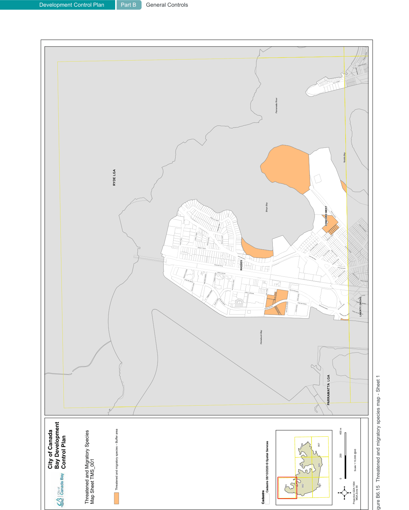
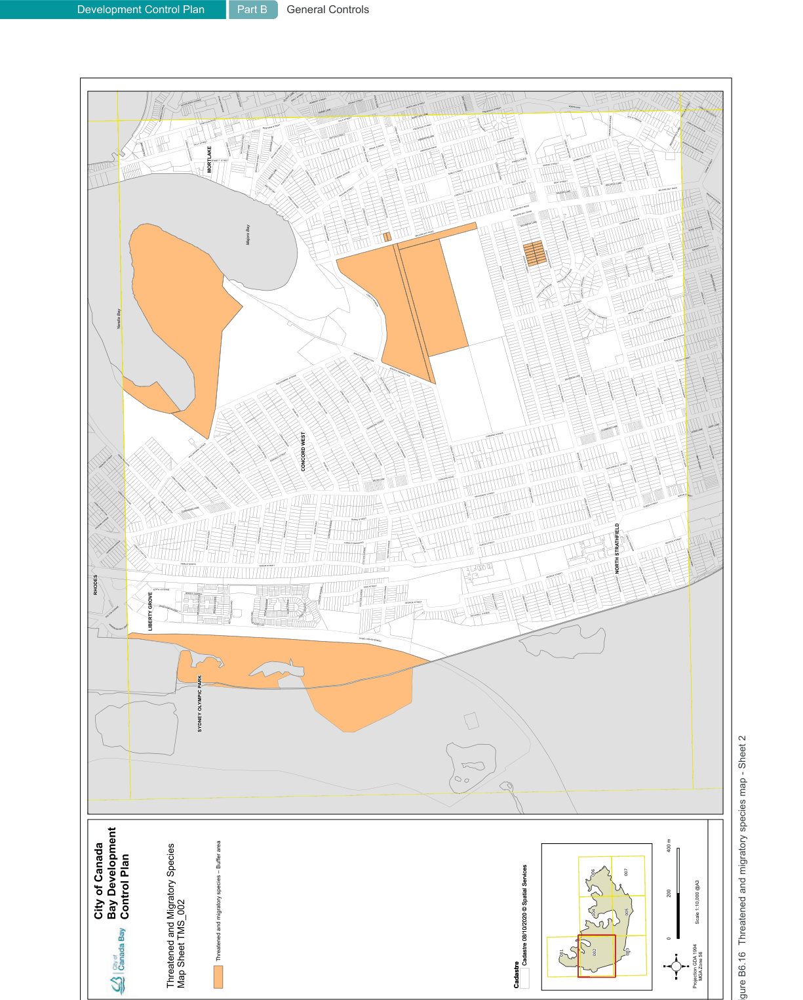
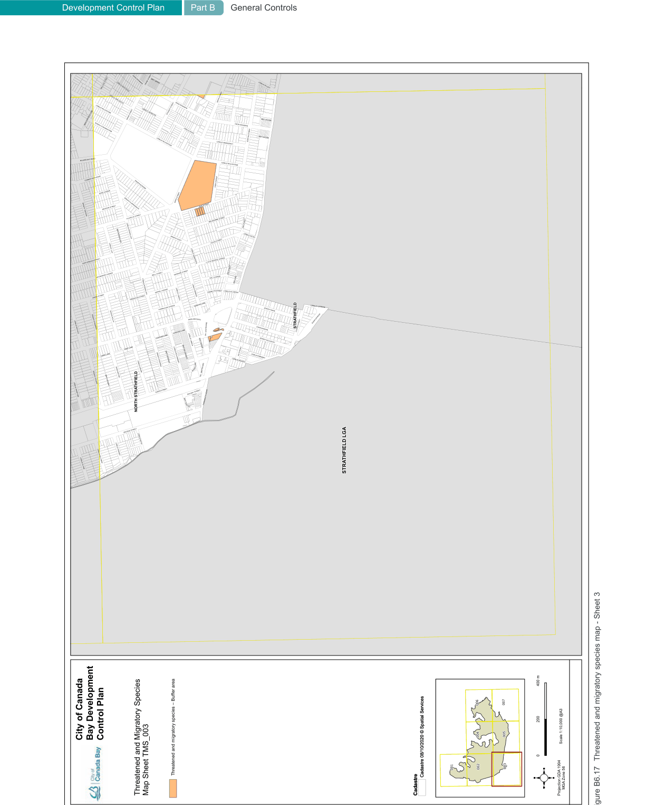
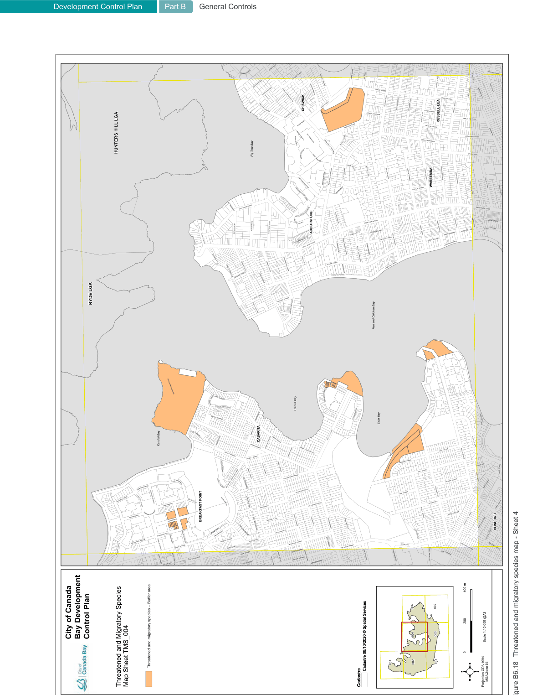
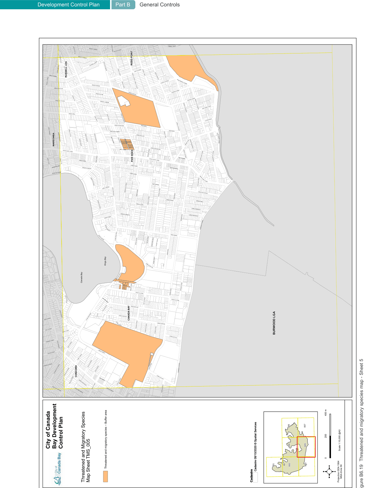
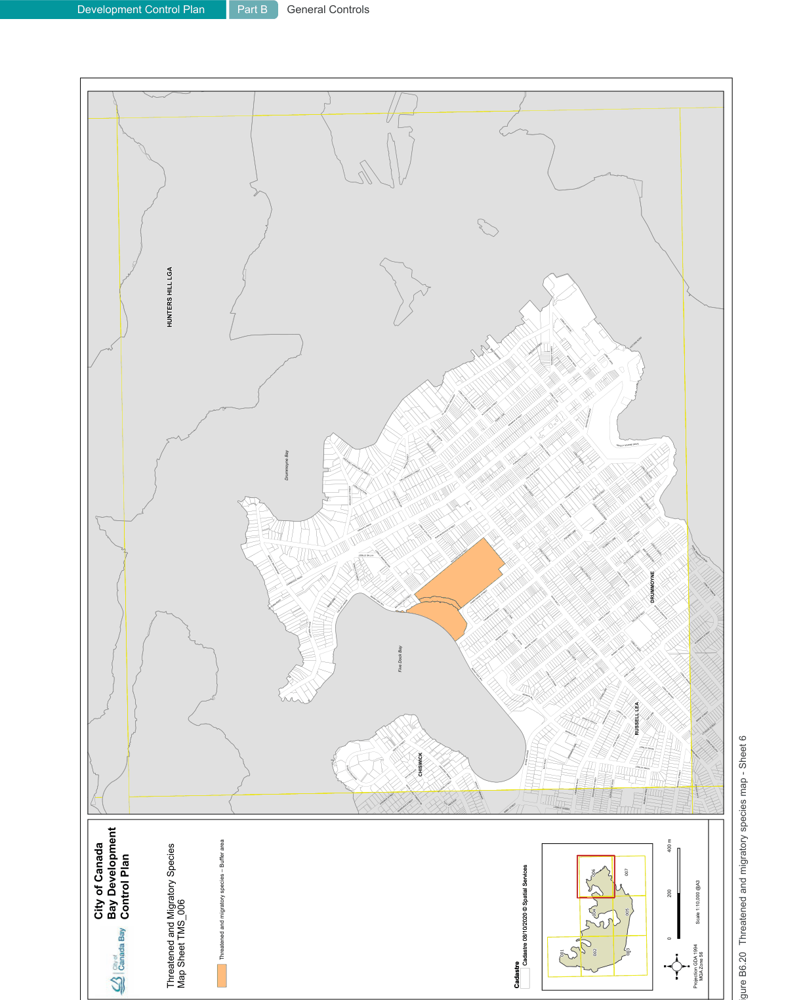
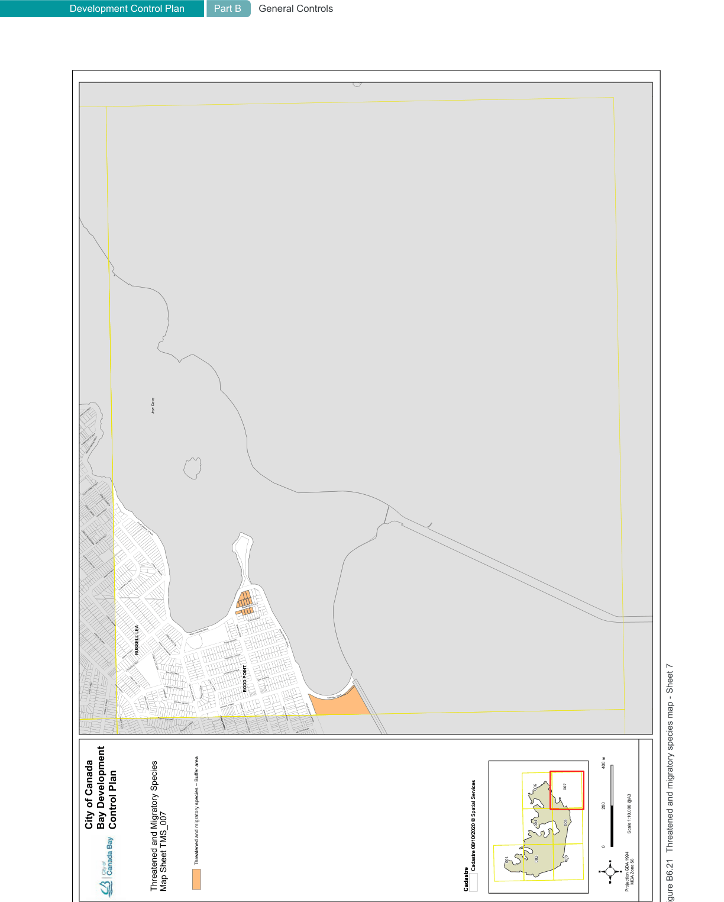

#### B6.8  Threatened and migratory species

Threatened species are particular plants and animals that are at risk of extinction. Threatened species also include threatened populations and endangered ecological communities. Unless the processes that are threatening these species are controlled (habitat loss, pollution, competition from introduced plants or animals), they are at risk of disappearing.

In order to assist landowners in identifying where threatened species, populations and ecological communities are known to exist, all known sites in the City of Canada Bay have been mapped by Council (current at the time of publishing). These appear on the maps entitled “Threatened and Migratory Species” which form part of this DCP (see Figure B6.15 to Figure B6.21). For additional information refer to Council’s website.

#### Objectives

O1. Avoid impact of development on threatened species and ecological communities. O2. To protect threatened and migratory species. O3. To protect and enhance biodiversity.

| Controls |  |
|---|---|
| C1. | Development on land in Zone C2 Environmental Conservation and land identified as Environmentally Sensitive Land on the Environmentally Sensitive Land Map or within a biodiversity corridor on the Biodiversity Corridor Map must not have a negative impact upon vegetation identified on the Biodiversity Map. |
| C2. | Development must not have a negative impact upon individual species or biodiversity of locations of threatened and migratory species identified in the following maps. |

> [Picture on page 92: a picture, saved as a picture (images/part-b-general-controls-page-92-1.gif, 150 dpi).]
> Words printed on the picture (title and legend, copied from the PDF):
> Development Control Plan
> City of Canada Bay Development Control Plan
> Threatened and Migratory Species Map Sheet TMS_001
> Part B General Controls
> Threatened and migratory species – Buffer area
> Threatened and migratory species – Buffer area
> Scale 1:10,000 @A3
> Cadastre 08/10/2020 © Spatial Services
> MGA Zone 56
> Cadastre
> Cadastre 08/10/2020 © Spatial Services
> Cadastre
> Projection GDA 1994
> Figure B6.15 Threatened and migratory species map - Sheet 1

> [Picture on page 93: a picture, saved as a picture (images/part-b-general-controls-page-93-1.gif, 150 dpi).]
> Words printed on the picture (title and legend, copied from the PDF):
> City of Canada Bay Development Control Plan
> Threatened and migratory species – Buffer area
> Threatened and migratory species – Buffer area
> Threatened and Migratory Species Map Sheet TMS_002
> Scale 1:10,000 @A3
> Cadastre 08/10/2020 © Spatial Services
> MGA Zone 56
> Cadastre
> Cadastre 08/10/2020 © Spatial Services
> Cadastre
> Projection GDA 1994
> Figure B6.16 Threatened and migratory species map - Sheet 2

> [Picture on page 94: a picture, saved as a picture (images/part-b-general-controls-page-94-1.gif, 150 dpi).]
> Words printed on the picture (title and legend, copied from the PDF):
> City of Canada Bay Development Control Plan
> Threatened and migratory species – Buffer area
> Threatened and migratory species – Buffer area
> Threatened and Migratory Species Map Sheet TMS_003
> Scale 1:10,000 @A3
> Cadastre 08/10/2020 © Spatial Services
> MGA Zone 56
> Cadastre
> Cadastre 08/10/2020 © Spatial Services
> Cadastre
> Projection GDA 1994
> Figure B6.17 Threatened and migratory species map - Sheet 3

> [Picture on page 95: a picture, saved as a picture (images/part-b-general-controls-page-95-1.gif, 150 dpi).]
> Words printed on the picture (title and legend, copied from the PDF):
> City of Canada Bay Development Control Plan
> Threatened and migratory species – Buffer area
> Threatened and migratory species – Buffer area
> Threatened and Migratory Species Map Sheet TMS_004
> Scale 1:10,000 @A3
> Cadastre 08/10/2020 © Spatial Services
> MGA Zone 56
> Cadastre
> Cadastre 08/10/2020 © Spatial Services
> Cadastre
> Projection GDA 1994
> Figure B6.18 Threatened and migratory species map - Sheet 4

> [Picture on page 96: a picture, saved as a picture (images/part-b-general-controls-page-96-1.gif, 150 dpi).]
> Words printed on the picture (title and legend, copied from the PDF):
> City of Canada Bay Development Control Plan
> Threatened and migratory species – Buffer area
> Threatened and migratory species – Buffer area
> Threatened and Migratory Species Map Sheet TMS_005
> Scale 1:10,000 @A3
> Cadastre 08/10/2020 © Spatial Services
> MGA Zone 56
> Cadastre
> Cadastre 08/10/2020 © Spatial Services
> Cadastre
> Projection GDA 1994
> Figure B6.19 Threatened and migratory species map - Sheet 5

> [Picture on page 97: a picture, saved as a picture (images/part-b-general-controls-page-97-1.gif, 150 dpi).]
> Words printed on the picture (title and legend, copied from the PDF):
> Development Control Plan
> City of Canada Bay Development Control Plan
> Threatened and Migratory Species Map Sheet TMS_006
> Part B General Controls
> Threatened and migratory species – Buffer area
> Threatened and migratory species – Buffer area
> Scale 1:10,000 @A3
> Cadastre 08/10/2020 © Spatial Services
> MGA Zone 56
> Cadastre
> Cadastre 08/10/2020 © Spatial Services
> Cadastre
> Projection GDA 1994
> Figure B6.20 Threatened and migratory species map - Sheet 6

> [Picture on page 98: a picture, saved as a picture (images/part-b-general-controls-page-98-1.gif, 150 dpi).]
> Words printed on the picture (title and legend, copied from the PDF):
> City of Canada Bay Development Control Plan
> Threatened and migratory species – Buffer area
> Threatened and migratory species – Buffer area
> Threatened and Migratory Species Map Sheet TMS_007
> Scale 1:10,000 @A3
> Cadastre 08/10/2020 © Spatial Services
> MGA Zone 56
> Cadastre
> Cadastre 08/10/2020 © Spatial Services
> Cadastre
> Projection GDA 1994
> Figure B6.21 Threatened and migratory species map - Sheet 7
