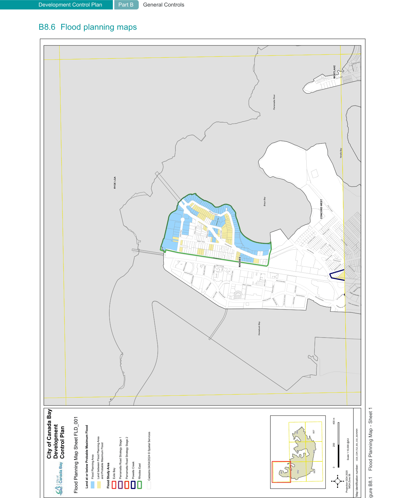

#### B8.5  Flood studies

The following flood studies currently apply to the City of Canada Bay LGA and are shown on the Flood Planning Maps in Part B8.6.

#### Table B-W Flood studies

| Flood study | Study date | Map reference |
|---|---|---|
| Parramatta Road Corridor Urban Transformation Study (PRCUTS) - Stage 2 Flood Risk Assessment | 24 April 2024 | Parramatta Road Strategy Stage 2 |
| Powells Creek Flood Study | 20 December 2022 | Powells Creek |
| Exile Bay Catchment Flood Study | 7 December 2022 | Exile Bay |
| Parramatta Road Corridor - Flood Risk Assessment for City of Canada Bay Council | 4 September 2020 | Parramatta Road Strategy Stage 1 |
| Rhodes East Priority Investigation Area Hydrology and Flooding Report | 21 December 2016 | Rhodes East |

Note 1: A newer flood study prevails over an older study if there is any inconsistency.

Note 2: Flood study data shown on the Flood Planning Maps has been adjusted where required to remove areas outside of the Canada Bay LGA, to remove overlapping data and depict the prevailing study.

Note 3: The flood studies are available on Council's website.

> [Picture on page 103: a picture, saved as a picture (images/part-b-general-controls-page-103-1.gif, 150 dpi).]
> Words printed on the picture (title and legend, copied from the PDF):
> Development Control Plan Part B
> General Controls
> Figure B8.1
> Flood Planning Map - Sheet 1
