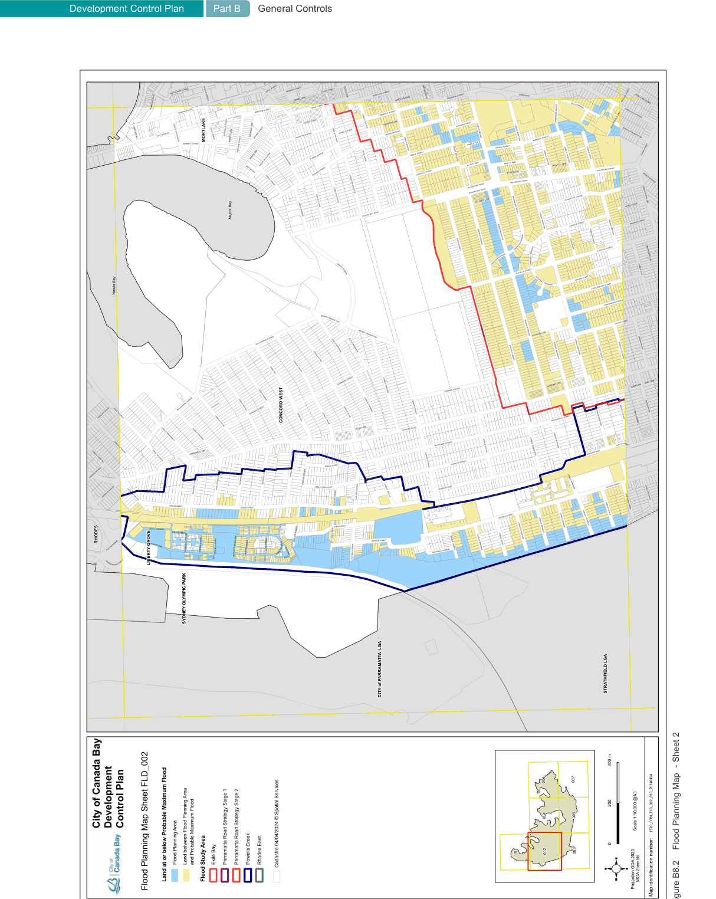
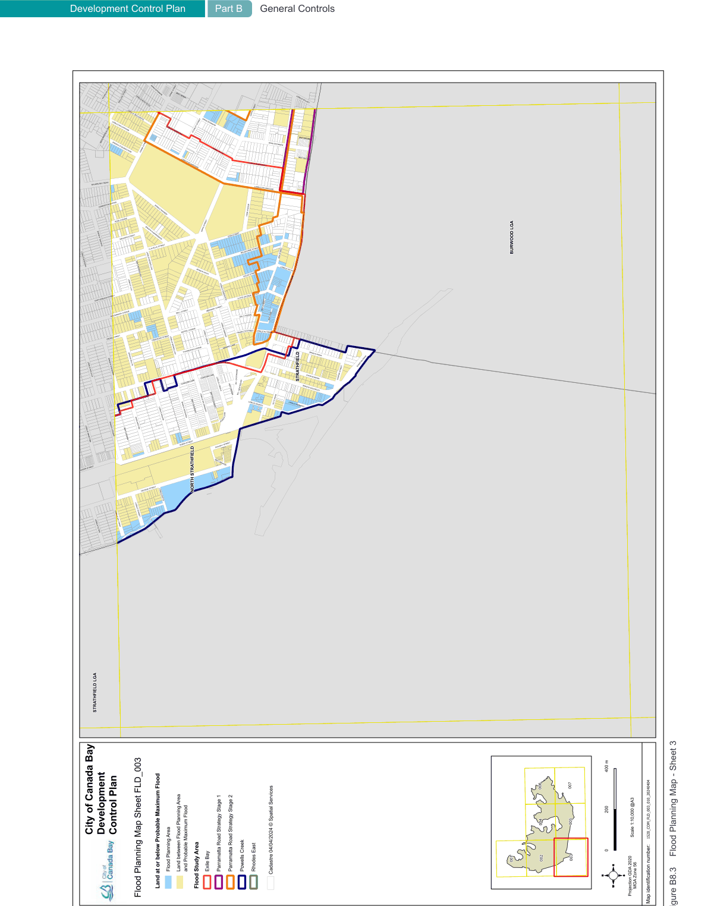
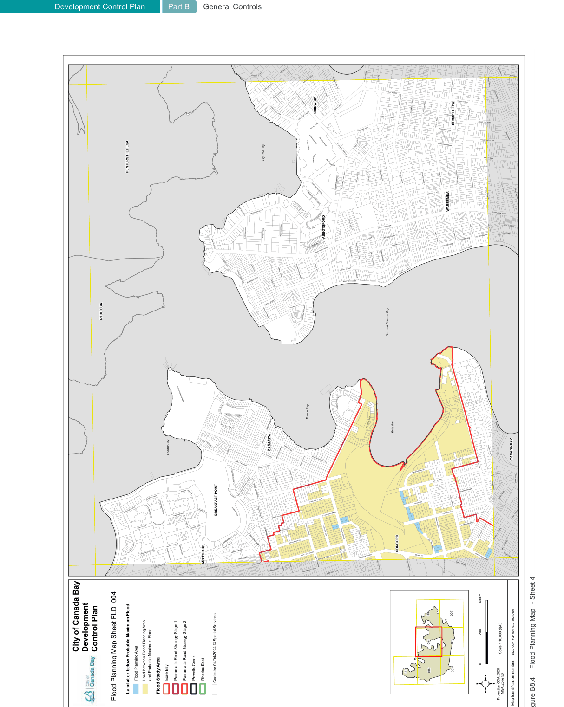
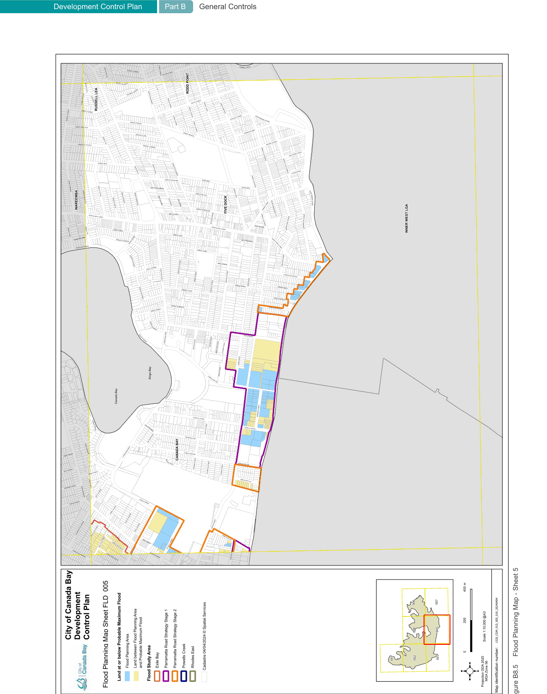

#### B8.6  Flood planning maps

> [Picture on page 104: a picture, saved as a picture (images/part-b-general-controls-page-104-1.gif, 150 dpi).]
> Words printed on the picture (title and legend, copied from the PDF):
> Development Control Plan
> Part B General Controls
> Figure B8.2
> Flood Planning Map  - Sheet 2

> [Picture on page 105: a picture, saved as a picture (images/part-b-general-controls-page-105-1.gif, 150 dpi).]
> Words printed on the picture (title and legend, copied from the PDF):
> Development Control Plan
> Part B General Controls
> Figure B8.3
> Flood Planning Map - Sheet 3

> [Picture on page 106: a picture, saved as a picture (images/part-b-general-controls-page-106-1.gif, 150 dpi).]
> Words printed on the picture (title and legend, copied from the PDF):
> Development Control Plan
> Part B General Controls
> Figure B8.4
> Flood Planning Map  - Sheet 4

> [Picture on page 107: a picture, saved as a picture (images/part-b-general-controls-page-107-1.gif, 150 dpi).]
> Words printed on the picture (title and legend, copied from the PDF):
> Development Control Plan
> Part B General Controls
> Figure B8.5
> Flood Planning Map - Sheet 5
