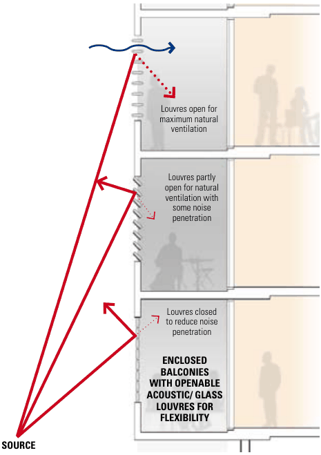
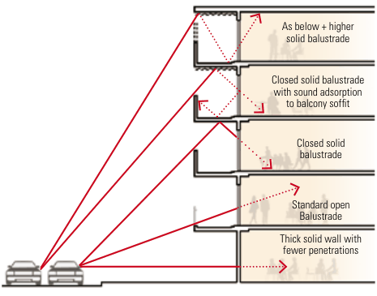

#### B13.9  Transport corridor amenity impacts

• Queens Road (Five Dock, Concord)

• Gipps Street Concord

#### Objectives

• Patterson Street Concord

• Concord Road (Concord West, Concord, North Strathfield)

O1. To protect building users from negative impacts (noise, air quality, vibration) from road and rail corridors.

• Great North Road Five Dock

#### Controls

• Ramsay Road Five Dock An acoustic report must be provided to demonstrate compliance.

C2. For residential components of new development, noise sensitive areas (living rooms, bedrooms) are located away from road and rail corridors.

C1. Development must consider the provisions in Division 15, Subdivision 2 of State Environmental Planning Policy (Transport and Infrastructure) 2021 and Development Near Rail Corridors and Busy Roads Interim Guidelines (2008, NSW Department of Planning) for land in or adjacent to a rail corridor, or a road corridor for a freeway, tollway, transitway, or with an average daily traffic volume of more than 20,000 vehicles.

C3. Windows located towards road and rail corridors are to be double-glazed (or have laminated glazing) and have acoustic seals.

Roads with a high traffic volume may include:

C4. Internal habitable rooms of dwellings are to be designed to achieve internal noise levels of no greater than 50dBA.

> [Picture on page 122: a map, saved as a picture (images/part-b-general-controls-page-122-40.gif, 150 dpi); the street names and other small labels are on the picture.]
> Words printed on the picture (title and legend, copied from the PDF):
> figure 3.16: Enclosable
> balconies facing the
> Louvres open for
> open for natural
> to reduce noise

• Homebush Bay Drive (Rhodes, Liberty Grove, Concord)

road

• Parramatta Road (North Strathfield, Strathfield, Concord, Five Dock)

Where balconies are required, solid balustrades with sound absorption material added to the underside of balconies above is a good means of reducing noise entering the building.

• Victoria Road Drummoyne

• Lyons Road (Russell Lea, Drummoyne)

• Lyons Road West (Canada Bay, Five Dock)

Providing enclosed balconies (or winter gardens) is another means of reducing the noise entering a building. Where enclosed balconies are used ventilation may need to be considered. By installing acoustic louvres ventilation requirements and reduced noise can be addressed. These approaches are shown in figure 3.16.

> [Picture on page 122: a map, saved as a picture (images/part-b-general-controls-page-122-61.gif, 150 dpi); the street names and other small labels are on the picture.]
> Words printed on the picture (title and legend, copied from the PDF):
> As below + higher
> figure 3.15: Balcony treatments
> which reduce traffic noise
> Closed solid balustrade
> with sound adsorption
> to balcony soffit
> Thick solid wall with

#### SOURCE

Figure B13.1 Noise mitigating facade treatments (Source: Development Near Rail Corridors And Busy Roads Interim Guideline, NSW)
