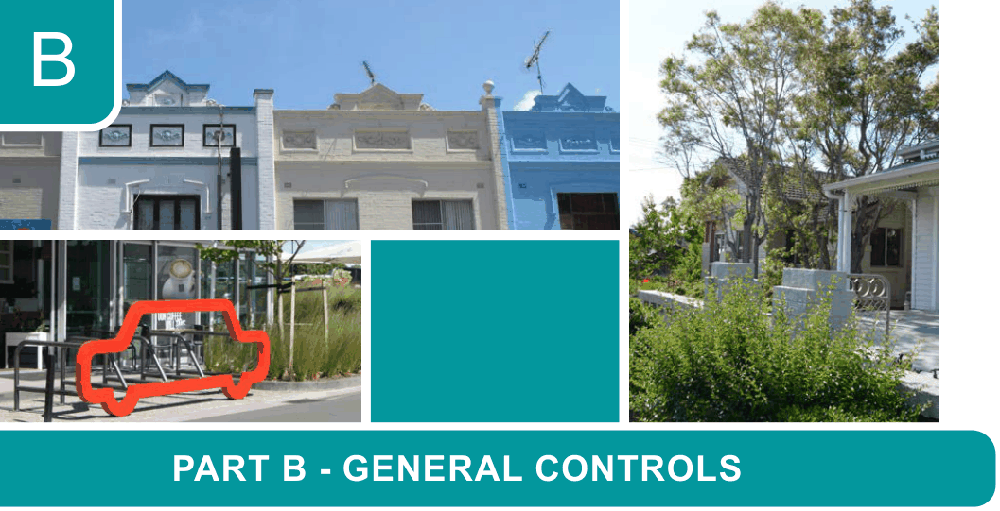

# Canada Bay Development Control Plan - Part B General Controls

> This chapter is split into 60 section file(s), one per numbered heading, in the order they appear in the PDF.

Source PDF: [DCP-03_Part-B-General-Controls_v2022-08-26.pdf](DCP-03_Part-B-General-Controls_v2022-08-26.pdf)

> [Picture on page 1: a picture, saved as a picture (images/part-b-general-controls-page-1-1.gif, 150 dpi).]

### B

### PART B - GENERAL CONTROLS

| B1 | Accessibility....................................................................................................................B-3 B1.1 Adaptable housing ................................................................................................ B-3 B1.2 Accessible Design .................................................................................................B-4 |
|---|---|
| B2 | Telecommunications and radiocommunications ........................................................B-5 B2.1 To what facilities does this Part apply? ................................................................. B-5 B2.2 What is the purpose of this Part?.......................................................................... B-5 B2.3 Design controls......................................................................................................B-6 |
| B3 | Vehicle and bicycle parking and access......................................................................B-9 B3.1 Vehicle Parking......................................................................................................B-9 B3.2 Single Dwellings, Semi-Detached Dwellings and Dual Occupancies ................. B-14 B3.3 Multi-dwelling housing, multi dwelling housing (terraces), manor houses and residential flat buildings.......................................................................................B-18 B3.4 Residential low density car parking rates............................................................ B-19 B3.5 Residential medium/high density car parking rates............................................. B-20 B3.6 Residential medium/high density car parking rates maps................................... B-22 B3.7 Accessible car parking rates................................................................................ B-29 B3.8 Non-residential and commercial car parking rates.............................................. B-30 B3.9 Industrial car parking rates .................................................................................. B-33 B3.10 Special Precincts ...............................................................................................B-34 B3.11 Bicycle parking and storage facilities................................................................. B-36 B3.12 End of trip facilities ............................................................................................ B-38 B3.13 Electric Vehicles ................................................................................................B-39 B3.14 Common loading docks and service vehicle parking ........................................ B-42 B3.15 Car Share .......................................................................................................... B-44 |
| B4 | Waste Management ......................................................................................................B-45 B4.1 General Controls .................................................................................................B-45 B4.2 Single Dwellings and Dual Occupancies............................................................. B-47 B4.3 Multi-unit Dwelling Residential Development ...................................................... B-47 B4.4 Controls for Mixed Use Developments................................................................ B-59 |

B5  Water conservation.......................................................................................................B-64

B6  Trees and Urban Ecology ............................................................................................B-65

B6.1  Urban Forest........................................................................................................ B-65

B6.2  Tree pruning and/or removal ............................................................................... B-68

B6.3  Biodiversity ..........................................................................................................B-71

B6.4  Biodiversity Corridors ..........................................................................................B-79

B6.5  Assessment of trees ...........................................................................................B-87

B6.6  Replacement tree planting................................................................................... B-89

B6.7  Waterways and Foreshore Areas ........................................................................ B-90

B6.8  Threatened and migratory species ..................................................................... B-91

B7  Engineering Requirements for Development ............................................................B-99

B7.1  Engineering works ...............................................................................................B-99

B7.2  Objectives ........................................................................................................... B-99

B8  Flooding Control ........................................................................................................B-100

B8.1  Introduction........................................................................................................B-100

B8.2  Relationship to other documents....................................................................... B-100

B8.3  Land to which this Flood Control clause applies...............................................B-100

B8.4  Sea level rise.....................................................................................................B-102

B8.5  Flood studies .....................................................................................................B-102

B8.6  Flood planning maps .........................................................................................B-103

B8.7  Development Controls .......................................................................................B-108

B8.8  Details of the Flood Controls .............................................................................B-111

B9  Contaminated land .....................................................................................................B-113

B10  Energy Infrastructure ..............................................................................................B-114

B10.1  Energy efficiency ............................................................................................ B-114

B10.2  Substations ..................................................................................................... B-114

B11  Subdivision and allotment size ..............................................................................B-115

B12  Isolated sites ............................................................................................................ B-116

B13  Environmental criteria and residential amenity ...................................................B-117

B13.1  Topography...................................................................................................... B-117

B13.2  Harbour foreshore development and foreshore access.................................. B-117

B13.3  Solar access to neighbours ............................................................................. B-119

B13.4  Solar access to dwellings within the development.......................................... B-119

B13.5  Solar access for solar panels .......................................................................... B-120

B13.6  Solar access general guidelines...................................................................... B-120

B13.7  Shade guidelines ............................................................................................B-121

B13.8  Indoor air quality..............................................................................................B-121

B13.9  Transport corridor amenity impacts ................................................................. B-122

B13.10  Crime prevention through environmental design...........................................B-123

<!-- sections -->
## Sections

1. [B1.1 Adaptable housing](01-b1-1-adaptable-housing.md)
2. [B1.2 Accessible Design](02-b1-2-accessible-design.md)
3. [B2 Telecommunications and radiocommunications](03-b2-telecommunications-and.md)
4. [B2.1 To what facilities does this Part](04-b2-1-to-what-facilities-does-this-part.md)
5. [B2.2 What is the purpose of this Part?](05-b2-2-what-is-the-purpose-of-this-part.md)
6. [B2.3 Design controls](06-b2-3-design-controls.md)
7. [B3.1 Vehicle Parking](07-b3-1-vehicle-parking.md)
8. [B3.2 Single Dwellings, Semi-Detached](08-b3-2-single-dwellings-semi-detached.md)
9. [B3.4 Residential low density car parking rates](09-b3-4-residential-low-density-car-parking.md)
10. [B3.5 Residential medium/high density car parking rates](10-b3-5-residential-medium-high-density-car.md)
11. [B3.6 Residential medium/high density car parking rates maps](11-b3-6-residential-medium-high-density-car.md)
12. [B3.7 Accessible car parking rates](12-b3-7-accessible-car-parking-rates.md)
13. [B3.8 Non-residential and commercial car parking rates](13-b3-8-non-residential-and-commercial-car.md)
14. [B3.9 Industrial car parking rates](14-b3-9-industrial-car-parking-rates.md)
15. [B3.10 Special Precincts](15-b3-10-special-precincts.md)
16. [B3.11 Bicycle parking and storage](16-b3-11-bicycle-parking-and-storage.md)
17. [B3.12 End of trip facilities](17-b3-12-end-of-trip-facilities.md)
18. [B3.13 Electric Vehicles](18-b3-13-electric-vehicles.md)
19. [B3.14 Common loading docks and service](19-b3-14-common-loading-docks-and-service.md)
20. [B3.15 Car Share](20-b3-15-car-share.md)
21. [B4 Waste Management](21-b4-waste-management.md)
22. [B4.1 General Controls](22-b4-1-general-controls.md)
23. [B4.2 Single Dwellings and Dual](23-b4-2-single-dwellings-and-dual.md)
24. [B4.3 Multi-unit Dwelling Residential](24-b4-3-multi-unit-dwelling-residential.md)
25. [B4.4 Controls for Mixed Use](25-b4-4-controls-for-mixed-use.md)
26. [B5 Water conservation](26-b5-water-conservation.md)
27. [B6 Trees and Urban Ecology](27-b6-trees-and-urban-ecology.md)
28. [B6.1 Urban Forest](28-b6-1-urban-forest.md)
29. [B6.2 Tree pruning and/or removal](29-b6-2-tree-pruning-and-or-removal.md)
30. [B6.3 Biodiversity](30-b6-3-biodiversity.md)
31. [B6.4 Biodiversity Corridors](31-b6-4-biodiversity-corridors.md)
32. [B6.5 Assessment of trees](32-b6-5-assessment-of-trees.md)
33. [B6.6 Replacement tree planting](33-b6-6-replacement-tree-planting.md)
34. [B6.7 Waterways and Foreshore Areas](34-b6-7-waterways-and-foreshore-areas.md)
35. [B6.8 Threatened and migratory species](35-b6-8-threatened-and-migratory-species.md)
36. [B7.1 Engineering works](36-b7-1-engineering-works.md)
37. [B7.2 Objectives](37-b7-2-objectives.md)
38. [B8.1 Introduction](38-b8-1-introduction.md)
39. [B8.2 Relationship to other documents](39-b8-2-relationship-to-other-documents.md)
40. [B8.3 Land to which this Flood Control](40-b8-3-land-to-which-this-flood-control.md)
41. [B8.4 Sea level rise](41-b8-4-sea-level-rise.md)
42. [B8.5 Flood studies](42-b8-5-flood-studies.md)
43. [B8.6 Flood planning maps](43-b8-6-flood-planning-maps.md)
44. [B8.7 Development Controls](44-b8-7-development-controls.md)
45. [B8.8 Details of the Flood Controls](45-b8-8-details-of-the-flood-controls.md)
46. [B9 Contaminated land](46-b9-contaminated-land.md)
47. [B10.1 Energy efficiency](47-b10-1-energy-efficiency.md)
48. [B10.2 Substations](48-b10-2-substations.md)
49. [B11 Subdivision and allotment size](49-b11-subdivision-and-allotment-size.md)
50. [B12 Isolated sites](50-b12-isolated-sites.md)
51. [B13.1 Topography](51-b13-1-topography.md)
52. [B13.2 Harbour foreshore development](52-b13-2-harbour-foreshore-development.md)
53. [B13.3 Solar access to neighbours](53-b13-3-solar-access-to-neighbours.md)
54. [B13.4 Solar access to dwellings within](54-b13-4-solar-access-to-dwellings-within.md)
55. [B13.5 Solar access for solar panels](55-b13-5-solar-access-for-solar-panels.md)
56. [B13.6 Solar access general guidelines](56-b13-6-solar-access-general-guidelines.md)
57. [B13.7 Shade guidelines](57-b13-7-shade-guidelines.md)
58. [B13.8 Indoor air quality](58-b13-8-indoor-air-quality.md)
59. [B13.9 Transport corridor amenity impacts](59-b13-9-transport-corridor-amenity-impacts.md)
60. [B13.10 Crime prevention through environmental design](60-b13-10-crime-prevention-through-environmental.md)
