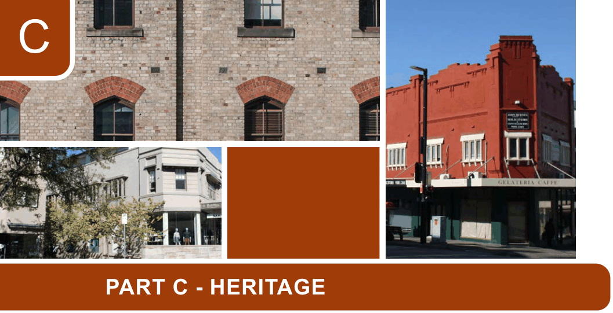

# Canada Bay Development Control Plan - Part C Heritage

> This chapter is split into 47 section file(s), one per numbered heading, in the order they appear in the PDF.

Source PDF: [DCP-04_Part-C-Heritage_v2022-05-16.pdf](DCP-04_Part-C-Heritage_v2022-05-16.pdf)

> [Picture on page 1: a picture, saved as a picture (images/part-c-heritage-page-1-1.gif, 150 dpi).]

### C

### PART C - HERITAGE

| C1 | Heritage reports to accompany development applications C1.1 Statement of heritage impact ................................................................................C-3 C1.2 Conservation policy ...............................................................................................C-3 C1.3 Conservation management plan ...........................................................................C-3 C1.4 Requirements for heritage reports ........................................................................C-4 |
|---|---|
| C2 | Development of heritage items C2.1 Setting ...................................................................................................................C-5 C2.2 Scale......................................................................................................................C-5 C2.3 Form and detailing.................................................................................................C-6 C2.4 Materials and colours ............................................................................................C-7 C2.5 Doors and windows...............................................................................................C-7 C2.6 Car parking............................................................................................................C-8 C2.7 Fencing..................................................................................................................C-9 C2.8 Landscape elements including paving and driveways........................................C-10 C2.9 Outbuildings......................................................................................................... C-11 C2.10 Services............................................................................................................. C-11 C2.11 Demolition .........................................................................................................C-12 C2.12 Subdivision ........................................................................................................C-13 C2.13 Signs ................................................................................................................C-13 C2.14 Adaptive reuse...................................................................................................C-14 C2.15 Structural Integrity .............................................................................................C-15 C2.16 Conservation Works ..........................................................................................C-16 C2.17 Secondary dwellings .........................................................................................C-17 |
| C3 | Development in the vicinity of a heritage item or a heritage conservation area C3.1 General................................................................................................................C-18 C3.2 Scale....................................................................................................................C-19 C3.3 Siting....................................................................................................................C-19 C3.4 Materials and Colours .........................................................................................C-20 C3.5 Landscaping ........................................................................................................C-20 |

<!-- sections -->
## Sections

1. [C4 Development in Heritage Conservation Areas](01-c4-development-in-heritage-conservation.md)
2. [C1 Heritage reports to accompany development applications](02-c1-heritage-reports-to-accompany.md)
3. [C1.1 Statement of heritage impact](03-c1-1-statement-of-heritage-impact.md)
4. [C1.2 Conservation policy](04-c1-2-conservation-policy.md)
5. [C1.3 Conservation management plan](05-c1-3-conservation-management-plan.md)
6. [C1.4 Requirements for heritage reports](06-c1-4-requirements-for-heritage-reports.md)
7. [C2 Development of heritage items](07-c2-development-of-heritage-items.md)
8. [C2.1 Setting](08-c2-1-setting.md)
9. [C2.2 Scale](09-c2-2-scale.md)
10. [C2.3 Form and detailing](10-c2-3-form-and-detailing.md)
11. [C2.4 Materials and colours](11-c2-4-materials-and-colours.md)
12. [C2.5 Doors and windows](12-c2-5-doors-and-windows.md)
13. [C2.6 Car parking](13-c2-6-car-parking.md)
14. [C2.7 Fencing](14-c2-7-fencing.md)
15. [C2.8 Landscape elements including](15-c2-8-landscape-elements-including.md)
16. [C2.9 Outbuildings](16-c2-9-outbuildings.md)
17. [C2.10 Services](17-c2-10-services.md)
18. [C2.11 Demolition](18-c2-11-demolition.md)
19. [C2.12 Subdivision](19-c2-12-subdivision.md)
20. [C2.13 Signs](20-c2-13-signs.md)
21. [C2.15 Structural Integrity](21-c2-15-structural-integrity.md)
22. [C2.16 Conservation Works](22-c2-16-conservation-works.md)
23. [C2.17 Secondary dwellings](23-c2-17-secondary-dwellings.md)
24. [C3 Development in the vicinity of a heritage item or a heritage](24-c3-development-in-the-vicinity-of-a.md)
25. [C3.1 General](25-c3-1-general.md)
26. [C3.2 Scale](26-c3-2-scale.md)
27. [C3.3 Siting](27-c3-3-siting.md)
28. [C3.4 Materials and Colours](28-c3-4-materials-and-colours.md)
29. [C3.5 Landscaping](29-c3-5-landscaping.md)
30. [C4 Development in Heritage Conservation Areas](30-c4-development-in-heritage-conservation.md)
31. [C4.1 General](31-c4-1-general.md)
32. [C4.2 Scale](32-c4-2-scale.md)
33. [C4.3 Form and detailing](33-c4-3-form-and-detailing.md)
34. [C4.4 Siting](34-c4-4-siting.md)
35. [C4.5 Materials and colours](35-c4-5-materials-and-colours.md)
36. [C4.6 Doors and Windows](36-c4-6-doors-and-windows.md)
37. [C4.7 Car parking](37-c4-7-car-parking.md)
38. [C4.8 Fencing](38-c4-8-fencing.md)
39. [C4.9 Landscape elements including](39-c4-9-landscape-elements-including.md)
40. [C4.10 Outbuildings](40-c4-10-outbuildings.md)
41. [C4.11 Services](41-c4-11-services.md)
42. [C4.12 Demolition](42-c4-12-demolition.md)
43. [C4.13 Subdivision](43-c4-13-subdivision.md)
44. [C4.14 Signs](44-c4-14-signs.md)
45. [C4.15 Conservation Works](45-c4-15-conservation-works.md)
46. [C4.16 Secondary Dwellings](46-c4-16-secondary-dwellings.md)
47. [C5 Additional heritage provisions to be considered](47-c5-additional-heritage-provisions-to-be.md)
