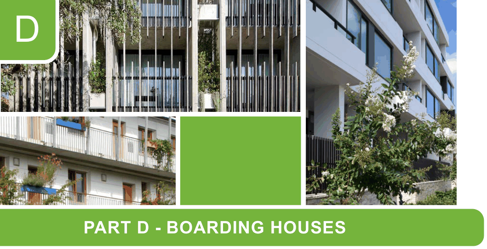

# Canada Bay Development Control Plan - Part D Boarding Houses

> This chapter is split into 2 section file(s), one per numbered heading, in the order they appear in the PDF.

Source PDF: [ECM_7719478_v3_CCB-DCP-05_Part-D-Character-Areas_v2022-05-16.pdf](ECM_7719478_v3_CCB-DCP-05_Part-D-Character-Areas_v2022-05-16.pdf)

> [Picture on page 1: a picture, saved as a picture (images/part-d-boarding-houses-page-1-1.gif, 150 dpi).]

### D

### PART D - BOARDING HOUSES

D1  Land to which Part D applies ........................................................................................D-2

D2  Council approval process for boarding houses  .......................................................D-2

<!-- sections -->
## Sections

1. [D1 Land to which Part D applies](01-d1-land-to-which-part-d-applies.md)
2. [D2 Council approval process for boarding houses](02-d2-council-approval-process-for-boarding.md)
