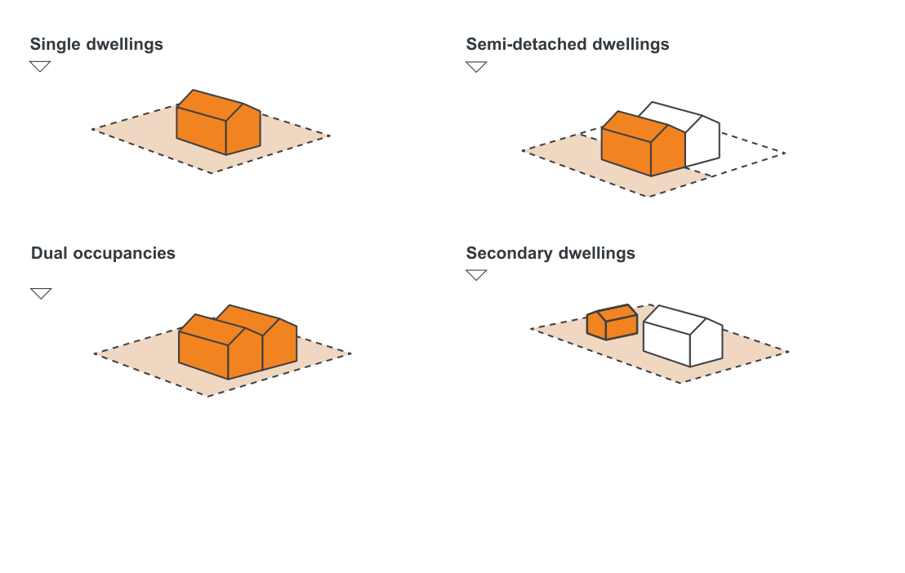

### E1  Land to which Part E applies

Part E applies to development for the purpose of single dwellings, semi-detached dwellings, dual occupancies and secondary dwellings.

Figure E1.1 - Types of dwellings Part E applies to

> [Picture on page 2: a picture, saved as a picture (images/part-e-single-dwellings-semi-detached-dwellings-dual-occu-page-2-6.gif, 150 dpi).]

#### Single dwellings

#### Semi-detached dwellings

#### Dual occupancies

#### Secondary dwellings

Single Dwellings, Semi-Detached Dwellings, Dual Occupancies and Secondary Dwellings

Development Control Plan Part E
