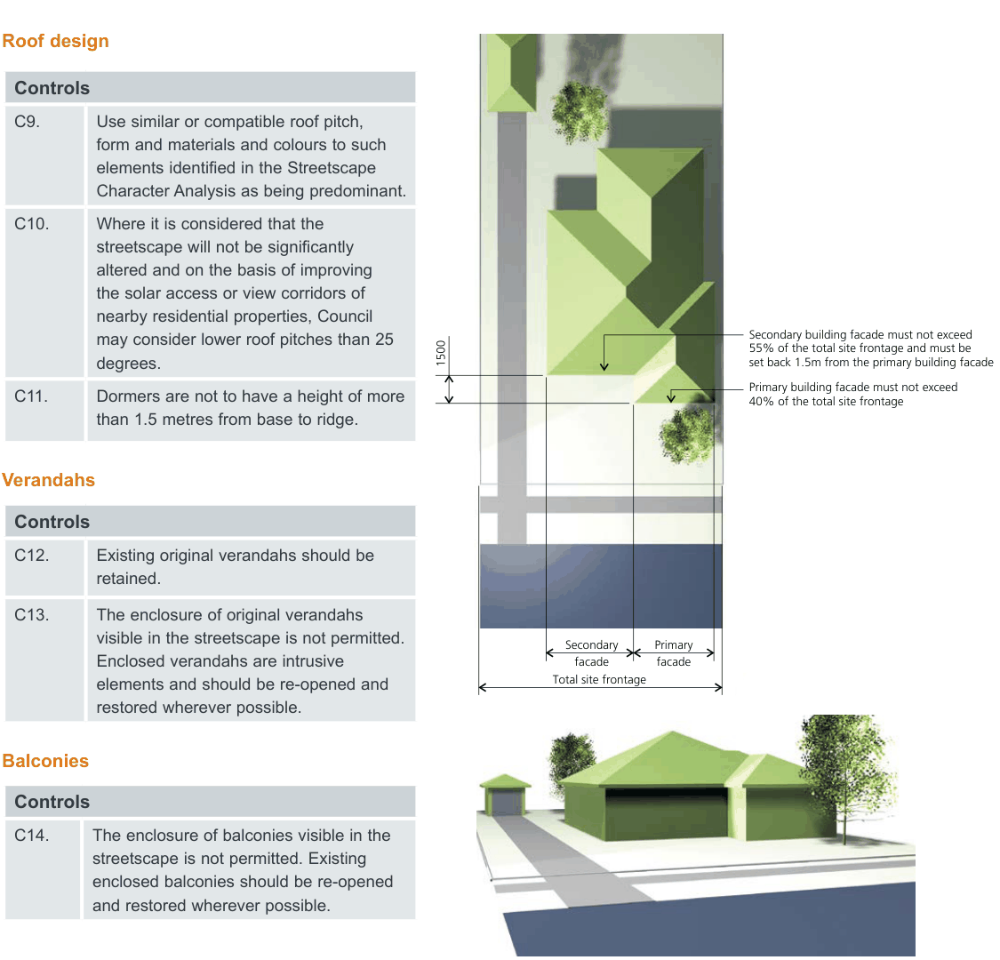

### E2  Design Quality

E2.1  Design of dwelling houses,

#### semi-detached dwellings, dual

#### occupancies and secondary

#### dwellings

#### Objectives

New buildings and alterations and additions should:

O1. Reflect the dominant building pattern of the streetscape with regard to the location, spacing and proportion of built elements in the streetscape.

O2. Complement and conserve the visual character of the street and neighbourhood through appropriate building scale, form, detail and finish. O3. Reinforce existing streetscape features such as building setbacks, alignments, heights and fence design.

O4. Ensure that development conserves and respects significant streetscape items (such as street tree planting) and points of interest (such as views to waterways).

#### Street presentation

| Controls |  |
|---|---|
| C1. | Buildings adjacent to the street should address the street by having a front door and/ or living room addressing the street. The frontage of buildings should by their design, and the location of entries (including pedestrian pathways), be readily apparent from the street. |
| C2. | Roller shutters, security bars and grilles are not permitted on window and door openings that have a frontage to the street or that are adjacent to public open space. |

#### Front facade articulation

| Controls |  |
|---|---|
| C3. | New buildings and additions should be designed with an articulated front façade - See Figure E2.1. The front façade should comply with the following requirements: • Where a garage is attached to a dwelling it must not be located within the primary façade; and • The secondary building façade should be set back a minimum of 1.5 metres from the primary building façade. |
| C4. | Entry alcoves recessed into, or protruding from, the front facade will not be considered as an articulated front facade. |
| C5. | Secondary building façade must not exceed 55% of the total site frontage and must be setback 1.5m from the primary building façade. |
| C6. | Primary building façade must not exceed 40% of the total site frontage. |
| C7. | The ground floor of the primary building facade must contain a habitable room with a window. |
| C8. | Upper levels, including balconies must not extend further forward than the ground floor primary or secondary façade. |

#### Refer to Figure E2.1

Single Dwellings, Semi-Detached Dwellings, Dual Occupancies and Secondary Dwellings

> [Picture on page 4: a picture, saved as a picture (images/part-e-single-dwellings-semi-detached-dwellings-dual-occu-page-4-2.gif, 150 dpi).]
> Words printed on the picture (copied from the PDF):
> 1500
> Secondary building facade must not exceed
> 55% of the total site frontage and must be
> set back 1.5m from the primary building facade
> Primary building facade must not exceed
> 40% of the total site frontage
> Secondary Primary
> facade
> facade
> Total site frontage

Development Control Plan Part E

#### Roof design

| Controls |  |
|---|---|
| C9. | Use similar or compatible roof pitch, form and materials and colours to such elements identified in the Streetscape Character Analysis as being predominant. |
| C10. | Where it is considered that the streetscape will not be significantly altered and on the basis of improving the solar access or view corridors of nearby residential properties, Council may consider lower roof pitches than 25 degrees. |
| C11. | Dormers are not to have a height of more than 1.5 metres from base to ridge. |

#### Verandahs

| Controls |  |
|---|---|
| C12. | Existing original verandahs should be retained. |
| C13. | The enclosure of original verandahs visible in the streetscape is not permitted. Enclosed verandahs are intrusive elements and should be re-opened and restored wherever possible. |

#### Balconies Controls

C14. The enclosure of balconies visible in the streetscape is not permitted. Existing enclosed balconies should be re-opened and restored wherever possible.

Figure E2.1 - Example of front facade articulation control

Single Dwellings, Semi-Detached Dwellings, Dual Occupancies and Secondary Dwellings

Development Control Plan Part E

#### Additions to semi-detached dwellings

| Controls |  |
|---|---|
| C15. | Any alteration and addition to an individual semi should recognise it as being one pair or group of similar, identical or complementary buildings. In this regard, any extension should be carefully integrated with the building to which it is attached, both in its present form and on the assumption that the adjoining owner may wish to undertake extensions in the future. |
| C16. | First floor additions should be set back from the principal street frontage of the building, in order to maintain a substantial portion of the existing roof unaltered over the front of the building and to locate the bulk of new development towards the rear. First floor additions should be set back beyond the apex or main ridge of the principal roof form of the building and should retain chimneys |
| C17. | The choice of materials utilised on additions and alterations to a semi-detached dwelling should complement the building as a whole. |

#### Design of attached dual occupancies Objective

O5. Ensure that the design of attached dual occupancies complements and enhances the character and streetscape of their locality and protects the amenity of neighbouring properties.

| Controls |  |
|---|---|
| C18. | Attached dual occupancies where both dwellings are oriented towards the same street frontage are to ensure that one dwelling does not extend into the rear yard further than 5 metres beyond the other dwelling. |
| C19. | Attached dual occupancies should reflect the building form and roof lines of adjoining dwellings, where a pattern is established by a group of adjoining houses. |

#### Driveways and access ways for attached dual

occupancies

| Controls |  |
|---|---|
| C20. | No more than one third of the width of the frontage of a property should be used for driveways and access ways. |
| C21. | The provision of access to garages and additional parking spaces for dual occupancy dwellings should minimise paved surfaces to the front of the building. |
| C22. | Garages for each dwelling within an attached dual occupancy should be single car width only. |
| C23. | Where all existing dwellings are located to the left or right side of their respective allotment and have a side driveway, this pattern should also be observed by the design of the attached dual occupancy. |

#### Driveways and access ways for secondary

dwellings

| Controls |  |
|---|---|
| C24. | Access to parking spaces for both the secondary dwelling and principal dwelling are to be via a common or shared driveway. |
| C25. | Where the principal dwelling has a secondary street frontage, a second vehicular access for the secondary dwelling is permitted. |

Note: Parking is not required for a secondary dwelling.

Single Dwellings, Semi-Detached Dwellings, Dual Occupancies and Secondary Dwellings

Development Control Plan Part E

E2.2  Materials, colour schemes and

#### details

#### Objectives

O1. To ensure that the choice of external materials, colour schemes and building details on new development and existing houses visible from a public place, reinforces and enhances any identifiable visual cohesiveness or special qualities evident in the street and the adjoining locality.

O2. To encourage complementary and sympathetic wall treatments on new development and existing houses that are consistent with the architectural style of existing dwellings found in the street and the adjoining locality.

O3. To encourage roof forms and materials consistent with the positive qualities evident in the street and the adjoining locality.

O4. To encourage verandahs/balconies etc. that are consistent with original structures evident in the street and the adjoining locality. O5. To permit flexibility in the choice of materials to meet the practical requirements of energy efficiency, construction and maintenance costs.

#### Controls

The colour and surface finish of external building materials should minimise the overall visual impact of new development and be sympathetic to the surrounding locality as identified in the relevant Character statement and the Streetscape Character Analysis submitted with the application.

#### Walls/ masonry

| Controls |  |
|---|---|
| C1. | Use darker face brick in streetscapes which predominantly exhibit this external finish. |
| C2. | Retain or incorporate existing sandstone fences, walls or wall bases into the design of the building. |

#### Roof finish Controls

| C3. | Roof colours and materials shall be compatible to such elements identified as being predominant in the Streetscape Character Analysis. |
|---|---|

#### Balconies

| Controls |  |
|---|---|
| C4. | First floor balcony balustrades facing the street should use a different material to the main wall finish. |

#### Colour schemes

| Controls |  |
|---|---|
| C5. | Subject to the Streetscape Character Analysis, no large expansive surface of predominantly white, light or primary colours which would dominate the streetscape or other vista should be used. |
| C6. | New development should incorporate colour schemes that have a hue and tonal relationship with the predominant colour schemes found in the street. |
| C7. | Matching buildings in a row should be finished in the same colour, or have a tonal relationship. |

#### General

| Controls |  |
|---|---|
| C8. | All materials and finishes utilised should have low reflectivity. |

Single Dwellings, Semi-Detached Dwellings, Dual Occupancies and Secondary Dwellings

Development Control Plan Part E
