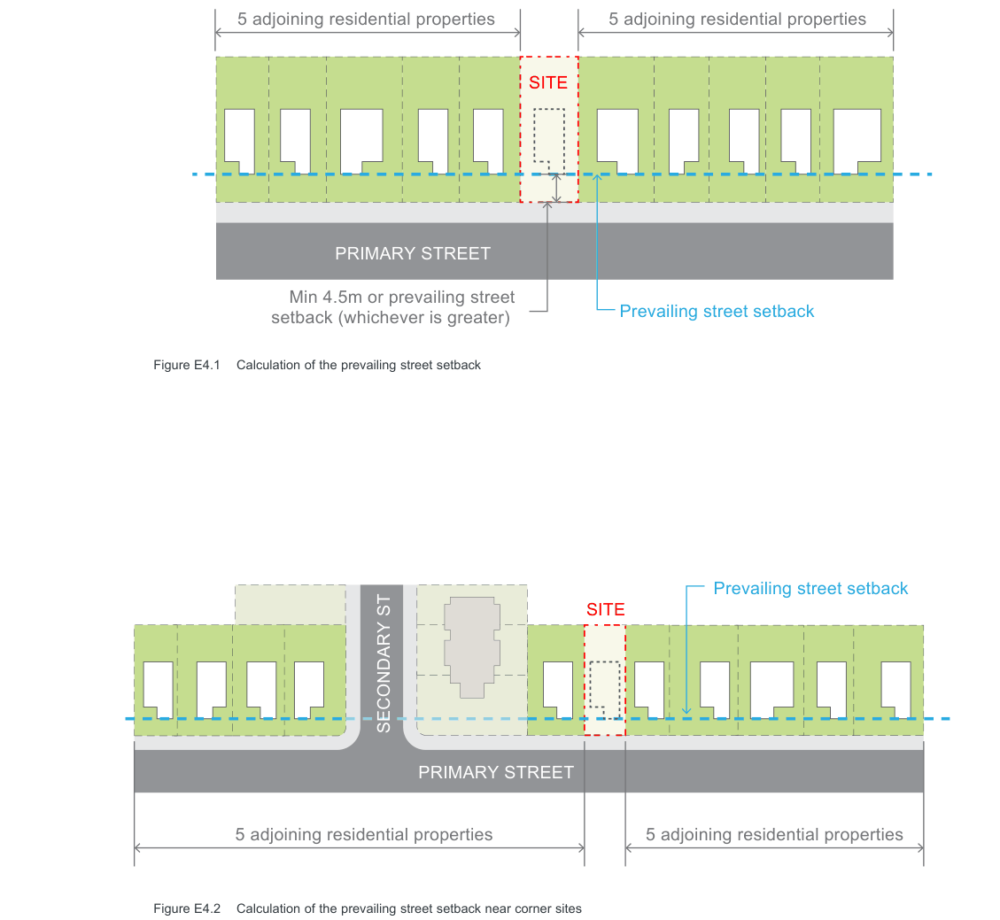
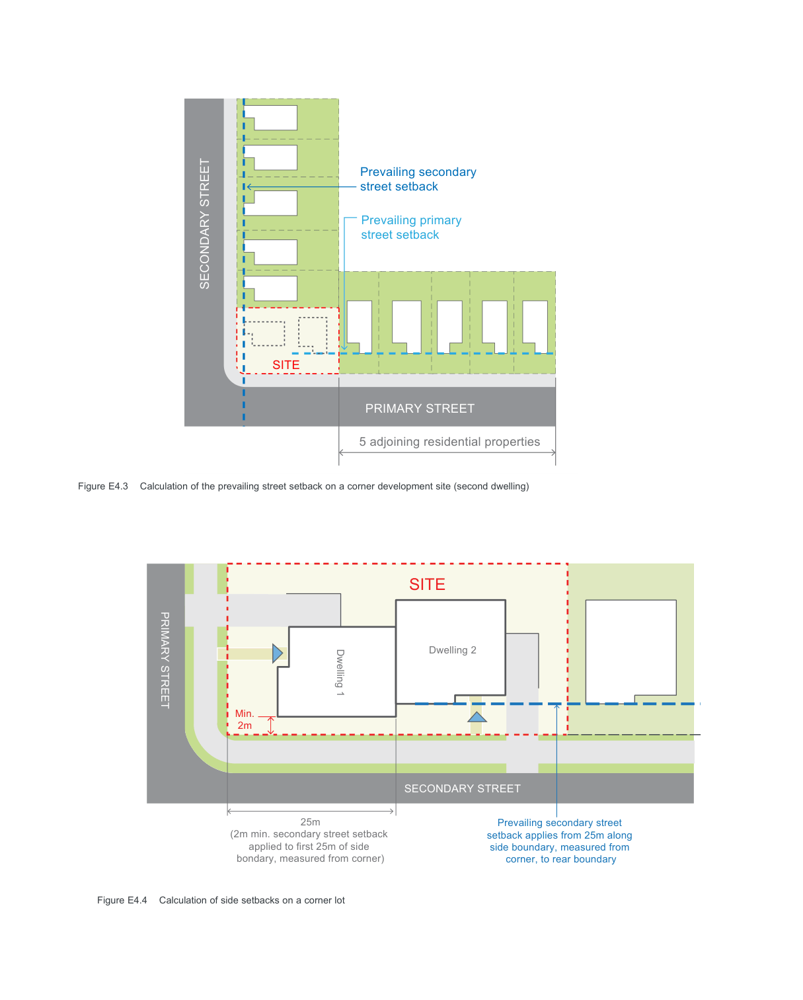
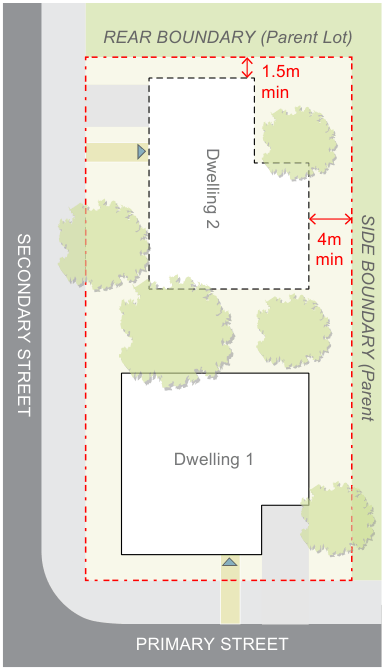
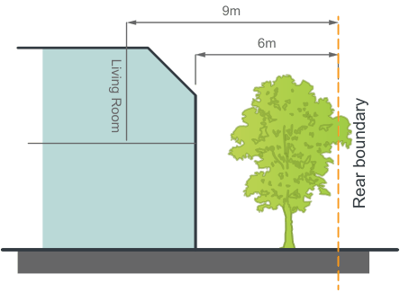
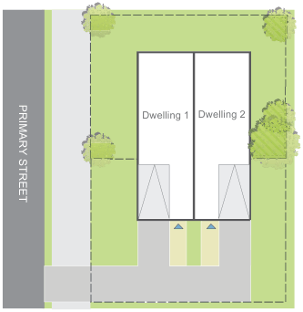

#### E4.2  Building setbacks

#### Objectives

O1. To integrate new development with the established setback character of the street. O2. Preserve significant vegetation which contributes to the public domain and allows for street landscape character to be enhanced. O3. Ensure adequate separation between buildings consistent with the established character and rhythm of built elements in the street. O4. To ensure adequate separation between buildings for visual and acoustic privacy. O5. Maximise solar access to achieve amenity for neighbours.

#### Front setbacks - primary street

| Controls |  |
|---|---|
| C1. | The front setback of all residential buildings is to be a minimum of 4.5 metres or no less than the Prevailing Street Setback, whichever is the greater. The “Prevailing Street Setback” is the setback calculated by averaging the setback of five (5) adjoining residential properties on both sides of the development. (Refer Figure E4.1) Where there are fewer than five residential properties or a non-residential use property between a street end or corner and the development site, the “Prevailing Street Setback” is the setback calculated by averaging the setback of the five next residential properties fronting the street (if any) on both sides of the property. (Refer Figure E4.2) Note: In many instances, the front setback of buildings in Canada Bay is 7.5 metres or greater and development in these areas will be required to comply with this prevailing setback. |
| C2. | No balconies, entry porches or verandahs are permitted to encroach within the front setback. The only encroachments permitted within the front setback are restricted to eaves and awnings for weather protection but no supporting columns or posts. |
| C3. | Secondary dwellings must be located behind the front building line of the principal dwelling; |

Note: On a site with two street frontages, the primary street is considered to be the one to which the property is addressed.

Single Dwellings, Semi-Detached Dwellings, Dual Occupancies and Secondary Dwellings

| Semi-detached dwellings | • Single storey semi-detached dwellings are to be set back a minimum of 900mm from side boundaries of the parent lot. • The second storey of all semi-detached dwellings is to be set back a minimum of 1500mm from side boundaries of the parent lot. |
|---|---|
| Secondary dwellings | • All walls are to be set back a minimum of 1500mm. |

Development Control Plan Part E

#### Front setbacks - parallel road lot

| Controls |  |
|---|---|
| C4. | If the secondary street (other than a lane) is at the rear of the property, any dwelling facing the secondary street is to use the secondary street as its primary street and be designed to comply with the Front setback – primary street controls. |

#### Front setbacks - corner lot

| Controls |  |
|---|---|
| C5. | If the secondary street (other than a lane) is at the side of the property, any dwelling proposed to the rear of the site must acknowledge the prevailing street setback of the secondary street. (Refer Figure E4.3) |

#### Side setbacks – single frontage or parallel

road lot

| Controls |  |
|---|---|
| C6. | All developments are to comply with the following numerical requirements: |

| Development | Minimum distance from side boundary of parent lot |
|---|---|
| Dwelling houses | • Single storey dwellings are to be set back a minimum of 900mm from side boundaries. • The second storey of all dwellings are to be set back a minimum of 1500mm from side boundaries. |
| Dual occupancies | • Single storey dual occupancies are to be set back a minimum of 900mm from side boundaries. • The second storey of all dual occupancies is to be set back a minimum of 1500mm from side boundaries. |

Note 1: Upper floor setbacks may be achieved by stepping the building in, integrating any proposed upper floor within the roof form or by setting back both the ground and first floors from the side boundaries.

Note 2: Sites that have more than one street frontage (other than a lane) will have additional setback requirements.

#### Side setbacks – corner lot

| Controls |  |
|---|---|
| C7. | If two dwellings are proposed with one behind the other then any dwelling that faces the primary street must have a secondary street (side setback) of a minimum of 2m for the first 25m measured from the corner. |
| C8. | If two dwellings are proposed with one behind the other then the prevailing street setback for the secondary frontage is to be applied from 25m from the corner to the existing rear boundary of the site. |

(Refer Figure E4.4)

> [Picture on page 13: a picture, saved as a picture (images/part-e-single-dwellings-semi-detached-dwellings-dual-occu-page-13-1.gif, 150 dpi).]
> Words printed on the picture (copied from the PDF):
> 5 adjoining residential properties
> 5 adjoining residential properties
> SITE
> PRIMARY STREET
> Prevailing street setback
> setback (whichever is greater)

Min 4.5m or prevailing street

Figure E4.1 Calculation of the prevailing street setback

> Words printed on the picture (copied from the PDF):
> Prevailing street setback
> SITE
> SECONDARY ST
> PRIMARY STREET
> 5 adjoining residential properties
> 5 adjoining residential properties

Figure E4.2 Calculation of the prevailing street setback near corner sites

> [Picture on page 14: a map, saved as a picture (images/part-e-single-dwellings-semi-detached-dwellings-dual-occu-page-14-1.gif, 150 dpi); the street names and other small labels are on the picture.]
> Labels printed on the map (copied from the PDF, in no particular order):
> Prevailing secondary · street setback · Prevailing primary · street setback · SECONDARY STREET · SITE · PRIMARY STREET · 5 adjoining residential properties · Figure E4.3 Calculation of the prevailing street setback on a corner development site (second dwelling) · Dwelling 2 · Dwelling 1 · PRIMARY STREET · Min. · 2m · SECONDARY STREET · 25m · (2m min. secondary street setback · Prevailing secondary street · setback applies from 25m along · side boundary, measured from · applied to first 25m of side · bondary, measured from corner) · corner, to rear boundary · Figure E4.4 Calculation of side setbacks on a corner lot

#### SITE

Single Dwellings, Semi-Detached Dwellings, Dual Occupancies and Secondary Dwellings

| C15. | The outer edge of excavation, piling and all subsurface walls including driveway excavation to basement car parking for dwelling houses should not be less than 900mm from any boundary. |
|---|---|
| C16. | A basement should not result in a building departing from the prevailing street setback. |
| C17. | A basement must generally be constructed below the existing ground level and remain consistent with the definition of basement in the Canada Bay LEP. |

Development Control Plan Part E

#### Rear setbacks – single street frontage

| Controls |  |
|---|---|
| C9. | All development (not including an outbuilding or secondary dwelling) is to have a minimum rear setback of 6.0 metres measured from the outside face of the development (wall, balcony, deck, post, roof etc). Refer to Canada Bay LEP definition of ‘building line or setback’. |
| C10. | Any living room located on an upper floor is to have a minimum rear setback of 9.0m. |
| C11. | A secondary dwelling is to have a minimum rear setback of 3.0m. |

(Refer Figure E4.5)

#### Rear setbacks – corner lot

| Controls |  |
|---|---|
| C12. | If dwellings are designed to address different street frontages then the dwelling oriented to the secondary frontage shall have a minimum setback to the rear boundary of the parent lot of 1.5 metres and a minimum setback to the side boundary (at rear of dwelling) of 4 metres. (Refer Figure E4.6) |
| C13. | Any living room located on an upper floor is to be oriented towards the street frontage, and not extend through to the rear, to minimise overlooking of side and rear boundaries. Note: For a single dwelling refer to single street frontage controls. |

#### Basement setbacks

| Controls |  |
|---|---|
| C14. | Basement excavation for all development is limited to the area of the building at ground level. The excavation setback includes the driveway access to the basement. |

#### Outbuildings Controls

C18. Outbuildings are to be located behind the main building alignment and should have a minimum setback of 900mm to side and rear boundaries. However, reduced side and rear boundary setbacks may be considered on merit where:

a) they are consistent with the setbacks of outbuildings in the vicinity;

b) they require no maintenance (including roof gutters);

c) there are no adverse impacts to the amenity of the adjoining properties; and

d) the total area of all outbuildings (including any secondary dwellings) does not exceed 35m2.

#### Advisory Notes

Notwithstanding compliance with the above numerical controls, Council may require building setbacks to be increased if necessary to reduce bulk, overshadowing, visual impact, view loss, privacy concerns and to retain existing trees on site.

Any Foreshore Building Line will continue to apply and overrides any setback provisions in this plan.

Single Dwellings, Semi-Detached Dwellings, Dual Occupancies and Secondary Dwellings

> [Picture on page 16: a picture, saved as a picture (images/part-e-single-dwellings-semi-detached-dwellings-dual-occu-page-16-2.gif, 150 dpi).]
> Words printed on the picture (copied from the PDF):
> REAR BOUNDARY (Parent Lot)
> 1.5m
> min
> Dwelling 2
> 4m
> min
> SECONDARY STREET
> SIDE BOUNDARY (Parent
> Dwelling 1
> PRIMARY STREET

Development Control Plan Part E

9m

> [Picture on page 16: a picture, saved as a picture (images/part-e-single-dwellings-semi-detached-dwellings-dual-occu-page-16-5.gif, 150 dpi).]
> Words printed on the picture (copied from the PDF):
> 6m
> Living Room
> Rear boundary

Minimum rear setback control for single street

Figure E4.5

frontage lots

Figure E4.6 Rear setback controls for corner lots

Single Dwellings, Semi-Detached Dwellings, Dual Occupancies and Secondary Dwellings

> [Picture on page 17: a picture, saved as a picture (images/part-e-single-dwellings-semi-detached-dwellings-dual-occu-page-17-2.gif, 150 dpi).]
> Words printed on the picture (copied from the PDF):
> Dwelling 2
> Dwelling 1
> PRIMARY STREET

Development Control Plan Part E
