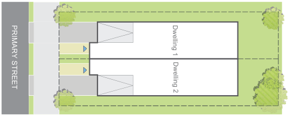
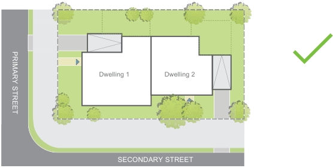

#### E4.3  Street orientation and presentation

#### Objectives

O1. Ensure that development contributes to the activity, safety, amenity and quality of streets and the public domain.

O2. Present appropriate frontages to adjacent streets and public domain in terms of scale, finishes and architectural character.

O3. Provide legible and accessible entries from the street and the public domain. O4. Minimise and ameliorate the effect of blank walls (with no windows or entrances) at the ground level.

O5. Minimise amenity impacts upon adjoining sites.

#### Controls

C1. Buildings shall be aligned and oriented to all street frontages.

C2. At a minimum, the front façade of a dwelling shall orientate the front door and a window of a habitable room on the ground floor to address the principal street frontage. If the site has more than one street frontage and more than one dwelling is proposed then this is to be applied to all frontages.

(Refer Figure E4.7 to Figure E4.9)

Figure E4.7 Undesired development - dwellings not orientated towards the street frontage

> [Picture on page 17: a picture, saved as a picture (images/part-e-single-dwellings-semi-detached-dwellings-dual-occu-page-17-32.gif, 150 dpi).]
> Words printed on the picture (copied from the PDF):
> PRIMARY STREET
> Dwelling 2
> Dwelling 1

Figure E4.8 Desired development - dwellings are orientated towards the street frontage

> [Picture on page 17: a picture, saved as a picture (images/part-e-single-dwellings-semi-detached-dwellings-dual-occu-page-17-35.gif, 150 dpi).]
> Words printed on the picture (copied from the PDF):
> Dwelling 1 Dwelling 2
> PRIMARY STREET
> SECONDARY STREET

Figure E4.9 Desired development on lots with more than one street frontage - dwellings are orientated towards all streets

Single Dwellings, Semi-Detached Dwellings, Dual Occupancies and Secondary Dwellings

Development Control Plan Part E
