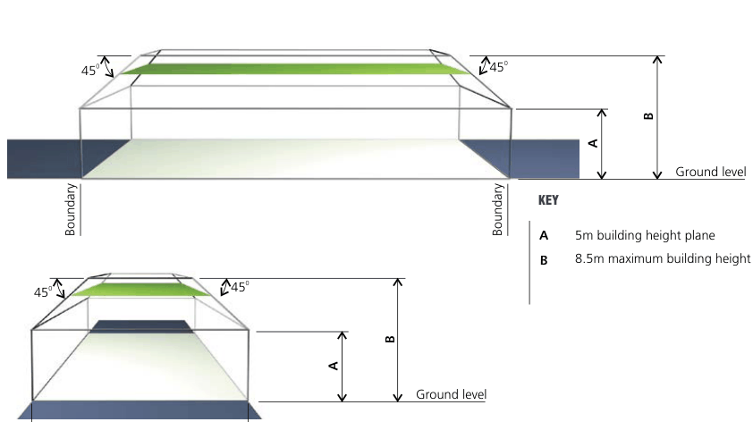
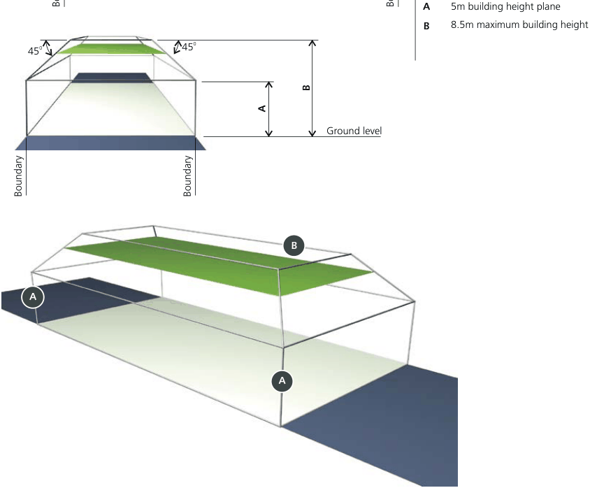
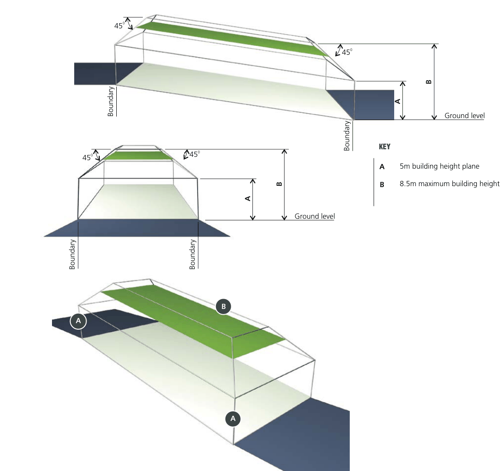
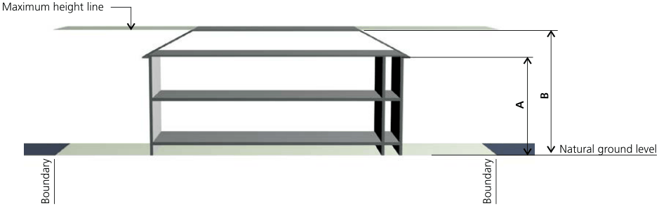
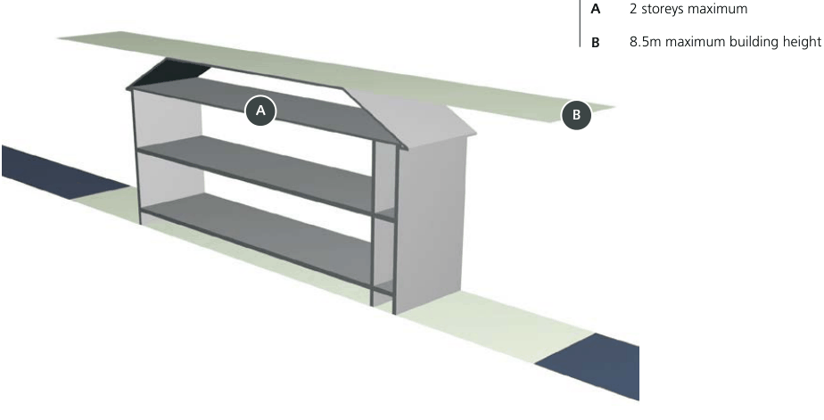
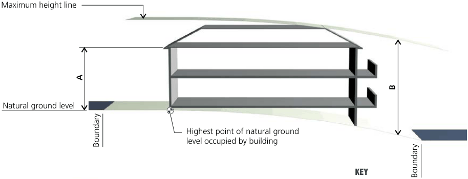
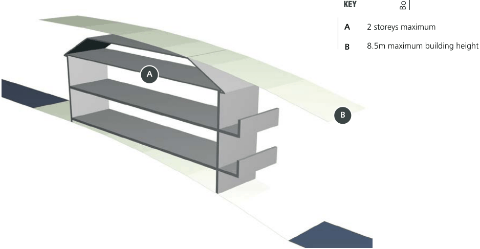
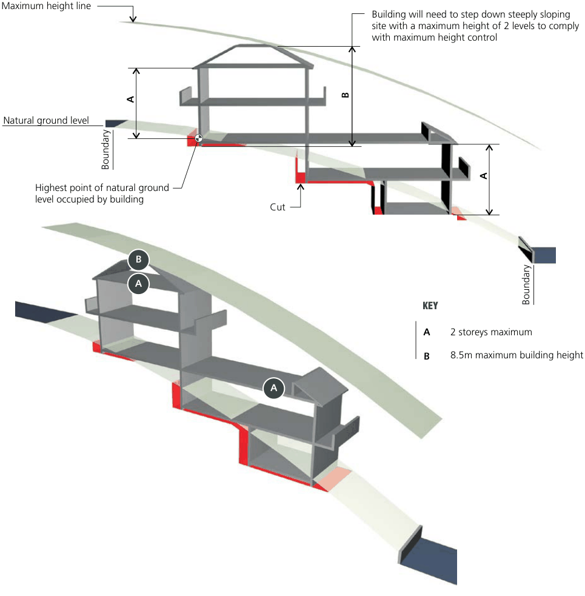

#### E4.4  Height of buildings

#### Objectives

O1. To ensure that buildings are compatible with the height, bulk and scale of the existing and desired future character of the locality. O2. To minimise visual impact, disruption of views, loss of privacy and loss of sunshine to existing residential development. O3. To minimise the adverse impact on Conservation Areas, Heritage Items and contributory buildings. O4. To reduce the visual impact of development when viewed from the Parramatta River as well as other public places such as parks, roads and community facilities.

#### Controls

C1. Single dwellings, dual occupancies and secondary dwellings are not to exceed the building height plane projected at an angle of 45 degrees over the site from a vertical distance of 5.0 metres above ground level at any boundary of the site.

C2. The following maximum building storey limits must not be exceeded:

#### Refer to Figure E4.10, Figure E4.11, Figure

#### E4.12, Figure E4.13 and Figure E4.14 Single street frontage

| Dwelling type | Maximum storeys |
|---|---|
| Dwelling house | Two (2) storeys |
| Attached dual occupancy | Two (2) storeys (dwellings side by side) |
| Detached dual occupancy | Two (2) storeys (dwellings side by side) |
| Semi-detached dwelling | Two (2) storeys (dwellings side by side) |
| Secondary dwelling | Two (2) storey if within principal dwelling One (1) storey if rear dwelling |
| Outbuilding | One (1) storey |

#### Two or more street frontages

| Dwelling type | Maximum storeys |
|---|---|
| Dwelling house | Two (2) storeys |
| Attached dual occupancy | Two (2) storeys (dwellings side by side) Two (2) storeys front dwelling, two (2) storey rear dwelling, if rear dwelling is facing secondary frontage |
| Detached dual occupancy | Two (2) storeys (dwellings side by side) Two (2) storeys front dwelling, one (1) storey rear dwelling, if both dwellings face primary frontage Two (2) storeys front dwelling, two (2) storey rear dwelling, if rear dwelling is facing secondary frontage |
| Semi-detached dwelling | Two (2) storeys (dwellings side by side) |
| Secondary dwelling | Two (2) storey if within principal dwelling One (1) storey if rear dwelling |
| Outbuilding | One (1) storey |

#### Internal lot

| Dwelling type | Maximum storeys |
|---|---|
| Any dwelling | One (1) storey |
| Outbuilding | One (1) storey |

Note 1: Reference should be made to the Building Height Maps which accompany the Canada Bay Local Environmental Plan.

Note 2: On a site with two street frontages, the dwelling facing the primary street frontage is considered to be the front dwelling.

Note 3: For the purpose of calculating the number of street frontages a lane is not considered to be a street frontage.

Note 4: Refer to definitions in the Canada Bay LEP.

Single Dwellings, Semi-Detached Dwellings, Dual Occupancies and Secondary Dwellings

Development Control Plan Part E

#### Attics above dwellings

| Controls |  |
|---|---|
| C3. | The use of an attic room within the roof space of a dwelling house is permitted for habitable purposes, provided that: a) no external balconies are proposed for the attic room; b) the attic room does not increase the bulk of the building; c) it does not compromise the privacy of adjacent properties. |

#### Attics above garages and outbuildings

| Controls |  |
|---|---|
| C4. | A single storey structure with an attic above is only permissible if: a) it is adjacent to a rear lane; b) the height does not exceed 5.4m; c) amenity to adjacent sites is maintained; d) No external balconies are proposed for the attic room; e) It does not compromise the privacy of adjoining properties; f) The roof pitch of a rear lane building must be between 30o and 40o; g) Any structure adjoining a rear lane is to be clearly subservient to the principal dwelling. |

Single Dwellings, Semi-Detached Dwellings, Dual Occupancies and Secondary Dwellings

Development Control Plan Part E

> [Picture on page 20: a picture, saved as a picture (images/part-e-single-dwellings-semi-detached-dwellings-dual-occu-page-20-3.gif, 150 dpi).]
> Words printed on the picture (copied from the PDF):
> 45
> 0
> 45
> 0

Boundary

45

0

45

0

Boundary

Boundary

Figure E4.10 Height plane envelope on a level site

Boundary

#### B

#### A

Ground level

#### B

#### A

Ground level

#### KEY

> [Picture on page 20: a picture, saved as a picture (images/part-e-single-dwellings-semi-detached-dwellings-dual-occu-page-20-20.gif, 150 dpi).]
> Words printed on the picture (copied from the PDF):
> A
> B
> A

A 5m building height plane B 8.5m maximum building height

Single Dwellings, Semi-Detached Dwellings, Dual Occupancies and Secondary Dwellings

Development Control Plan Part E

> [Picture on page 21: a map, saved as a picture (images/part-e-single-dwellings-semi-detached-dwellings-dual-occu-page-21-3.gif, 150 dpi); the street names and other small labels are on the picture.]
> Labels printed on the map (copied from the PDF, in no particular order):
> 45 · 0 · Boundary · 45 · 0 · 45 · 0 · Boundary · Boundary · B · A · A · 45 · 0 · Boundary · B · A · Ground level · KEY

Figure E4.11 Height plane envelope on a sloping site

#### B

#### A

Ground level

A 5m building height plane

B 8.5m maximum building height

Single Dwellings, Semi-Detached Dwellings, Dual Occupancies and Secondary Dwellings

Development Control Plan Part E

> [Picture on page 22: a picture, saved as a picture (images/part-e-single-dwellings-semi-detached-dwellings-dual-occu-page-22-3.gif, 150 dpi).]
> Words printed on the picture (copied from the PDF):
> Maximum height line
> Boundary
> Boundary
> B
> A
> Natural ground level

#### KEY

> [Picture on page 22: a picture, saved as a picture (images/part-e-single-dwellings-semi-detached-dwellings-dual-occu-page-22-5.gif, 150 dpi).]
> Words printed on the picture (copied from the PDF):
> A
> A
> B
> B

2 storeys maximum

8.5m maximum building height

Figure E4.12 Maximum building height and maximum number of storeys on a level site

Single Dwellings, Semi-Detached Dwellings, Dual Occupancies and Secondary Dwellings

> [Picture on page 23: a picture, saved as a picture (images/part-e-single-dwellings-semi-detached-dwellings-dual-occu-page-23-2.gif, 150 dpi).]
> Words printed on the picture (copied from the PDF):
> Boundary
> Highest point of natural ground
> level occupied by building
> B

Development Control Plan Part E

Maximum height line

#### A

Natural ground level

> [Picture on page 23: a picture, saved as a picture (images/part-e-single-dwellings-semi-detached-dwellings-dual-occu-page-23-7.gif, 150 dpi).]
> Words printed on the picture (copied from the PDF):
> A
> B

Figure E4.13 Maximum building height and maximum number of storeys on a sloping site

KEY Boundary

A 2 storeys maximum

B 8.5m maximum building height

Single Dwellings, Semi-Detached Dwellings, Dual Occupancies and Secondary Dwellings

Development Control Plan Part E

> [Picture on page 24: a map, saved as a picture (images/part-e-single-dwellings-semi-detached-dwellings-dual-occu-page-24-3.gif, 150 dpi); the street names and other small labels are on the picture.]
> Labels printed on the map (copied from the PDF, in no particular order):
> A · Natural ground level · Boundary · Highest point of natural ground · level occupied by building · B · A · Building will need to step down steeply sloping · site with a maximum height of 2 levels to comply · with maximum height control · B · A · Cut · Boundary · KEY · A 2 storeys maximum · B 8.5m maximum building height · A

Maximum height line

Figure E4.14 Maximum building height and maximum number of storeys on a steep site

Single Dwellings, Semi-Detached Dwellings, Dual Occupancies and Secondary Dwellings

Development Control Plan Part E
