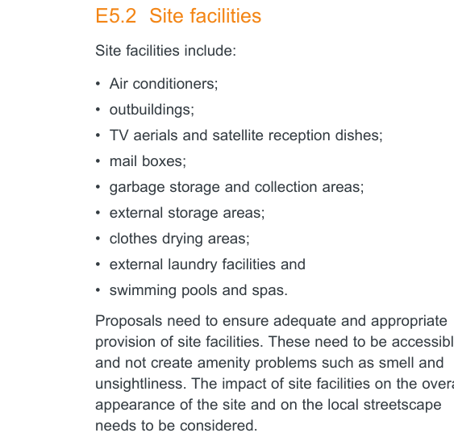

#### E5.2  Site facilities

> [Picture on page 30: a picture, saved as a picture (images/part-e-single-dwellings-semi-detached-dwellings-dual-occu-page-30-4.gif, 150 dpi).]

Site facilities include:

• Air conditioners;

• outbuildings;

• TV aerials and satellite reception dishes;

• mail boxes;

• garbage storage and collection areas;

• external storage areas;

• clothes drying areas;

• external laundry facilities and

• swimming pools and spas.

Proposals need to ensure adequate and appropriate provision of site facilities. These need to be accessible and not create amenity problems such as smell and unsightliness. The impact of site facilities on the overall appearance of the site and on the local streetscape needs to be considered.

The design of site facilities for multi-unit dwellings needs particular consideration as these facilities are shared. They need to be designed and located so that they are accessible by all residents and do not detract from the amenity of any residence.

#### Objectives

O1. To ensure that adequate provision is made for site facilities.

O2. To ensure that site facilities are functional and accessible to all residents. O3. To ensure that site facilities are easy to maintain. O4. To ensure that site facilities are thoughtfully and sensitively integrated into development, are safe, unobtrusive and not unsightly.

#### Air Conditioners

| Controls |  |
|---|---|
| C1. | Air conditioning units must be sited so that they are not visible from the street. |
| C2. | Air conditioning units must not be installed on the front façade of a building, within window frames or otherwise obscure a window. |
| C3. | Air conditioning units must not obscure architectural details visible from the street. |
| C4. | The noise level from air conditioning systems is not to exceed the L aeq 15 minute by 5dBA measured at the property boundary. |
| C5. | Air conditioning units must not be installed where they will have a negative visual or acoustic impact upon neighbours. |

#### Outbuildings and outdoor structures

| Controls |  |
|---|---|
| C6. | Outbuildings and outdoor structures should be located behind the front building line. This clause does not apply to any required waste storage area, front fences or carports permissible under the provisions of this DCP. |
| C7. | Windows and doors of outbuildings should face into the rear yard, or be frosted, if facing into a neighbour’s property. |

#### Clothes drying facilities

| Controls |  |
|---|---|
| C8. | Adequate open air clothes drying facilities should be provided that are easily accessible to all residents and are visually screened from the street and adjoining premises. |

Single Dwellings, Semi-Detached Dwellings, Dual Occupancies and Secondary Dwellings

Development Control Plan Part E

#### Numbering of buildings Controls

| C9. | Street numbers are to be placed on the building in accordance with Council’s street numbering system and be visible from the primary street frontage. |
|---|---|

#### Public utilities Controls

C10. For new development and substantial alterations to existing premises provision must be made for connection to future underground distribution mains. In such developments the following must be installed:

• an underground service line to a suitable existing street pole; or

• sheathed underground consumers mains to a customer pole erected near the front property boundary (within 1 metre). Council may require the bundling of cables in the area surrounding the development to reduce the visual impact of the overhead cables.

For further details see Energy Australia requirements.

#### Mail boxes

| Controls |  |
|---|---|
| C11. | All mail boxes should be designed in a manner that enhances the visual presentation of the building(s) they serve. |
| C12. | Mail box structures should not dominate the street elevation. |
| C13. | Individual mail boxes should be located close to each ground floor dwelling entry where individual street entries are provided. |
| C14. | All mail boxes must comply with the requirements of Australia Post. |

#### Swimming pools and spas

| Controls |  |
|---|---|
| C15. | Swimming pools and spas should be located behind the front building line of the primary frontage. |
| C16. | If more than one dwelling is proposed and they are oriented to different street frontages then any swimming pools/ spas are not to be located within the front setback of any dwelling. |
| C17. | Swimming pools/spas should be positioned so that the water line is a minimum of 800mm from the property boundary. |
| C18. | In-ground swimming pools should be built so that the top of the swimming pool is as close to the existing ground level as possible. On sloping sites this will often mean excavation of the site on the high side to obtain the minimum out of ground exposure of the swimming pool at the low side. |
| C19. | Provided one point on the swimming pool or one side of the swimming pool is at or below existing ground level, then one other point or one other side may be up to 500mm above existing ground level. |

Single Dwellings, Semi-Detached Dwellings, Dual Occupancies and Secondary Dwellings

Development Control Plan Part E

#### Tennis Courts

| Controls |  |
|---|---|
| C20. | Tennis courts are to be sited at the rear of properties. |
| C21. | For corner allotments or where the property has two street frontages, the location of tennis courts is not to be in the primary frontage. |
| C22. | A minimum of five (5) metres should be maintained between the tennis court fencing and habitable rooms of any dwelling. |
| C23. | Tennis courts should be positioned having regard to the location of habitable rooms both on site and on adjoining properties and to the maintenance of appropriate private open space. |
| C24. | Screen planting should be provided between court fencing and the nearest property boundary or any dwelling on an adjoining property. |
| C25. | The court playing surface should be of a material that minimises light reflection. |
| C26. | Flood lighting is generally not permitted unless it can be demonstrated the lighting and use of the court at night will not interfere with neighbour amenity. |
| C27. | Fencing material is to be a recessive colour. |
| C28. | Fences are to be set back a minimum of 1.5 metres from boundaries. |
| C29. | Cut and fill associated with the construction of a tennis court should not unreasonably intrude into the natural topography of the land. |

#### TV antennae and satellite dishes

| Controls |  |
|---|---|
| C30. | Satellite dishes, telecommunication antennae and ancillary facilities are to be: a) Located away from the front and side boundaries; b) Installed so that they do not encroach upon any easements, rights of ways, vehicular access or parking spaces required for the property, and c) Painted in colours selected to match the colour scheme of the building. |
| C31. | Satellite dishes where they are situated in rear yards are to be less than 1.8m above ground. |
