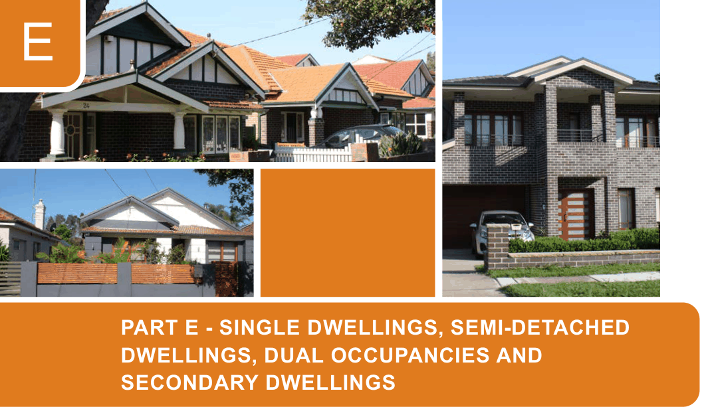

# Canada Bay Development Control Plan - Part E Single Dwellings, Semi-detached Dwellings, Dual Occupancies and Secondary Dwellings

> This chapter is split into 15 section file(s), one per numbered heading, in the order they appear in the PDF.

Source PDF: [DCP-06_Part-E-Single-Dwellings-Dual-Occ_v2022-05-16.pdf](DCP-06_Part-E-Single-Dwellings-Dual-Occ_v2022-05-16.pdf)

> [Picture on page 1: a picture, saved as a picture (images/part-e-single-dwellings-semi-detached-dwellings-dual-occu-page-1-1.gif, 150 dpi).]

### E

### PART E - SINGLE DWELLINGS, SEMI-DETACHED

### DWELLINGS, DUAL OCCUPANCIES AND

### SECONDARY DWELLINGS

| E1 | Land to which Part E applies.........................................................................................E-2 |
|---|---|
| E2 | Design Quality.................................................................................................................E-3 E2.1 Design of dwelling houses, semi-detached dwellings, dual occupancies and secondary dwellings.............................................................................................. E-3 E2.2 Materials, colour schemes and details .................................................................. E-7 |
| E3 | Environmental criteria and residential amenity...........................................................E-8 E3.1 Visual and acoustic privacy ................................................................................... E-8 E3.2 Access to views ...................................................................................................E-10 |
| E4 | General Controls........................................................................................................... E-11 E4.1 Frontage and dwelling width................................................................................ E-11 E4.2 Building setbacks................................................................................................. E-11 E4.3 Street orientation and presentation ..................................................................... E-17 E4.4 Height of buildings ..............................................................................................E-18 E4.5 Bulk and Scale.....................................................................................................E-25 E4.6 Landscaped area.................................................................................................E-25 E4.7 Parking and access .............................................................................................E-27 E4.8 Private open space..............................................................................................E-27 |
| E5 | Ancillary structures ......................................................................................................E-28 E5.1 Fencing ............................................................................................................... E-28 E5.2 Site facilities......................................................................................................... E-30 |

<!-- sections -->
## Sections

1. [E1 Land to which Part E applies](01-e1-land-to-which-part-e-applies.md)
2. [E2 Design Quality](02-e2-design-quality.md)
3. [E3 Environmental criteria and residential amenity](03-e3-environmental-criteria-and-residential.md)
4. [E3.1 Visual and acoustic privacy](04-e3-1-visual-and-acoustic-privacy.md)
5. [E3.2 Access to views](05-e3-2-access-to-views.md)
6. [E4.1 Frontage and dwelling width](06-e4-1-frontage-and-dwelling-width.md)
7. [E4.2 Building setbacks](07-e4-2-building-setbacks.md)
8. [E4.3 Street orientation and presentation](08-e4-3-street-orientation-and-presentation.md)
9. [E4.4 Height of buildings](09-e4-4-height-of-buildings.md)
10. [E4.5 Bulk and Scale](10-e4-5-bulk-and-scale.md)
11. [E4.6 Landscaped area](11-e4-6-landscaped-area.md)
12. [E4.7 Parking and access](12-e4-7-parking-and-access.md)
13. [E4.8 Private open space](13-e4-8-private-open-space.md)
14. [E5.1 Fencing](14-e5-1-fencing.md)
15. [E5.2 Site facilities](15-e5-2-site-facilities.md)
