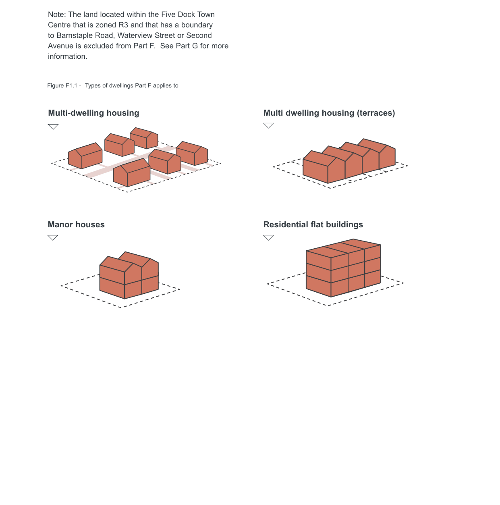

### F1  Land to which Part F applies

Part F applies to development for the purposes of multi-dwelling housing, multi dwelling housing (terraces), manor houses and residential flat buildings.

Note: The land located within the Five Dock Town Centre that is zoned R3 and that has a boundary to Barnstaple Road, Waterview Street or Second Avenue is excluded from Part F.  See Part G for more information.

Figure F1.1 - Types of dwellings Part F applies to

#### Multi-dwelling housing

#### Multi dwelling housing (terraces)

> [Picture on page 2: a picture, saved as a picture (images/part-f-multi-dwelling-housing-multi-dwelling-housing-terr-page-2-13.gif, 150 dpi).]

#### Manor houses

#### Residential flat buildings
