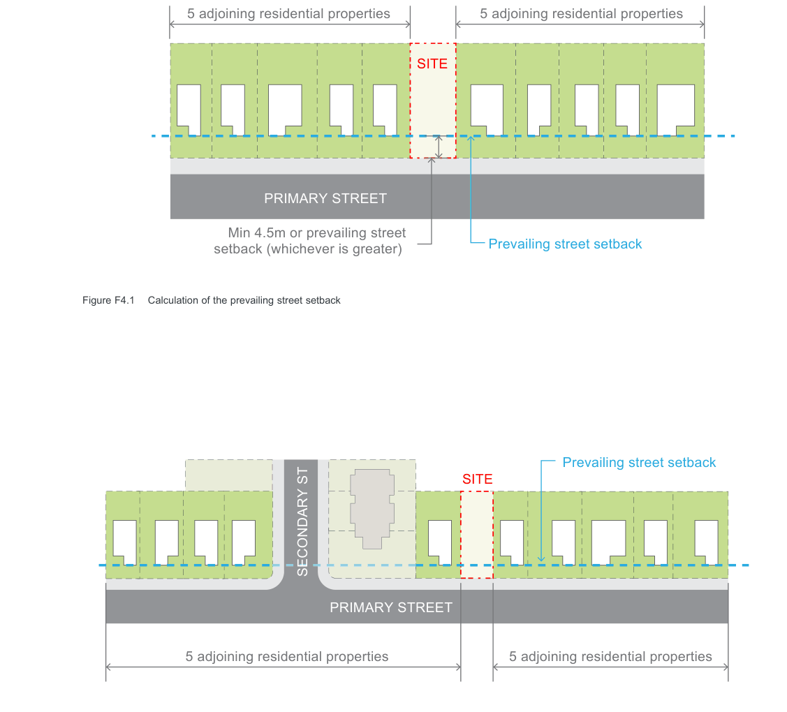
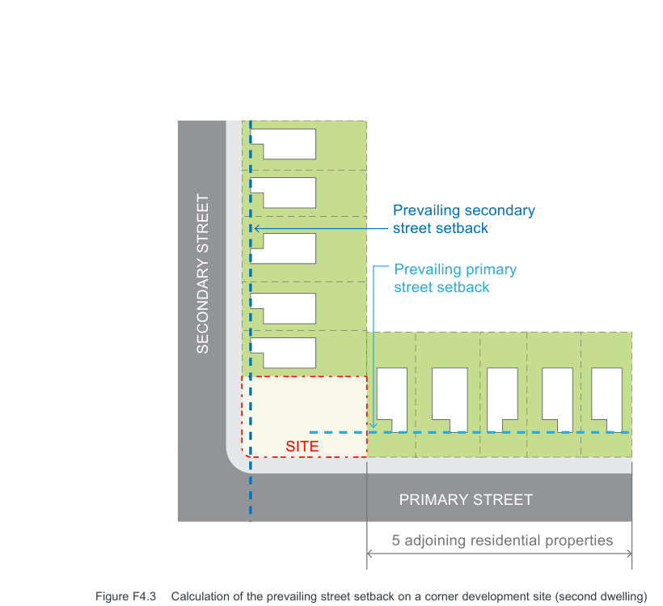
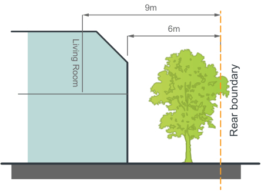

#### F4.2  Building setbacks

Setbacks define the overall footprint of a building and the outer extremities of that building in relation to the front, side and rear boundaries.

Appropriate street setback controls can contribute to the public domain by enhancing the streetscape character and the continuity of street facades. Street setbacks also enhance the setting of a building. Canada Bay Council places particular emphasis on continuing the building alignment in uniform streetscapes.

Rear setbacks provide space for planting, including trees, which will achieve a reasonable height and canopy and provide for adequate open space for the amenity of residents. Rear setbacks also promote privacy between residents of adjoining properties, particularly where development is greater than single storey.

#### Objectives

O1. To integrate new development with the established setback character of the street. O2. Preserve significant vegetation which contributes to the public domain and allows for street landscape character to be enhanced. O3. Ensure adequate separation between buildings consistent with the established character and rhythm of built elements in the street. O4. To ensure adequate separation between buildings for visual and acoustic privacy. O5. Maximise solar access to achieve amenity for neighbours.

Multi-dwelling Housing, Multi Dwelling Housing (Terraces), Manor Houses and Residential Flat Buildings

Development Control Plan Part F

#### Front setbacks - primary street Controls

Note: On a site with two street frontages, the primary street is considered to be the one to which the property is addressed.

#### Front setbacks - parallel road lot Controls

| C1. | The front setback of all residential buildings is to be a minimum of 4.5 metres or no less than the Prevailing Street Setback, whichever is the greater. | C4. | If the secondary street (other than a lane) is at the rear of the property, any dwelling facing the secondary street is to use the secondary street as its primary street and be designed to comply with the Front |
|---|---|---|---|
|  | The “Prevailing Street Setback” is the setback calculated by averaging the setback of five (5) adjoining residential properties on both sides of the development. (Refer Figure F4.1) | setback – primary street controls. Front setbacks - corner lot Controls |  |
|  | Where there are fewer than five | C5. | If the secondary street (other than a lane) |
|  | residential properties or a non-residential |  | is at the side of the property, any dwelling |
|  | use property between a street end or |  | proposed to the rear of the site must |
|  | corner and the development site, the |  | acknowledge the prevailing street setback |
|  | “Prevailing Street Setback” is the setback |  | of the secondary street. (Refer Figure |
|  | calculated by averaging the setback of the five next residential properties fronting the street (if any) on both sides of the property. (Refer Figure F4.2) | C6. | F4.3) Any dwelling that faces the primary street must have a secondary street (side setback) of a minimum of 2m for the first |
|  | Note: In many instances, the front setback |  | 25m measured from the corner. |
|  | of buildings in Canada Bay is 7.5 metres | C7. | Any dwelling to the rear of the site is to |
|  | or greater and development in these |  | face the secondary street and is to use |
|  | areas will be required to comply with this |  | the secondary street as its primary street |
|  | prevailing setback. |  | and be designed to comply with the Front |
| C2. | No balconies, entry porches or verandahs |  | setback – primary street controls. |
|  | are permitted to encroach within the | C8. | The prevailing street setback for the |
|  | front setback. The only encroachments |  | secondary frontage is to be applied from |
|  | permitted within the front setback are |  | 25m from the corner to the existing rear |
|  | restricted to eaves and awnings for weather protection but no supporting |  | boundary of the site. |
|  | columns or posts. |  |  |
| C3. | Where a site has more than one street frontage (other than a lane) and a dwelling is proposed to the rear of the site, the development must acknowledge the prevailing setback of both streets. |  |  |

> [Picture on page 11: a picture, saved as a picture (images/part-f-multi-dwelling-housing-multi-dwelling-housing-terr-page-11-1.gif, 150 dpi).]
> Words printed on the picture (title and legend, copied from the PDF):
> 5 adjoining residential properties
> 5 adjoining residential properties
> SITE
> PRIMARY STREET
> Prevailing street setback
> setback (whichever is greater)

Min 4.5m or prevailing street

Figure F4.1 Calculation of the prevailing street setback

> Words printed on the picture (title and legend, copied from the PDF):
> Prevailing street setback
> 5 adjoining residential properties
> 5 adjoining residential properties

Figure F4.2 Calculation of the prevailing street setback near corner sites

> [Picture on page 12: a picture, saved as a picture (images/part-f-multi-dwelling-housing-multi-dwelling-housing-terr-page-12-1.gif, 150 dpi).]
> Words printed on the picture (title and legend, copied from the PDF):
> Prevailing secondary
> street setback
> Prevailing primary
> street setback
> SECONDARY STREET
> SITE
> PRIMARY STREET
> 5 adjoining residential properties

Figure F4.3 Calculation of the prevailing street setback on a corner development site (second dwelling)

9m

> [Picture on page 12: a picture, saved as a picture (images/part-f-multi-dwelling-housing-multi-dwelling-housing-terr-page-12-4.gif, 150 dpi).]
> Words printed on the picture (title and legend, copied from the PDF):
> 6m
> Living Room
> Rear boundary

Figure F4.4 Rear setback control for single street frontage lots

Multi-dwelling Housing, Multi Dwelling Housing (Terraces), Manor Houses and Residential Flat Buildings

Development Control Plan Part F

#### Side setbacks Controls

C9. All developments are to comply with the following numerical requirements:

| Development | Minimum distance from side boundary of parent lot |
|---|---|
| Multi-dwelling housing | • All walls are to be set back a minimum of 1500mm. |
| Multi dwelling housing (terraces) | • All walls are to be set back a minimum of 1500mm. |
| Manor houses | • All walls are to be set back a minimum of 1500mm. |
| Residential flat buildings | • All walls are to be set back a minimum of 5000mm. |

Note 1: Upper floor setbacks may be achieved by stepping the building in, integrating any proposed upper floor within the roof form or by setting back both the ground and first floors from the side boundaries.

Note 2: Sites that have more than one street frontage (other than a lane) will have additional setback requirements.

#### Rear setbacks – single street frontage

| Controls |  |
|---|---|
| C10. | All development (not including an outbuilding) is to have a minimum rear setback of 6.0 metres. |
| C11. | Any living room located on an upper floor is to have a minimum rear setback of 9.0m. |

(Refer Figure F4.4)

#### Rear setbacks – corner lot

| Controls |  |
|---|---|
| C12. | The dwelling oriented to the secondary frontage shall have a minimum setback to the rear boundary of the parent lot of 1.5 metres and a minimum setback to the side boundary (at rear of dwelling) of 4 metres. |
| C13. | Any living room located on an upper floor is to be oriented towards the street frontage, and not extend through to the rear, to minimise overlooking of side and rear boundaries. |

#### Basement setbacks

| Controls |  |
|---|---|
| C14. | Basement excavation for all development is limited to the area of the building at ground level. The excavation setback includes the driveway access to the basement. |
| C15. | Where it can be demonstrated the site is so constrained (for example by its width) that it is impossible to provide basements without extending beyond the permitted side and rear setbacks, excavation up to but no closer than 3.0 metres to a site boundary will be considered. |

#### Internal setbacks

| Controls |  |
|---|---|
| C16. | If two or more rows of dwellings are proposed in Multi-Dwelling Housing or Residential Flat Buildings, an internal setback of 12.0 metres is required between rows. |

Multi-dwelling Housing, Multi Dwelling Housing (Terraces), Manor Houses and Residential Flat Buildings

Development Control Plan Part F

#### Outbuildings Controls

C17. Outbuildings are to be located behind the main building alignment and should have a minimum setback of 900mm to side and rear boundaries. However, reduced side and rear boundary setbacks may be considered on merit where:

a) they are consistent with the setbacks of outbuildings in the vicinity;

b) they require no maintenance (including roof gutters);

c) there are no adverse impacts to the amenity of the adjoining properties; and

d) the total area of all outbuildings (including any secondary dwellings) does not exceed 35m2.

However, reduced side and rear boundary setbacks may be considered on merit where:

a) they are consistent with the setbacks of outbuildings in the vicinity;

b) they require no maintenance (including roof gutters);

c) there are no adverse impacts to the amenity of the adjoining properties; and

d) the total area of all outbuildings does not exceed 35m2.

#### Advisory Notes

Notwithstanding compliance with the above numerical controls, Council may require building setbacks to be increased if necessary to reduce bulk, overshadowing, visual impact, view loss, privacy concerns and to retain existing trees on site.

Any Foreshore Building Line will continue to apply and overrides any setback provisions in this plan.
