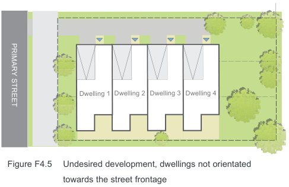
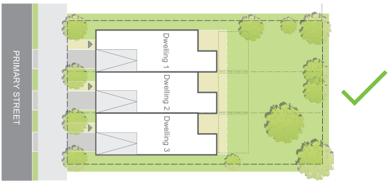
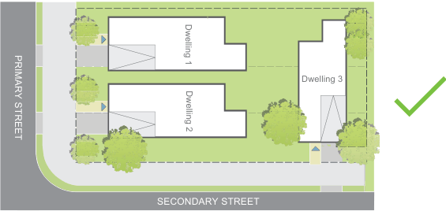

#### F4.3  Street orientation and presentation

#### Objectives

O1. Ensure that development contributes to the activity, safety, amenity and quality of streets and the public domain.

O2. Present appropriate frontages to adjacent streets and public domain in terms of scale, finishes and architectural character.

O3. Provide legible and accessible entries from the street and the public domain. O4. Minimise and ameliorate the effect of blank walls (with no windows or entrances) at the ground level.

O5. Minimise amenity impacts upon adjoining sites.

| Controls |  |
|---|---|
| C1. | Buildings shall be aligned and oriented to all street frontages. |
| C2. | Buildings must address all street frontages through the provision of habitable rooms, windows and doors and architectural features. |
| C3. | At a minimum, the front façade of a dwelling shall orientate the front door and a window of a habitable room on the ground floor to address the principal street frontage. If the site has more than one street frontage and more than one dwelling is proposed then this is to be applied to all frontages. |
| C4. | Buildings are to have a street address and provide a direct line of sight from a street to the principal dwelling entry, common building entry or entries. Where a development comprises a number of buildings with a variety of orientations, a major part of the overall development is to face the street; |
| C5. | Provide individual entries directly from the street to any ground floor dwellings next to the street. |

Multi-dwelling Housing, Multi Dwelling Housing (Terraces), Manor Houses and Residential Flat Buildings

> [Picture on page 15: a picture, saved as a picture (images/part-f-multi-dwelling-housing-multi-dwelling-housing-terr-page-15-2.gif, 150 dpi).]
> Words printed on the picture (title and legend, copied from the PDF):
> PRIMARY STREET
> Dwelling 2 Dwelling 3 Dwelling 4
> Dwelling 1

Development Control Plan Part F

| Controls |  |
|---|---|
| C6. | Buildings are to be designed to maximise the number of entries, visible internal uses at ground level, and include high quality finishes and public art to enhance the public domain. |
| C7. | Development that exposes the blank side of an adjoining building or has a party wall to the public domain is to be designed with a visually interesting treatment of high quality design applied to that wall. |
| C8. | Ground floor tenancies and building entry lobbies are to: a) have entries at the same level as the adjacent footpath or public domain; b) have finished floor levels between 0-1.0m above or below the adjacent footpath or public domain entry; c) provide opportunities for direct surveillance of the adjacent street or public domain at maximum intervals of 6m; and d) be elevated up to 1.0m above ground level for privacy for ground floor residential uses. |
| C9. | Lanes are to be fronted by entries to dwellings, retail and/or commercial uses where practicable. |
| C10. | Align breaks between buildings with nearby streets, lanes and pedestrian links to enable view connections. |

#### Refer to Figure F4.5 - Figure F4.7.

Figure F4.5

Figure F4.6

Figure F4.7

Undesired development, dwellings not orientated towards the street frontage

> [Picture on page 15: a picture, saved as a picture (images/part-f-multi-dwelling-housing-multi-dwelling-housing-terr-page-15-11.gif, 150 dpi).]
> Words printed on the picture (title and legend, copied from the PDF):
> PRIMARY STREET
> Dwelling 2 Dwelling 3
> Dwelling 1

Desired development, where dwellings are orientated towards the street frontage

> [Picture on page 15: a picture, saved as a picture (images/part-f-multi-dwelling-housing-multi-dwelling-housing-terr-page-15-14.gif, 150 dpi).]
> Words printed on the picture (title and legend, copied from the PDF):
> PRIMARY STREET
> Dwelling 1
> Dwelling 3
> Dwelling 2
> SECONDARY STREET

Desired development on lots with more than one street frontage where dwellings are orientated towards all streets

Multi-dwelling Housing, Multi Dwelling Housing (Terraces), Manor Houses and Residential Flat Buildings

Development Control Plan Part F
