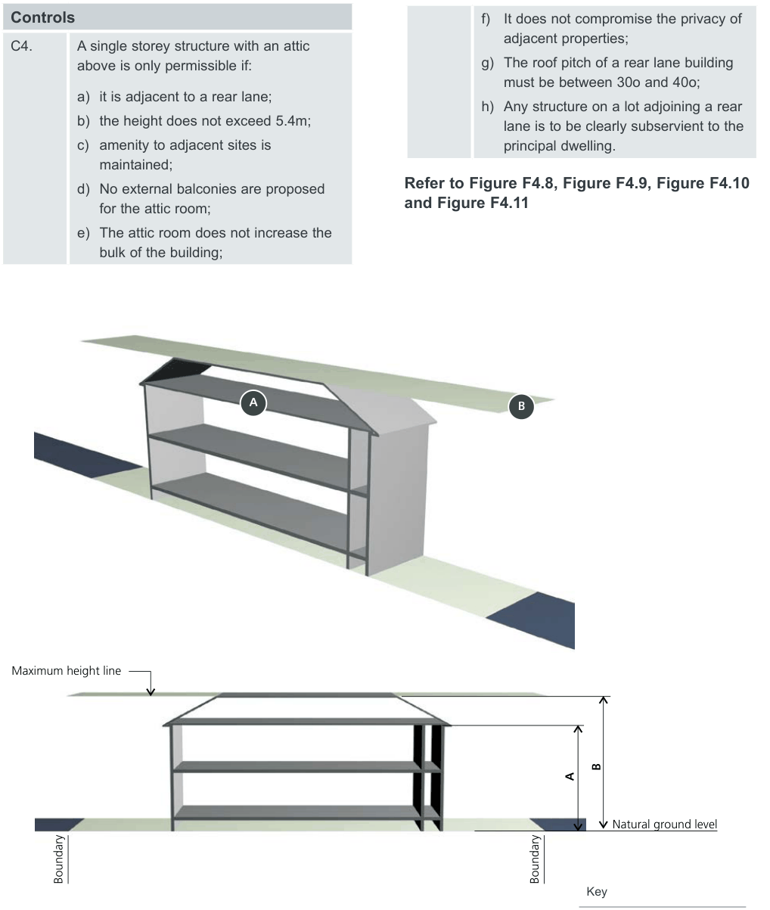
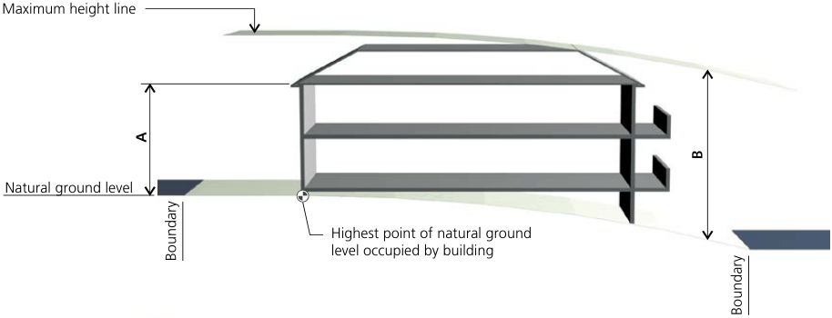
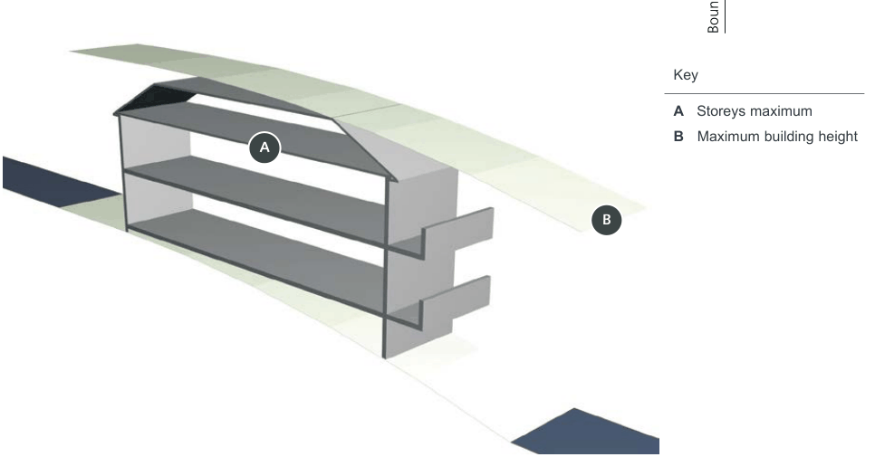
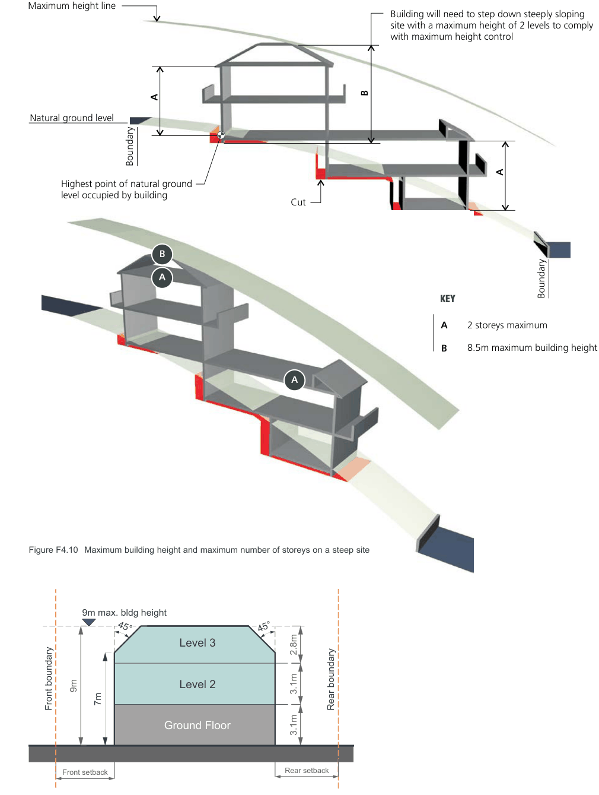

#### F4.4  Height of buildings

Height is an important control because it has a major impact on the physical and visual amenity of a place. Building height is also critical in addressing impacts from development such as solar access, privacy and view loss.

#### Objectives

O1. To ensure that buildings are compatible with the height, bulk and scale of the existing and desired future character of the locality. O2. To minimise visual impact, disruption of views, loss of privacy and loss of sunshine to existing residential development. O3. To minimise the adverse impact on Conservation Areas, Heritage Items and contributory buildings. O4. To reduce the visual impact of development when viewed from the Parramatta River as well as other public places such as parks, roads and community facilities.

#### Controls

C1. The following maximum building heights should not be exceeded:

| Dwelling type | Maximum storeys |
|---|---|
| Manor houses | Two (2) storey where LEP maximum height 8.5m > Two (2) storey where LEP maximum height >8.5m |
| Multi-dwelling housing | Two (2) storey |
| Multi-dwelling (terraces) | Two (2) storey where LEP maximum height 8.5m Three (3) storey where LEP maximum height 9.0m |
| Residential flat building | Two (2) storey where LEP maximum height 8.5m > Two (2) storey where LEP maximum height >8.5m |
| Outbuildings | One (1) storey |

Note 1: Reference should be made to the Building Height Maps which accompany the Canada Bay Local Environmental Plan.

Note 2: On a site with two street frontages, the dwelling facing the primary street frontage is considered to be the front dwelling.

Note 3: For the purpose of calculating the number of street frontages a lane is not considered to be a street frontage

#### Controls

C2. Multi dwelling housing (terraces) must not exceed two storeys unless it complies with the requirements set out in Clause 4.3 of the Canada Bay Local Environmental Plan. Refer also to Figure F4.11.

#### Attics above dwellings Controls

C3. The use of an attic room within the roof space of a dwelling house is permitted for habitable purposes, provided that:

a) no external balconies are proposed for the attic room;

b) the attic room does not increase the bulk of the building;

c) it does not compromise the privacy of adjacent properties.

#### Attics above garages and outbuildings

f) It does not compromise the privacy of

#### Controls

adjacent properties;

g) The roof pitch of a rear lane building

C4. A single storey structure with an attic above is only permissible if:

must be between 30o and 40o;

a) it is adjacent to a rear lane;

h) Any structure on a lot adjoining a rear

b) the height does not exceed 5.4m;

c) amenity to adjacent sites is

lane is to be clearly subservient to the principal dwelling.

maintained;

d) No external balconies are proposed

#### Refer to Figure F4.8, Figure F4.9, Figure F4.10

and Figure F4.11

for the attic room;

e) The attic room does not increase the bulk of the building;

> [Picture on page 17: a picture, saved as a picture (images/part-f-multi-dwelling-housing-multi-dwelling-housing-terr-page-17-22.gif, 150 dpi).]
> Words printed on the picture (title and legend, copied from the PDF):
> A 2 storeys maximum
> B 8.5m maximum building height
> B
> A
> Maximum height line
> B
> A
> Natural ground level
> Boundary
> Boundary

Key

#### KEY

A   Storeys maximum

Figure F4.8 Maximum building height and maximum number of storeys on a level site

B   Maximum building height

Multi-dwelling Housing, Multi Dwelling Housing (Terraces), Manor Houses and Residential Flat Buildings

> [Picture on page 18: a picture, saved as a picture (images/part-f-multi-dwelling-housing-multi-dwelling-housing-terr-page-18-2.gif, 150 dpi).]
> Words printed on the picture (title and legend, copied from the PDF):
> Boundary
> Highest point of natural ground
> level occupied by building
> B

Development Control Plan Part F

Maximum height line

#### A

Natural ground level

> [Picture on page 18: a picture, saved as a picture (images/part-f-multi-dwelling-housing-multi-dwelling-housing-terr-page-18-7.gif, 150 dpi).]
> Words printed on the picture (title and legend, copied from the PDF):
> A
> B

Maximum building height and maximum number of storeys on a sloping site

Figure F4.9

KEY Boundary

A 2 storeys maximum

Key

B 8.5m maximum building height

A   Storeys maximum B   Maximum building height

Multi-dwelling Housing, Multi Dwelling Housing (Terraces), Manor Houses and Residential Flat Buildings

Development Control Plan Part F

> [Picture on page 19: a map, saved as a picture (images/part-f-multi-dwelling-housing-multi-dwelling-housing-terr-page-19-3.gif, 150 dpi); the street names and other small labels are on the picture.]
> Words printed on the picture (title and legend, copied from the PDF):
> Natural ground level
> Highest point of natural ground
> level occupied by building
> Building will need to step down steeply sloping
> site with a maximum height of 2 levels to comply
> with maximum height control
> A 2 storeys maximum
> B 8.5m maximum building height
> Figure F4.10 Maximum building height and maximum number of storeys on a steep site
> 9m max. bldg height

Maximum height line

Figure F4.11 Maximum building height and maximum number of storeys for multi dwelling housing (terraces) in accordance with Clause 4.3 of Canada Bay Local Environmental Plan

Multi-dwelling Housing, Multi Dwelling Housing (Terraces), Manor Houses and Residential Flat Buildings

Development Control Plan Part F
