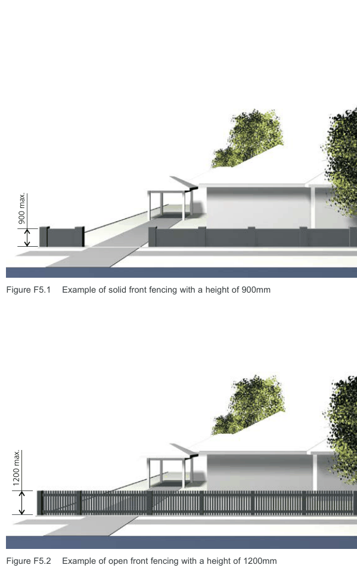

### F5  Ancillary structures

#### F5.1  Fencing

Fencing is an important streetscape element and can indicate the architectural period of an area. Consistent and uniform front fencing contributes significantly to the streetscape and character of an area.

For the purpose of this DCP, front fencing is any fence between the front alignment of a building and the street boundary.

Whilst privacy and security of individual households is an important consideration, high blank fencing along the street has a negative impact on the streetscape, personal safety and security by reducing the opportunities for overlooking of private areas. The construction of high blank front fencing is therefore not desirable and should be avoided.

#### Objectives

O1. To maintain and enhance the character of streetscapes within the Canada Bay LGA. O2. To ensure that views from streets are maintained and not negated by excessively high fences. O3. To reduce the impact of front fencing on the streetscape and encourage fencing consistent with the existing streetscape pattern and in sympathy with the general topography and the architectural style of the existing dwelling or new development.

O4. To ensure that materials used in front fencing are of high quality and are in keeping with the existing streetscape character.

O5. To retain and re-use original fences and gates. O6. To reinstate traditional period fences and gates on street frontages (including side streets) that is of an appropriate architectural style to complement existing buildings.

#### Height of front fencing

| Controls |  |
|---|---|
| C1. | Front fencing and side fencing forward of the building line constructed of a solid material such as brick/masonry, lapped and capped, timber, brushwood and the like should not exceed 900mm (including piers) in height above the footpath level. |

#### Refer to Figure F5.1

C2. Front fencing and side fencing forward of the building line, constructed of visually transparent material such as timber picket/ metal grill, should not exceed 1.2m in height above the footpath level. Visually transparent components should be no less than 40% of the fence structure and should be distributed evenly along the entire length of the fence.

#### Refer to Figure F5.2

| C3. | From the building line, side fences are to taper down to the height of the front fence line. |
|---|---|
| C4. | In the case of sloping streets, the height limitations may be averaged, with regular steps. |
| C5. | Solid fences greater than 1.2 m will only be considered in a streetscape which is shown in the Streetscape Character Analysis to exhibit in excess of 70% high solid fence forms. In such circumstance the appearance of the fence should be softened by: a) Providing a continuous landscaped area of not less than 600mm wide on the street side of the fence, planted with tree and shrub species selected on the basis of low maintenance attributes; and b) The use of openings and variations in colour, texture or materials to create visual interest. |

Multi-dwelling Housing, Multi Dwelling Housing (Terraces), Manor Houses and Residential Flat Buildings

> [Picture on page 28: a picture, saved as a picture (images/part-f-multi-dwelling-housing-multi-dwelling-housing-terr-page-28-2.gif, 150 dpi).]
> Words printed on the picture (title and legend, copied from the PDF):
> 900 max.
> Figure F5.1 Example of solid front fencing with a height of 900mm
> 1200 max.

Development Control Plan Part F

#### Design of fences

| Controls |  |
|---|---|
| C6. | Avoid painting or rendering original masonry and sandstone fencing. |
| C7. | New fencing should complement any original fencing found on adjoining properties and in the street in terms of style, height, materials, colour, texture, rhythm of bays and openings. Note: Blank walls disrupt established fencing patterns and should be avoided. |
| C8. | Fencing and associated walls must be positioned so as not to interfere with any existing trees. |

#### Materials Controls

C9. Materials of construction will be considered on their merit, with regard being given to materials of construction of other contributory fences in the vicinity and/or that of the building on the allotment where such materials enhance the streetscape – with a general prohibition on the following materials:

a) Cement block;

b) Metal sheeting, profiled, treated or pre-coated.

c) Fibro, flat or profile;

d) Brushwood; and

e) Barbed wire.

#### General

| Controls |  |
|---|---|
| C10. | Gates and doors are to be of a type which do not encroach over the street alignment during operation. |
| C11. | Fencing is to be designed and constructed in accordance with the requirements of a front fence wherever dwellings have a front façade to a street; irrespective of whether there are dwellings within the same development fronting a primary street. |

Figure F5.2 Example of open front fencing with a height of 1200mm

#### Advisory Notes

All controls are subject to the provision of adequate sight lines for emerging vehicles to enable surveillance of pedestrian and vehicle traffic.

Multi-dwelling Housing, Multi Dwelling Housing (Terraces), Manor Houses and Residential Flat Buildings

Development Control Plan Part F
