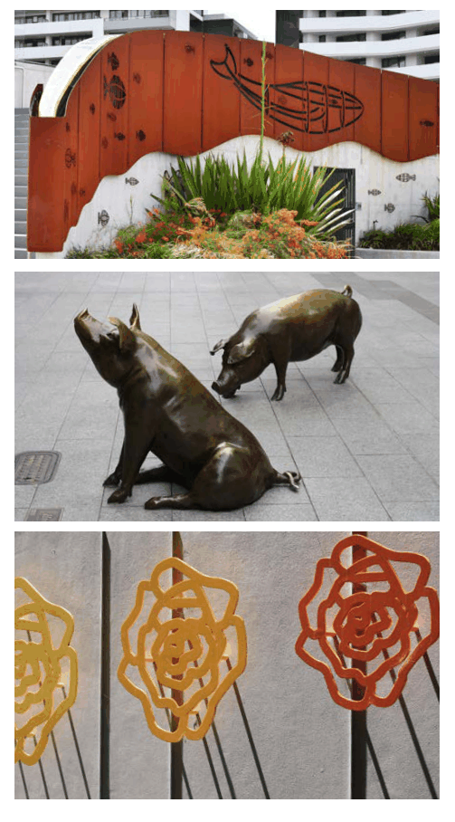

### F6  Public Art

Public art contributes to place identity and increasingly it is a significant part of the visitor experience. Cities around the world have recognised the value of cultural statements and public art has a key role in giving character and cultural definition to areas. This has been particularly successful in Australia with substantial public art initiatives reactivating waterfronts and urban development. The City of Canada Bay has increasingly used art as part of place making across the City.

#### Objectives

O1. To include public art in communal and public spaces. O2. To focus public art on the history and heritage, stories, people, landscape, streetscape, and culture of the place.

| Controls |  |
|---|---|
| C1. | Consider the City of Canada Bay Public Art Plan and City of Canada Bay Cultural Plan and provide details of public art to be included in communal and public spaces. |
| C2. | Identify locations for mural, integrated artworks, sculptural and lighting projects including hoardings for new developments. |
| C3. | Coordinate cultural input and community participation into interpretive artworks and public art. |
| C4. | Use public art, interpretive work, oral histories and industrial artefacts to celebrate the working heritage of Canada Bay’s foreshores. |
| C5. | Reflect industrial, social and cultural history in the built and natural environment. |

> [Picture on page 32: a picture, saved as a picture (images/part-f-multi-dwelling-housing-multi-dwelling-housing-terr-page-32-18.gif, 150 dpi).]
