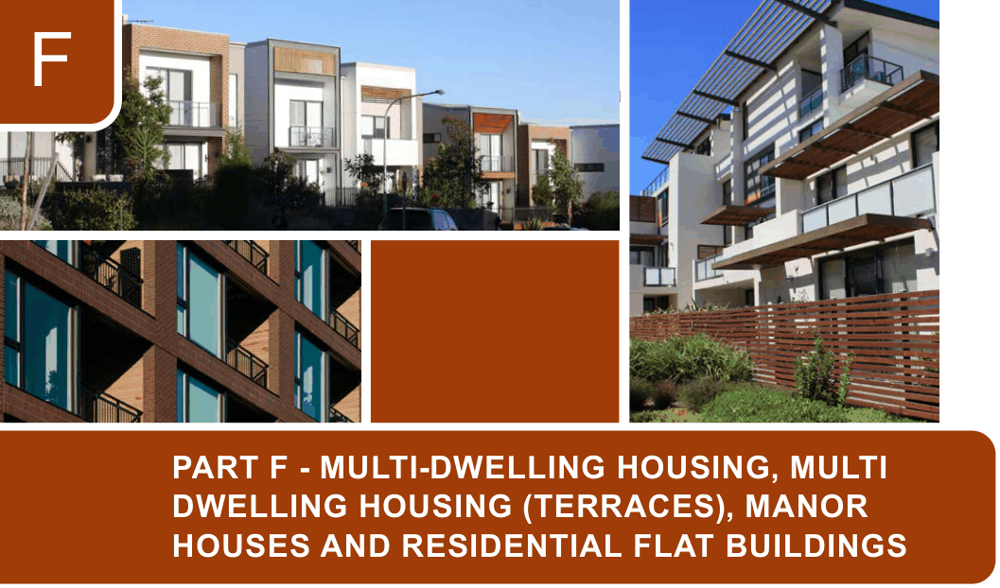

# Canada Bay Development Control Plan - Part F Multi-dwelling Housing, Multi Dwelling Housing (terraces), Manor Houses and Residential Flat Buildings

> This chapter is split into 18 section file(s), one per numbered heading, in the order they appear in the PDF.

Source PDF: [ECM_7719480_v3_CCB-DCP-07_Part-F-Multi-Dwelling-RFB_v2022-05-16.pdf](ECM_7719480_v3_CCB-DCP-07_Part-F-Multi-Dwelling-RFB_v2022-05-16.pdf)

> [Picture on page 1: a picture, saved as a picture (images/part-f-multi-dwelling-housing-multi-dwelling-housing-terr-page-1-1.gif, 150 dpi).]

### F

### PART F - MULTI-DWELLING HOUSING, MULTI

### DWELLING HOUSING (TERRACES), MANOR

### HOUSES AND RESIDENTIAL FLAT BUILDINGS

| F1 | Land to which Part F applies......................................................................................... F-2 |
|---|---|
| F2 | Design Quality................................................................................................................. F-3 F2.1 Design Quality of Residential Apartment Development......................................... F-3 F2.2 Materials, colour schemes and details .................................................................. F-4 |
| F3 | Environmental criteria and residential amenity........................................................... F-5 F3.1 Visual and acoustic privacy ................................................................................... F-5 F3.2 Access to views ..................................................................................................... F-7 F3.3 Access to public transport...................................................................................... F-8 |
| F4 | General Controls............................................................................................................. F-9 F4.1 Frontage and dwelling width.................................................................................. F-9 F4.2 Building setbacks................................................................................................... F-9 F4.3 Street orientation and presentation ..................................................................... F-14 F4.4 Height of buildings .............................................................................................. F-16 F4.5 Bulk and Scale..................................................................................................... F-20 F4.6 Landscaped area ................................................................................................. F-20 F4.7 Parking and access ............................................................................................. F-22 F4.8 Private open space.............................................................................................. F-22 F4.9 Common open space ......................................................................................... F-23 F4.10 Alterations and additions.................................................................................... F-24 |
| F5 | Ancillary structures....................................................................................................... F-27 F5.1 Fencing ............................................................................................................... F-27 F5.2 Site facilities......................................................................................................... F-29 |
| F6 | Public Art ...................................................................................................................... F-32 |

<!-- sections -->
## Sections

1. [F1 Land to which Part F applies](01-f1-land-to-which-part-f-applies.md)
2. [F2.1 Design Quality of Residential](02-f2-1-design-quality-of-residential.md)
3. [F3 Environmental criteria and residential amenity](03-f3-environmental-criteria-and-residential.md)
4. [F3.1 Visual and acoustic privacy](04-f3-1-visual-and-acoustic-privacy.md)
5. [F3.2 Access to views](05-f3-2-access-to-views.md)
6. [F3.3 Access to public transport](06-f3-3-access-to-public-transport.md)
7. [F4.1 Frontage and dwelling width](07-f4-1-frontage-and-dwelling-width.md)
8. [F4.2 Building setbacks](08-f4-2-building-setbacks.md)
9. [F4.3 Street orientation and presentation](09-f4-3-street-orientation-and-presentation.md)
10. [F4.4 Height of buildings](10-f4-4-height-of-buildings.md)
11. [F4.5 Bulk and Scale](11-f4-5-bulk-and-scale.md)
12. [F4.6 Landscaped area](12-f4-6-landscaped-area.md)
13. [F4.8 Private open space](13-f4-8-private-open-space.md)
14. [F4.9 Common open space](14-f4-9-common-open-space.md)
15. [F4.10 Alterations and additions](15-f4-10-alterations-and-additions.md)
16. [F5.1 Fencing](16-f5-1-fencing.md)
17. [F5.2 Site facilities](17-f5-2-site-facilities.md)
18. [F6 Public Art](18-f6-public-art.md)
