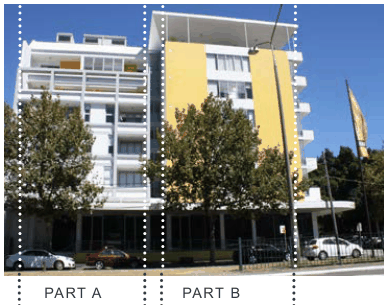
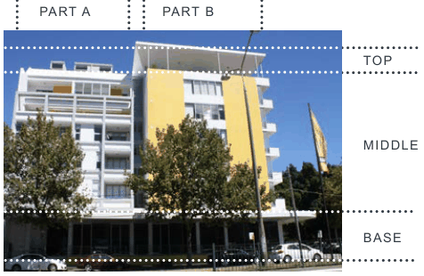

### G2  General Requirements

#### G2.1  General objectives

The controls in this section of the DCP apply to permissible development in mixed use areas and neighbourhood centres. It contains general controls that apply to all commercial development and specific controls that apply to selected commercial precincts.

There are scattered retail and commercial areas that provide local neighbourhood goods and services outside the main retail nodes of Great North Road, Majors Bay Road, Victoria Avenue and Victoria Road. The general planning, design and environmental management controls outlined in Section G2 apply in these areas to ensure the form and scale of development is appropriate.

Note: Developments that incorporate a residential component, such as shop top housing, also need to take into consideration the controls contained within the residential part of the DCP.

> [Picture on page 3: a picture, saved as a picture (images/part-g-local-centres-page-3-20.gif, 150 dpi).]

PART A PART B

> [Picture on page 3: a picture, saved as a picture (images/part-g-local-centres-page-3-22.gif, 150 dpi).]

TOP

MIDDLE

BASE

Fig G2.1 Example of an building that is vertically articulated into two components and differentiates between base, middle and top

O1. To facilitate the development of ALL commercial areas in a way that is economically sustainable and environmentally sensitive. O2. To encourage the revitalisation of commercial areas by enabling mixed use development. O3. To ensure development contributes to the improvement and amenity of public spaces. O4. To maintain the heritage values through appropriate alterations and additions. O5. To maximise opportunities for local employment and business

O6. Ensure that B4 Mixed Use Zones and B1 Neighbourhood Centres maintain a substantial retail, office and commercial focus.
