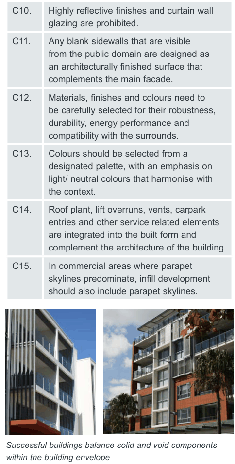
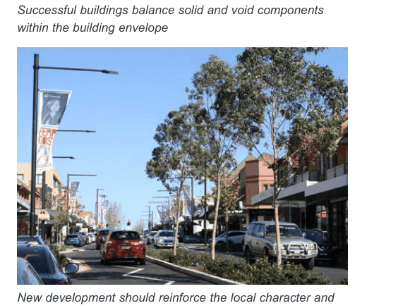

#### G2.2  Building design and appearance

The City of Canada Bay’s business centres are characterised by retail shopping strips, formed by a unique interaction between local topography, street layout, subdivision pattern and building form. The design of buildings significantly contributes to the streetscape character and adds visual richness, complexity and interest.

Facade treatment, the line of continuous awnings and the general vertical building proportions assist in tying buildings together into a cohesive group. The selection of materials, finishes and colours should have regard to compatibility to the surrounds and consider robustness, durability and ease of maintenance.

#### Built form massing and articulation Objectives

O1. To define and reinforce the identity and desired character of a place, and create variety in the streetscape while contributing to a sense of continuity and overall visual quality. O2. To add visual quality and interest to new buildings with a focus on breaking up massing of higher density forms when viewed from public places and neighbouring properties.

O3. To facilitate daylight access and ventilation to streets, public places and neighbouring properties.

| Controls |  |
|---|---|
| C1. | Building mass should maintain the prevailing vertical character found in Canada Bay’s business centres. |
| C2. | New development displays careful composition of building mass, height and (facade) treatment, including horizontal and vertical articulation, projections, recesses, eave overhangs and deep window reveals. |
| C3. | Buildings that are 3 storeys or more are to be designed so that they clearly articulate a base, middle and top. Refer to Fig G2.1. |
| C4. | Where frontages are more than 20 metres wide, building massing must be vertically articulated. |
| C5. | The maximum length of straight wall without articulation such as a balcony or return is 12m. |
| C6. | Compatibility with adjoining buildings is considered in terms of setbacks, awnings, parapets, cornice lines and facade proportions. |

#### Facades and exteriors Objective

O4. To ensure new development is well articulated, makes a positive contribution to the streetscape and responds to local urban character through detailed design of facades and exteriors.

#### Controls

C7. Where development has two (2) street frontages the streetscape should be addressed by both facades. Development should provide a definitive street address to both facades when fronting a main road and a smaller road or car park.

C8. The composition of the facade balances solid and void elements and does not display large areas of a single material, including reflective glass.

C9. External walls are constructed of high quality durable materials and finishes with low maintenance attributes (‘self-cleaning’) such as face brickwork, rendered brickwork, stone, concrete and glass.

| C10. | Highly reflective finishes and curtain wall glazing are prohibited. |
|---|---|
| C11. | Any blank sidewalls that are visible from the public domain are designed as an architecturally finished surface that complements the main facade. |
| C12. | Materials, finishes and colours need to be carefully selected for their robustness, durability, energy performance and compatibility with the surrounds. |
| C13. | Colours should be selected from a designated palette, with an emphasis on light/ neutral colours that harmonise with the context. |
| C14. | Roof plant, lift overruns, vents, carpark entries and other service related elements are integrated into the built form and complement the architecture of the building. |
| C15. | In commercial areas where parapet skylines predominate, infill development should also include parapet skylines. |

> [Picture on page 4: a picture, saved as a picture (images/part-g-local-centres-page-4-25.gif, 150 dpi).]

Successful buildings balance solid and void components within the building envelope

> [Picture on page 4: a picture, saved as a picture (images/part-g-local-centres-page-4-28.gif, 150 dpi).]
> Words printed on the picture (copied from the PDF):
> New development should reinforce the local character and

identity of the area
